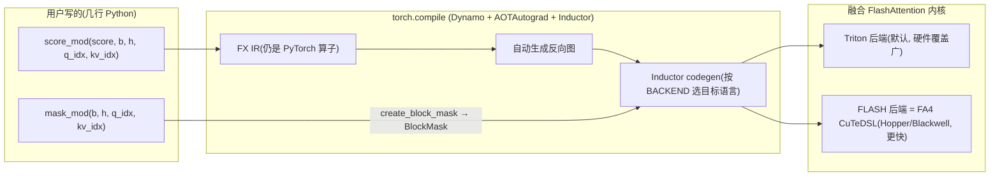
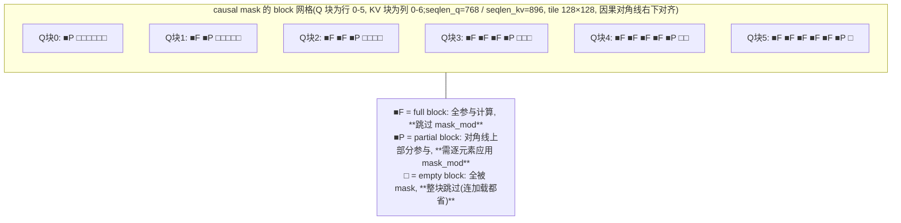

# FlexAttention:用几行 Python 声明注意力变体,编译器落到 Triton 或 FA4/CuTeDSL

> 定位:本篇是 attention 域的**框架/工具层**(frameworks/)第一篇,讲「用户怎么用一个 API 声明任意注意力变体、编译器怎么自动把它落成高效 GPU 内核」。FA 内核本身四代怎么写的,见互补篇 [../implementation/flash-attention-implementation.md](../implementation/flash-attention-implementation.md);CuTe Layout 代数等底座概念见 [../../cutlass/index.md](../../cutlass/index.md)。

## 0. TL;DR(30 秒)

- **FlexAttention 是 PyTorch 的一个 API**(`torch.nn.attention.flex_attention`):你用几行普通 Python 写一个 `score_mod`(改注意力分数)和/或 `mask_mod`(决定哪些位置不参与计算),`torch.compile` 就自动把它编译成**融合的 FlashAttention 风格内核**(不物化 N×N 中间矩阵),并**自动生成反向传播**——不用写一行 CUDA。(来源:PyTorch FlexAttention 官方博客,2024-08)
- 机制上它只做了两件事:**① pre-softmax 分数的逐点修改(pointwise score modification,可带任意全局内存加载);② 前向+反向的块稀疏迭代(block-sparse iteration,用 BlockMask 数据结构编码运行时 data-dependent 稀疏)**。(来源:FA4 博客 recap 节)
- **2026-03 起新增 FA4(FLASH)后端**:`kernel_options={"BACKEND": "FLASH"}` 让 PyTorch 把你的 score/mask 函数自动翻译成 **CuTeDSL** 代码,注入 FlashAttention-4 内核 JIT 实例化——在 compute-bound 负载上比原 Triton 后端快 **1.2×–3.2×**(Hopper/Blackwell,来源:FA4 博客 TL;DR);Colfax 口径:前向达 **FA3 性能的 ~95%**,比 Triton 版**提速约 50%**(来源:Colfax 用户指南)。
- 默认 `BACKEND="AUTO"`(Triton 系);`"FLASH"` 目前实验性,需要近期 PyTorch nightly + `flash-attn-4`(带 CuTeDSL 支持),且有 block size / scalar capture 等限制(见 §7.4)。

---

## 1. 背景:为什么需要 FlexAttention(「软件彩票」问题)

### 1.1 标准 attention 与它的两个世界

标准 scaled dot-product attention:

```
score = (Q @ Kᵀ) / sqrt(head_dim)   # [B, H, S, S]
probabilities = softmax(score, dim=-1)
output = probabilities @ V          # [B, H, S, D]
```

(代码形式 adapted from PyTorch FlexAttention 博客)

这个公式有**两个世界**:

- **数学世界**:随便用 PyTorch 算子写,三行搞定,想怎么改就怎么改;
- **性能世界**:三行写法要物化 N×N 的 `score`/`probabilities` 矩阵并来回读写 HBM,长序列下访存是瓶颈(标准实现 Θ(Nd+N²) 元素访问,详见 [FA 实现篇 §1.1](../implementation/flash-attention-implementation.md))。想快就必须用 **FlashAttention 式融合内核**(tiling + online softmax,N×N 矩阵永不落 HBM)。

问题是:融合内核是**手写的固定实现**。你只能用它内置的选项(causal、sliding window、GQA……),想改分数计算逻辑?得自己重写 CUDA 内核。

### 1.2 「软件彩票」(software lottery)

官方博客的原话:这变成了 ML 研究者的「软件彩票」——**如果你的注意力变体恰好不在已有优化内核的支持列表里,你就注定慢速运行 + CUDA OOM**。(来源:FlexAttention 博客开篇)

而注意力变体在爆炸:Causal、相对位置编码(Relative Positional Embeddings)、ALiBi、Sliding Window(滑窗)、PrefixLM、Document Masking(文档掩码/样本拼接 sample packing/jagged tensors)、Tanh Soft-Capping(Gemma2/Grok-1 用的 logits 软截断)、PagedAttention(vLLM 分页 KV)……更要命的是**组合**:Sliding Window + Document Masking + Causal + 上下文并行?PagedAttention + Sliding Window + Softcap?选项相乘是指数级组合空间,现有内核只覆盖零星子集,新变体支持为零。(变体清单来源:FlexAttention 博客)

传统解法是每种变体手写内核,代价极高。FlexAttention 的回答:**把「变体的定义」从内核代码里抽出来,变成一个用户可写的纯 Python 函数,让编译器负责把它塞回融合内核**。

---

## 2. 核心思想:相对 vanilla FlashAttention 只有两个扩展

FA4 博客把它总结得非常干净(来源:FA4 博客 "FlexAttention recap" 节):

1. **pre-softmax 分数的逐点修改**(pointwise modifications to pre-softmax scores),允许**任意从全局内存加载**(arbitrary loads from global memory)→ 用户接口就是 `score_mod`;
2. **前向+反向的块稀疏迭代**(block-sparse iteration for both forward and backward),用一个**简单数据结构**在运行时编码 data-dependent 稀疏 → 用户接口就是 `mask_mod` + `BlockMask`。

就这两条。再加上 `torch.compile` 的两项既有能力:

- **融合下降(lowering)**:score_mod/mask_mod 被编译进 FlashAttention 风格的 Triton(或 CuTeDSL)模板内核,不物化任何额外内存;
- **自动反向**:利用 PyTorch autograd(AOTAutograd)从前向图自动派生 score_mod 的反向,整个 FlashAttention 反向也由模板生成。



*(图:FlexAttention 编译流水线;各环节来源:FA4 博客 "Inductor → CuTeDSL" 节的 IR 变换示例 + FlexAttention 博客结论节)*

为什么「逐点改分数」这么弱的抽象就够了?因为绝大多数注意力变体本质上都是**给 softmax 之前的分数做位置相关的变换**:ALiBi 是加 `slope[h]·(kv_idx−q_idx)`,softcap 是套 tanh,相对位置编码是查表加 bias,causal 是加 −inf……(例证来源:FlexAttention 博客 Score Mod Examples 节)。

---

## 3. score_mod:逐点修改分数(API 详解 + 代码)

### 3.1 签名:5 个标量 tensor

```python
def score_mod(score: f32[], b: i32[], h: i32[], q_idx: i32[], kv_idx: i32[]) -> f32[]:
    return score  # noop —— 就是标准 attention
```

(adapted from PyTorch FlexAttention 博客;PyTorch 源码里的类型别名:`_score_mod_signature = Callable[[Tensor, Tensor, Tensor, Tensor, Tensor], Tensor]`,`torch/nn/attention/flex_attention.py:138`)

关键点:**5 个参数全是标量 tensor(0-dim)**,不是整块矩阵。语义上等价于四重循环逐元素调用:

```python
for b in range(batch_size):
    for h in range(num_heads):
        for q_idx in range(sequence_length):
            for kv_idx in range(sequence_length):
                modified_scores[b, h, q_idx, kv_idx] = score_mod(
                    scores[b, h, q_idx, kv_idx], b, h, q_idx, kv_idx)
```

(adapted from FlexAttention 博客——博客强调这只是语义示意,实际由 torch.compile 下降为单个融合内核,不会真的这样循环。)

数学形式:`modified_scores = score_mod(score); probabilities = softmax(modified_scores)`。

端到端最小用例(含前向+反向):

```python
from torch.nn.attention.flex_attention import flex_attention

def noop(score, b, h, q_idx, kv_idx):
    return score

flex_attention = torch.compile(flex_attention)
out = flex_attention(query, key, value, score_mod=noop)
out.sum().backward()   # 反向自动生成
```

(adapted from FlexAttention 博客 "Full Attention" 节)

### 3.2 变体代码速览(全部 adapted from FlexAttention 博客)

**相对位置编码**——不物化 S×S bias 矩阵,内核内「on the fly」算:

```python
def relative_positional(score, b, h, q_idx, kv_idx):
    return score + (q_idx - kv_idx)
```

**ALiBi**(per-head 斜率;`alibi_bias` 是全局 tensor,不是入参——Dynamo 允许闭包捕获外部 tensor 并在内核里生成正确的 load,值变了也不用重编译):

```python
alibi_bias = generate_alibi_bias(H)  # [num_heads], 预计算

def alibi(score, b, h, q_idx, kv_idx):
    bias = alibi_bias[h] * (kv_idx - q_idx)
    return score + bias
```

**Tanh soft-capping**(Gemma2/Grok-1):

```python
softcap = 20

def soft_cap(score, b, h, q_idx, kv_idx):
    score = score / softcap
    score = torch.tanh(score)
    score = score * softcap
    return score
```

**Causal 用 score_mod 表达**(正确但**不吃稀疏红利**,见 §4):

```python
def causal_mask(score, b, h, q_idx, kv_idx):
    return torch.where(q_idx >= kv_idx, score, -float("inf"))
```

**Document masking**(样本拼接后,token 只注意同文档):

```python
document_id = torch.tensor([0,0,0,1,1,2,2,2,2,2,2], device="cuda")  # 文档长 3/2/6

def document_masking(b, h, q_idx, kv_idx):
    return document_id[q_idx] == document_id[kv_idx]
```

---

## 4. mask_mod 与 BlockMask:让稀疏真正省计算

### 4.1 为什么 score_mod 和 mask_mod 要分开

签名几乎一样,只是**没有 score 参数**:

```python
# 返回 True 表示该位置参与计算
mask_mod(b, h, q_idx, kv_idx) -> bool
```

(source: FlexAttention 博客 Mask Mods 节)

明明 `score_mod` 表达能力严格更强(mask 可以写成 `torch.where(mask_mod(...), score, -inf)`),为什么还要单独一个 `mask_mod`?博客 FAQ 给了两层理由:

1. **语义上不可判定**:预计算 BlockMask 时手里没有真实 score 值,无法从一个任意 score_mod 里可靠地猜出「哪部分是 masking」(用户可能用大负数而不是 −inf,可能 score=0 时恰好返回 −inf)。所以必须由用户显式把「纯位置决定的掩码」拆出来。
2. **效率上根本不同**:被 mask 掉的位置可以**整块跳过计算**,score_mod 做不到——causal mask 约 **50% 稀疏**,不利用稀疏就白白慢 **2×**(来源:FlexAttention 博客 Causal Mask 节)。反过来,**逐元素应用 mask 本身很贵——基准测试显示约 15–20% 性能退化**(来源:FlexAttention 博客 FAQ "Why are score_mod and mask_mod different")。所以 BlockMask 进一步把 block 分成 full/partial/empty 三类,**full block 直接跳过 mask_mod**(对 causal,这一优化约带来 15% 加速,来源:PyTorch 源码 BlockMask docstring)。

### 4.2 create_block_mask 与组合子

```python
from torch.nn.attention.flex_attention import create_block_mask, flex_attention

def causal(b, h, q_idx, kv_idx):
    return q_idx >= kv_idx

# 稀疏模式与 batch/head 无关 → B/H 传 None 广播,省内存也省计算
block_mask = create_block_mask(causal, B=None, H=None, Q_LEN=1024, KV_LEN=1024, device="cuda")
out = flex_attention(query, key, value, block_mask=block_mask)  # 可不带 score_mod
```

(adapted from FlexAttention 博客 Causal Mask(mask_mod 版)节)

真实签名(PyTorch main `torch/nn/attention/flex_attention.py:2004`):

```python
def create_block_mask(
    mask_mod, B, H, Q_LEN, KV_LEN,
    device=None,
    BLOCK_SIZE=128,              # _DEFAULT_SPARSE_BLOCK_SIZE = 128(源码 :481);可为 (Q_BLOCK, KV_BLOCK) 元组
    _compile=False,              # 已弃用,现在可直接 torch.compile(create_block_mask)
    separate_full_blocks=True,   # True: full block 单独存, 内核跳过 mask_mod;False: 全部按 partial 处理
    compute_dq_write_order=False,  # 为确定性 block-sparse FLASH 反向预计算 dQ 写序元数据
    dq_kv_order=True,
) -> BlockMask
```

组合子:`and_masks` / `or_masks` / `noop_mask`(源码 :1796/:1810/:444)。例:sliding window + causal:

```python
from torch.nn.attention.flex_attention import and_masks

SLIDING_WINDOW = 1024

def sliding_window(b, h, q_idx, kv_idx):
    return q_idx - kv_idx <= SLIDING_WINDOW

sliding_window_causal = and_masks(causal, sliding_window)
block_mask = create_block_mask(sliding_window_causal, None, None, S, S, device="cuda")
```

(adapted from FlexAttention 博客 Sliding Window + Causal 节)

### 4.3 BlockMask 的代价与缓存

`create_block_mask` **相当昂贵**:判断一个 block 是否全稀疏要在 block 内每个点求值 mask_mod。量级上是**数百微秒**(远便宜于重编译的秒级,但也不能每次 attention 调用都算)。(来源:FlexAttention 博客 FAQ)缓解手段:

- mask 与 batch/head 无关 → `B=None, H=None` 广播;
- `torch.compile(create_block_mask)`(旧 `_compile=True` 旗标已弃用,源码里有 DeprecationWarning);
- 模式固定(如 causal)→ 手写构造器直接拼两个 tensor(博客给了 `create_causal_mask` 示例,用 `BlockMask(num_blocks, indices, BLOCK_SIZE=128, mask_mod=causal_mask)`);
- mask 每 batch 变(document masking)→ 在模型 forward 开头算一次,所有层复用。

BlockMask 元数据内存 = `[B, H, Q_LEN//BLOCK_SIZE, KV_LEN//BLOCK_SIZE]` 量级;序列长 100 万、BLOCK_SIZE=128 时约 **60MB**,把 BLOCK_SIZE 提到 1024 则降到 1MB 以内。(来源:FlexAttention 博客 FAQ "How much additional memory")

---

## 5. BlockMask 数据结构:full / partial / empty 三类 block

### 5.1 直觉图

把 S×S 的 mask 按 BLOCK_SIZE(默认 128)切格子。**只有整格全被 mask 才算 sparse**——这对齐硬件「连续加载+连续计算」的偏好(源码 BlockMask docstring:「somewhat of a cross in-between BCSR and a non-sparse format」)。以 causal 为例:



Colfax 指南给的具体算例(seqlen_q=768、seqlen_kv=896、tile 128×128,共 6×7=42 个 block;因果有效域 `q_idx >= kv_idx`,KV 比 Q 多一个整块,故下三角反而少、上三角反而多):**15 个下三角 block 是 full(免 mask_mod,但 score_mod 仍要应用),6 个对角 block 是 partial(需 mask_mod),21 个上三角 block 整块跳过**。计算:full=Σ_{qi=0..5}qi=0+1+2+3+4+5=15,partial=6,empty=Σ_{qi=0..5}(6−qi)=6+5+4+3+2+1=21,15+6+21=42。*(注:Colfax 用户指南原文此处把 full/empty 写成 21/15,系其笔误;本篇已按上述几何校正。)*

### 5.2 字段:两套「计数+索引」张量对

PyTorch `BlockMask` 类(`torch/nn/attention/flex_attention.py:892`)的核心字段:

| 字段 | 形状(概念) | 含义 |
|---|---|---|
| `kv_num_blocks` | `[B, H, num_q_blocks]` | 前向:每个 Q 块要算多少个 KV 块(partial) |
| `kv_indices` | `[B, H, num_q_blocks, max_blocks]` | 前向:这些 KV 块的列号,前 `kv_num_blocks[i]` 个有效,其余未定义 |
| `full_kv_num_blocks` / `full_kv_indices` | 同上 | **[可选优化]** full block 的计数+索引;有了它内核才能对 full block 跳过 mask_mod(causal 约 15% 加速,来源:BlockMask docstring) |
| `q_num_blocks` / `q_indices`(及 full 版) | `[B, H, num_kv_blocks, …]` | **[自动生成]** 反向用:算 dKV 要沿 Q 维迭代,由 kv 版自动转置生成 |
| `BLOCK_SIZE` | `(Q_BLOCK, KV_BLOCK)` | 块大小(默认 128) |
| `mask_mod` | callable | 记住生成它的 mask 函数(partial block 内逐元素应用) |

还原稠密 mask 的伪代码(docstring 原文):

```python
dense_mask = torch.zeros(ROWS, COLS)
for row in range(ROWS):
    for block_idx in range(num_blocks_in_row[row]):
        dense_mask[row, col_indices[row, block_idx]] = 1
```

### 5.3 FA4 侧的对应物:BlockSparseTensors

FA4 CuTeDSL 内核不直接用 PyTorch 的 BlockMask,而是用核心四张量 `BlockSparseTensors`(本地源码 `flash_attn/cute/block_sparsity.py`,NamedTuple,当前版本另扩展了 `cu_total_m_blocks`/`cu_block_idx_offsets`/`dq_write_order(_full)` 等字段):

```python
class BlockSparseTensors(NamedTuple):
    mask_block_cnt: cute.Tensor      # partial 块计数
    mask_block_idx: cute.Tensor      # partial 块索引(严格递增, 尾部补 0)
    full_block_cnt: cute.Tensor | None   # full 块计数(可选;None 则所有块都应用 mask_mod)
    full_block_idx: cute.Tensor | None
    ...
```

两组索引**互斥且各自严格递增**(保证同一 block 不会被处理两次)。(来源:Colfax 指南 Block Sparsity Tensors 节 + 本地 `block_sparsity.py`)PyTorch BlockMask 可通过 `as_tuple()` 转换:

```python
# adapted from Colfax 用户指南
_, _, mask_cnt, mask_idx, full_cnt, full_idx, *_ = block_mask_torch.as_tuple()
block_sparse_tensors = BlockSparseTensorsTorch(
    mask_block_cnt=mask_cnt, mask_block_idx=mask_idx,
    full_block_cnt=full_cnt, full_block_idx=full_idx,
)
```

块稀疏元数据怎么来的?FA4 仓库里有个专门的 `BlockSparsityKernel`(`flash_attn/cute/compute_block_sparsity.py`,docstring 自称 "Block sparsity kernel for FlexAttention"):对每个 block 的每个 token 求值 `mask_mod`,判定 full/masked/empty,把计数和索引写进 BlockSparseTensors;还有 `use_fast_sampling=True` 的 5 点采样模式(4 角+中心,只适用于该类采样足以判定的 mask)。

---

## 6. 底层编译器概念:Triton 与 CuTeDSL

这是理解「FlexAttention 为什么能既灵活又快」的关键一层:**你写的 score/mask 函数最终要变成某种 GPU 编程语言写成的内核代码**。目前有两个目标语言。

### 6.1 为什么需要 DSL 而不是手写 CUDA

高性能 attention 内核要同时管 tiling、共享内存、异步流水线、warp 分工……手写 CUDA/CUTLASS C++ 门槛极高、编译极慢。DSL(domain-specific language,领域专用语言)的思路:**用接近 Python 的方式声明计算,编译器负责映射到线程/内存层次并生成 CUDA(PTX/CUBIN)**。

### 6.2 Triton:块级张量抽象

**Triton** 是 OpenAI 出的开源 GPU 编程 DSL(主要作者 Philippe Tillet;FlexAttention 博客致谢节明确感谢 "Philippe Tillet and Keren Zhou for helping us with Triton")。编程模型:

- `@triton.jit` 装饰一个 Python 函数,函数体操作的是**块级张量(block tensor)**——你写「这一 tile 的数据做什么」,而不是「这个线程做什么」;
- tile 化、线程映射、共享内存分配、向量化由 Triton 编译器完成;
- PyTorch 的 TorchInductor(`torch.compile` 后端)天然会生成 Triton 代码,所以 **FlexAttention 的默认后端就是 Triton 模板内核**——Inductor 的模板机制还顺带给了 FlexAttention 动态 shape 支持和 epilogue fusion(把后续算子融进 attention 尾部)。(来源:FlexAttention 博客结论节)

Triton 的局限(FA4 博客引 Gluon 文档原话):「Triton 编译器对广泛内核都能生成高效代码,但会被手工调优的低层代码打败。这时用户无能为力,因为所有细节都被隐藏了。」Blackwell 上需要的深度异步流水线+warp 特化编排,Triton 抽象表达不出来——这正是引入 CuTeDSL 的动机。

### 6.3 CuTeDSL:CUTLASS 抽象的 Python 内嵌版

**CuTeDSL**(CUTE DSL,`nvidia-cutlass-dsl` 包)是 NVIDIA CUTLASS 团队 2025 年起推出的 Python DSL:**把原来必须用 CUTLASS C++ 写的东西(`cute.Layout` 布局代数、线程块划分、TMA/TMEM/tcgen05 等硬件特性)搬到 Python 里,用 `@cute.jit` 装饰、JIT 编译到 PTX/CUBIN**。(来源:FA4 博客 "FlashAttention-4 as the foundation" 节;CuTe Layout 代数详见 [../../cutlass/concepts/cute-layout-algebra.md](../../cutlass/concepts/cute-layout-algebra.md))

对 FlexAttention 的意义(FA4 博客原话大意):SOTA attention 实现重度使用 CUTLASS 抽象,但 CUTLASS C++ 编译痛苦、周期长;而 FlexAttention 的本质是**运行时才知道用户函数长什么样**,必须 JIT。CuTeDSL 让「Python 里写 CUTLASS 级内核」成为可能,JIT 工作流才现实。FA4 整条用 CuTeDSL 写成(本地源码 `flash_attn/cute/` 全部是 `@cute.jit` Python,编译产物运行时生成;依赖 `nvidia-cutlass-dsl>=4.6.2`,来源:仓库 AGENTS.md)。

计算核心抽象是 **TensorSSA**(static single assignment 形式的寄存器块张量):score_mod 被 Inductor 翻译成对 TensorSSA 的表达式运算,天然可向量化/广播,算术全部发生在寄存器(RMEM)里。(来源:FA4 博客 CuTeDSL 代码示例 + Colfax 指南 "CuTe DSL Implementation" 节)

### 6.4 对比表

| 维度 | Triton | CuTeDSL |
|---|---|---|
| 出品方 | OpenAI(Philippe Tillet 等) | NVIDIA CUTLASS 团队 |
| 编程模型 | `@triton.jit` + 块级张量;线程映射交给编译器 | `@cute.jit` + Layout 代数/TensorSSA;**显式控制**线程块、内存层次、异步流水线 |
| 抽象层次 | 中高(编译器隐藏 tile/线程细节) | 中低(能碰 TMEM/TMA/tcgen05/warp 特化) |
| 易用性 | 高,Python 味浓 | 低一些,要懂 CUTLASS 概念 |
| 性能上限 | 高,但 Blackwell 级异步编排表达不出来 | 最高(FA4 = 手工级流水线,但用 Python 写) |
| 硬件覆盖 | 广(NVIDIA 多代 + AMD ROCm 等) | NVIDIA Hopper(SM90)/Blackwell(SM100/110)为主;另见 Ampere 前向(FlashAttentionForwardSm80)与 SM120(Blackwell GeForce/DGX Spark)前向/反向源码已出现;Rubin 为 SM107 |
| 在 FlexAttention 中的角色 | 默认后端(`BACKEND="AUTO"/"TRITON"`) | FA4 后端(`BACKEND="FLASH"`) |

*(表为多源综合:FA4 博客 Blackwell 节 + Gluon 引文 + Colfax 指南 + 本地 AGENTS.md;「易用性/抽象层次」为定性判断)*

### 6.5 因果链:你的函数怎么变成内核

FA4 博客用 ALiBi 展示了完整下降链(此处浓缩,完整四层代码见博客 "Inductor → CuTeDSL" 节):

```
用户代码:      def alibi_mod(score, b, h, q_idx, kv_idx):
                   scale = torch.exp2(-((h + 1) * 8.0 / H))
                   return score + (kv_idx - q_idx) * scale
      ↓ TorchDynamo 图捕获
FX IR:        add / mul / div / neg / exp2 / sub / add_1(仍是 aten 算子, 标量 tensor)
      ↓ AOTAutograd(自动派生反向: d/dx (X+A) = 1, 梯度直通)
joint graph:  fw_graph0 + joint_graph0(backward)
      ↓ TorchInductor(按 BACKEND 选 handler;CuTeDSL handler 把逐点算子重写成 TensorSSA 表达式)
CuTeDSL:      @cute.jit
              def score_mod(tSrS_ssa, b_idx, h_idx, q_idx, kv_idx, seqlen_info, aux_tensors):
                  tmp13 = cute.math.exp2(...)      # 寄存器内运算, 可 CSE
                  tSrS_ssa = tmp1 + tmp5 * tmp13
```

机制要点(FA4 博客):Inductor 把逐点 IR 表示为 define-by-run 函数(逐算子调 `V.ops.<op>`),然后**换上目标后端的 handler**——Triton 后端换 Triton handler,FLASH 后端换 CuTeDSL handler(源码里的 `ops_wrapper`/`OpsWrapper` 机制)。闭包捕获的全局 tensor(如 `alibi_bias`)走专门的「任意加载」路径:物化一个 RMEM fragment,在(可能带间接寻址的)索引处发射 load,桥接进 TensorSSA。

---

## 7. FA4(FLASH)后端:FlexAttention × FlashAttention-4

### 7.1 动机:Triton 后端在 Blackwell 上被拉开鸿沟

时间线上的性能事实(全部来源:FA4 博客):

- 2024 年原博客时期:Triton FlexAttention ≈ **FA2 前向 90% / 反向 85%**(A100,来源:原博客 Performance 节);≈ FA3 的 80%;
- 2026 年再测:Triton FlexAttention 只有 **FA3 吞吐的约 60%**——双方都在进步,但差距反而拉大;
- Blackwell(GB200)上对比 cuDNN attention(SDPA):「曾经的小 gap 变成了鸿沟(chasm)」。原因:Blackwell 的 tensor core 更快且全异步,需要深度流水线+warp 特化+两 tile ping-pong(拿一个 tile 的矩阵乘掩盖另一个 tile 的 exp;SFU 没跟上 tensor core 的增速,exp 本身成了和 matmul 同量级的瓶颈)——这些在 Triton 抽象里表达不出来。FA4 内核机制细节见 [FA 实现篇 §4](../implementation/flash-attention-implementation.md)。

于是 PyTorch 团队和 Tri Dao 团队合流:**不另起炉灶,直接扩展 FA4**——共享同一套异步流水线基础设施,在需要注入 score 修改和稀疏的位置加扩展点。工作一分为二:FA4 侧产出「FlexAttention 模板实例化」,Inductor 侧从 PyTorch IR 生成所需 CuTeDSL 代码。

### 7.2 用法

```python
# adapted from FA4 博客官方示例
import torch
from functools import partial
from torch.nn.attention.flex_attention import flex_attention

flex_flash = torch.compile(
    partial(flex_attention, kernel_options={"BACKEND": "FLASH"}),
    dynamic=False,          # score_mod 捕获了 Python 标量时必须 dynamic=False, 见 §7.4
)

def local_boost(score, b_idx, h_idx, q_idx, kv_idx):
    return torch.where(torch.abs(q_idx - kv_idx) <= 8, score * 2, score)

B, H, S, D = 2, 8, 2048, 128
q = torch.randn(B, H, S, D, device="cuda", dtype=torch.bfloat16)
k = torch.randn(B, H, S, D, device="cuda", dtype=torch.bfloat16)
v = torch.randn(B, H, S, D, device="cuda", dtype=torch.bfloat16)
out = flex_flash(q, k, v, score_mod=local_boost)
```

环境要求(FA4 博客 + attention-gym 示例头注释):近期 **PyTorch nightly**(attention-gym 标注 PyTorch ≥ 2.10)+ **带 CuTeDSL 支持的 flash-attn**(`pip install flash-attn-4`,CUDA 13 加 `[cu13]` extra);官方明示「活跃开发中,预期有 breaking changes」。

带 block mask 的完整流程(FLASH 后端 block size 有讲究,见 §7.4):

```python
# adapted from attention-gym examples/flex_attention/flex_flash_attention.py
from attn_gym.masks import causal_mask
from attn_gym.utils import get_flash_block_size
from torch.nn.attention.flex_attention import create_block_mask

block_size = get_flash_block_size(device)   # SM100+ (Blackwell): (256,128); SM80/90: (128,128)
block_mask = create_block_mask(causal_mask, B, H, S, S, device=device, BLOCK_SIZE=block_size)
out = flex_flash(q, k, v, block_mask=block_mask)
```

### 7.3 原理:两个「flex 化」钩子插进 FA4 流水线

FA4 博客 "Flexifying FlashAttention-4" 节的心智模型:**FlashAttention 每个 SM 处理一个 KV tile 队列;flex 化 = 加两个钩子**——块稀疏决定**哪些 tile 进队列**(跳过 empty、标记 partial),score/mask mod 作为**逐点操作在 softmax warp 里应用**。两个扩展都用 CuTeDSL 实现,内联进同一条异步流水线,前向反向都有。

**score 修改(前向)**:S tile 从 TMEM 取回寄存器后,本来就要算 row max/sum 并生成 P tile——score/mask mod 趁数据驻留 RMEM 时顺手应用,**不新增阶段**,保持 TCGEN(tensor core)与 SFU(exp)工作的重叠。全局捕获 tensor 统一打包成 `aux_tensors` 列表传入(不用给内核穿 N 个变参),按需发射加载并与消费 S 的既有 stage 一起调度。

**score 修改(反向)**:接口同形,用自动生成的 `score_mod_bwd`。麻烦在生命周期(liveness):标准 FA4 里 S 和 dS 从不同时活,TMEM 可以分阶段复用;若用户的导数依赖 pre-softmax 分数(如 `score**2` 的梯度要 `2*score*grad`),就得把 S 片段留在寄存器里 → 寄存器压力大,当前 tiling 下几乎必然 spill、明显变慢(FA4 博客 Limitations 明说)。

**块稀疏迭代**:FA4 内核接受 block-mask 元数据,由它驱动 tile scheduler,只访问 mask 中存在的 (m, n) tile;反向沿同一 block-mask 走,只算前向碰过的 tile;兼容 GQA packing 和广播 head 维。

本地源码对照(`flash_attn/cute/`,commit 94e22c9):公开 API `flash_attn_func(...)` 直接带 `score_mod` / `score_mod_bwd` / `mask_mod` / `aux_tensors` / `aux_scalars` / `block_sparse_tensors` 参数(`interface.py:4098`);前向内核基类 `FlashAttentionForwardBase.__init__` 收 `score_mod`/`mask_mod`/`has_aux_tensors`(`flash_fwd.py:40`),分 `FlashAttentionForwardSm90`(Hopper,WGMMA)与 `FlashAttentionForwardSm100`(Blackwell,`q_stage=2` 双 tile ping-pong、1CTA/2CTA tcgen05 MMA);score_mod 在 `softmax.py` 的 `apply_score_mod_inner` 里以 TensorSSA 应用,mask_mod 由 `mask.py` 的 `AttentionMask.apply_mask*`(SM100 有 scalar(vec_size=1)/vector(bit-pack + R2P)两条路径,按 `mask_mod.__vec_size__` 分派)应用;内置 softcap 就是一个官方 score_mod:`utils.create_softcap_scoremod` 返回 `softcap * tanh(score/softcap)`。PyTorch 用户函数的 CuTeDSL 版签名比 PyTorch 版多两个参数(源码 `softmax.py:call_score_mod`):

```python
# FA4 CuTeDSL 侧 score_mod 的真实调用约定(本地源码 softmax.py / utils.py:171)
def score_mod(score_ssa, batch_idx, head_idx, q_idx=..., kv_idx=...,
              seqlen_info=..., aux_tensors=...):   # 多 seqlen_info + aux_tensors
    ...
# mask_mod 同理(mask.py:call_mask_mod), 返回 Boolean TensorSSA
```

(这一层由 Inductor 自动生成,普通 FlexAttention 用户不需要手写;想直接对 FA4 仓库编程时才用得上,详见 Colfax 指南。)

### 7.4 性能数字与限制

**性能**(全部来源:FA4 博客 Results 节,基准脚本 `attention-gym/benchmarks/flex_perf.py`;GB200=Blackwell、H200=Hopper):

| 场景 | 前向(FLASH vs Triton) | 反向(FLASH vs Triton) |
|---|---|---|
| GB200,SDPA 可覆盖模式(noop/causal) | **1.6–3.2×** | **1.85–2.3×**(部分场景追平甚至超过 cuDNN) |
| B200,ALiBi | 1.2–2.1× | 1.9–2.9× |
| B200,document mask | 最高 2.7× | 长序列最高 3× |
| B200,sliding window | 1.4–2.1× | 1.8–2.2× |
| H200,ALiBi | 1.30–1.54× | 1.36–1.65× |
| H200,document mask | 1.41–1.89× | 1.48–2.01× |
| H200,sliding window | 1.45–1.65× | 1.35–1.52× |

总体口径:**compute-bound 负载上比 Triton 实现快 1.2×–3.2×**(FA4 博客 TL;DR)。Colfax 独立口径:**前向达 FA3 的 ~95%,比 Triton 版提速约 50%**(Colfax 指南开篇;实现覆盖 SM90+SM100、前向+反向)。GB200 上 causal 前向落后 cuDNN 更多,根因是工作调度:FA4 内置 causal 路径用 LPT(longest processing time first)调度而 Flex 块稀疏路径没有;手动指定 LPT 后短序列前向再快最高 1.6×(长序列收敛到 ~1.1×);通用解法是 Blackwell 的 **CLC(Cluster Launch Control)动态调度**,CuTeDSL 4.4 起支持 persistent CLC 调度,FlexAttention 可透明受益。(来源:FA4 博客 "Why causal lags" 节)

正确性验证口径(FA4 博客):对 FP32 参考实现比对;PyTorch `test/inductor/test_flex_flash.py` 大批 score/mask 模式矩阵 + flash-attention `tests/cute/test_mask_mod.py`;真实训练验证:Llama 3 70B、64×H100、seq 8192、torchtitan,FLASH 与 Triton 后端 1000 步都收敛到 loss ≈ 3.7。

**BACKEND 枚举**(PyTorch main `torch/nn/attention/flex_attention.py:140`,比 brief 时代多了 ROCm 项):

```python
_Backend: TypeAlias = Literal["AUTO", "TRITON", "FLASH", "FLYDSL", "TRITON_DECODE"]
```

- `"AUTO"`(默认):启发式,通常 Triton 系,自动在 flex_attention/flex_decoding 间选;
- `"TRITON"`:标准 Triton flex_attention 内核;
- `"TRITON_DECODE"`:Triton flex_decoding 内核(解码场景,仅短序列+特定配置可用);
- `"FLASH"`:**实验性**,FA4 CuTeDSL 内核,需另装 flash 包;
- `"FLYDSL"`:实验性,ROCm gfx950 BF16 的 FlyDSL 前后向内核,不支持的配置回落 Triton。

**已知限制**(来源:FA4 博客 Limitations 节 + attention-gym 示例文档字符串 + PyTorch Inductor 源码,截至 2026-10):

1. **Block size 必须匹配内核 tile**:SM100+(Blackwell)`BLOCK_SIZE=(256,128)`——因为 `q_stage=2` 双 tile ping-pong,调度器可跳过的最小工作单元是 256 行(FA4 博客 + 本地 `flash_fwd_sm100.py:157`);SM80/90 用 `(128,128)`。不匹配会报 `ValueError: mask_block_cnt shape mismatch...`。用 `get_flash_block_size()` 自动探测。
2. **捕获的动态标量**:score_mod/mask_mod 闭包里捕获的 Python 标量(如变化的 `soft_cap`)在 FLASH 后端会被**烧进编译产物**,每个新值触发一次重编译;`dynamic=True` 下符号标量无法内联进 CuTeDSL 模板 → 用 `dynamic=False`。(attention-gym 限制清单)注:新版 `flash-attn-4>=4.0.0b17` 增加了 `aux_scalars` 运行时标量通道(Inductor 源码硬编码门槛 `flash-attn-4>=4.0.0b17` + `flash_supports_aux_scalars()` 按 `_flash_attn_fwd/_bwd` 签名探测;本地 interface.py 的 `flash_attn_func` 确已带 `aux_scalars` 参数)——限制已在逐步解除(已核实:本地 commit 94e22c9 / PyTorch main,截至 2026-10)。
3. **CPU 0-d tensor 捕获**:Inductor 源码 `has_unsupported_cpu_scalar_tensor_captures` 明示不支持需先标量化的 CPU 0-d tensor 捕获。
4. **需要梯度的捕获 buffer**:FLASH 后端不支持对捕获 tensor(如 learnable bias)求梯度,这类场景用 Triton 后端(FA4 博客明示「可预见的未来都如此」)。
5. **块稀疏下的确定性反向**:FLASH 后端 block-sparsity 开启时反向暂不确定(score-mod-only 是确定的),修复进行中(FA4 博客;当前 PyTorch main 已落地确定性 dQ 写序机制——`create_block_mask` 新增 `compute_dq_write_order`/`dq_kv_order`(默认开启),BlockMask 与 FA4 侧 `BlockSparseTensors` 均含 `dq_write_order(_full)` 字段——已核实:本地 commit 94e22c9 / PyTorch main,截至 2026-10)。
6. **性能坑**:前向沿 KV 维的加载会 stall 流水线,指针追逐式模式(document masking 的 per-token 元数据)尤甚;依赖 pre-softmax 分数的反向 score_mod 几乎必然寄存器 spill(见 §7.3)。
7. **kv_idx 索引开销**(attention-gym 文档):`score + bias[kv_idx]` 慢,`bias[h]`/`bias[q_idx]` 快;当时实测 800–900 TFLOPS、距峰值有距离(快照数字,**当前版本待核实**)。
8. `return_aux=AuxRequest(max_scores=True)` 在 FLASH 后端不支持(源码 `_apply_kernel_options` 抛 NotImplementedError)。

---

## 8. 实践 checklist

**何时用 FlexAttention**

- [ ] 想快速试一个注意力变体(改分数/加 bias/组合 mask),不想写内核 → FlexAttention 就是为此设计的;官方案例:torchtune 的 sample packing 吞吐 +71%(来源:FlexAttention 博客结论节);
- [ ] 需要 mask+bias 任意组合(document masking × PrefixLM × ALiBi……)→ 用 `and_masks`/`or_masks` 组合 mask_mod,score_mod 独立叠加;
- [ ] 变体是 SDPA/cuDNN 已内置的纯 causal/noop 且不需要灵活性 → 直接用 SDPA(cuDNN)更快,FA4 博客承认 Flex 块稀疏迭代相对 FA4 内置 causal 路径有开销。

**选后端**

- [ ] 默认 `AUTO`(Triton 系)即可:硬件覆盖最广(Ampere/ROCm/CPU 推理等),支持捕获 buffer 求梯度;
- [ ] Hopper/Blackwell + compute-bound + 追求性能 → `"FLASH"`:1.2–3.2× 于 Triton;
- [ ] 用 FLASH 前核对:PyTorch nightly、`flash-attn-4` 版本、`dynamic=False`(score_mod 捕获标量时)、BLOCK_SIZE 匹配(SM100=(256,128),SM80/90=(128,128))、无「捕获 buffer 求梯度」需求;
- [ ] 解码(decode)短序列场景可试 `"TRITON_DECODE"`。

**BlockMask 卫生**

- [ ] `create_block_mask` 昂贵(数百 µs 级):**固定 mask 全局缓存;每 batch 变的在 forward 开头算一次全层复用**;勿在每次 attention 调用里重算;
- [ ] 与 batch/head 无关的 mask 传 `B=None, H=None` 广播;
- [ ] 想省 BlockMask 构建时间可 `torch.compile(create_block_mask)`;极端情况手写构造器(§4.3);
- [ ] mask 值变(如 prefix 长度变)**不需要重编译内核**,但要重算 BlockMask(来源:FlexAttention 博客 FAQ);捕获 tensor 值变连重算都不用。

**已知坑速查**

- [ ] FLASH:scalar capture → 重编译风暴(每个新标量值一次);kv_idx 间接加载慢;依赖 pre-softmax score 的反向会 spill;
- [ ] 早期版本要求序列长是 128 的倍数、GQA 需复制 KV 头(原博客 Limitations;后续版本已改善——**当前版本行为待核实**);
- [ ] 数值上 FlexAttention 与 FlashAttention 同精度(非 bitwise 一致,误差分布几乎相同,来源:原博客 FAQ "How do the numerics compare")。

**找现成例子**

- [ ] attention-gym:https://github.com/meta-pytorch/attention-gym ——`examples/flex_attention/` 下有 `flex_flash_attention.py`(FLASH vs TRITON 数值对比+基准)、`paged_attention.py`、`ring_attention.py`、`mla.py`、`cuda_graphs.py` 等;`attn_gym/masks.py`、`attn_gym/mods.py` 是现成 mask/score mod 库;
- [ ] Colfax 指南:直接对 flash-attention CuTeDSL 仓库编程(绕过 PyTorch)时的 score_mod/mask_mod CuTeDSL 写法 + BlockSparseTensors 转换;
- [ ] PyTorch 官方文档 `torch.nn.attention.flex_attention`:API 签名权威来源。

---

## 溯源

- **FlexAttention 原始博客**(score_mod/mask_mod/BlockMask 机制、软件彩票叙事、15–20% mask 退化、50% causal 稀疏、60MB@1M、FA2 90%/85%、torchtune +71%):https://pytorch.org/blog/flexattention/ (2024-08-07 发布,2025-05-30 更新;抓取 2026-10-14)
- **FlexAttention + FA4 博客**(FLASH 后端、1.2–3.2×、GB200/B200/H200 分场景数字、q_stage=2→256×128、限制清单、LPT/CLC、Llama3-70B 收敛验证):https://pytorch.org/blog/flexattention-flashattention-4-fast-and-flexible/ (2026-03;抓取 2026-10-14)
- **FlexAttention 论文**:Shah et al., *Flex Attention: A Programming Model for Generating Optimized Attention Kernels*, arXiv:2412.05496(标题已 curl 核对)
- **Colfax 用户指南**(FA4 CuTeDSL 侧 API、95% FA3 / ~50% vs Triton、BlockSparseTensors 核心四张量约定、42-block 算例):https://research.colfax-intl.com/a-users-guide-to-flexattention-in-flash-attention-cute-dsl/ (抓取 2026-10-14)
- **PyTorch 源码**(`_Backend` 五枚举、`create_block_mask` 签名、`_DEFAULT_SPARSE_BLOCK_SIZE=128`、BlockMask 字段与 docstring、FLASH+output_max 不支持):https://github.com/pytorch/pytorch/blob/main/torch/nn/attention/flex_attention.py;Inductor 分派与 CuTeDSL codegen:https://github.com/pytorch/pytorch/tree/main/torch/_inductor/kernel/flex (读取 2026-10-14)
- **attention-gym**(FLASH/TRITON 对比脚本、get_flash_block_size、限制文档字符串):https://github.com/meta-pytorch/attention-gym/blob/main/examples/flex_attention/flex_flash_attention.py
- **FA4 CuTeDSL 本地一手核验**(flash_attn_func 签名带 score_mod/mask_mod/aux_scalars、AttentionMask、apply_score_mod_inner、BlockSparseTensors/BlockSparsityKernel、Sm100 q_stage=2、create_softcap_scoremod):https://github.com/Dao-AILab/flash-attention/tree/main/flash_attn/cute (本地 commit 94e22c9,2026-10-06)
- **FA4 论文/内核机制**:arXiv:2603.05451 (MLSys 2026),详见 [../implementation/flash-attention-implementation.md](../implementation/flash-attention-implementation.md) §4
- 外部链接总索引见 [../references.md](../references.md)

**待核实项汇总**(正文已就地标注,截至 2026-10):① attention-gym 文档里 800–900 TFLOPS 快照数字的当前值;② 「序列长须 128 倍数/无原生 GQA」两条早期限制在当前版本的解除情况。*(另:`aux_scalars` b17 门槛与块稀疏确定性反向两项已由本地源码/PyTorch main 核实落地,见 §7.4 限制 2、5。)*
