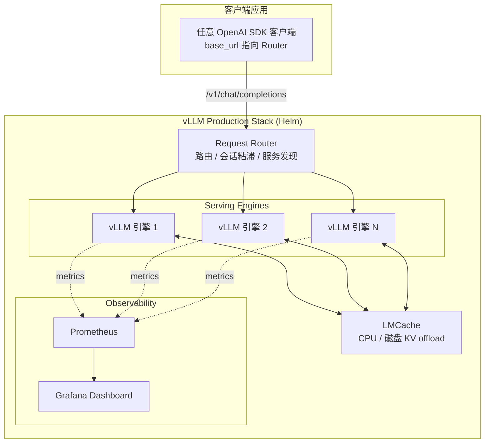
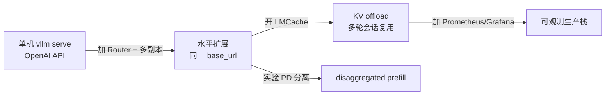

# vLLM Production Stack:从单机到集群的参考部署

## TL;DR

Production Stack 是 vLLM 官方的**参考部署栈**:用 Helm 一键把「多个 vLLM 引擎 + 请求路由 + LMCache 分层缓存 + Prometheus/Grafana 观测」装进 Kubernetes,应用侧只需把 `base_url` 从 `http://localhost:8000` 换成集群 Service,**接口与单机 vLLM 完全一致(OpenAI 兼容)**。它的价值不是某个新算法,而是把生产化需要的拓扑、缓存、监控做成可复制的模板。

> **心法**:单机 vLLM 到集群,真正的分水岭不是「多起几个 Pod」,而是**请求怎么分、KV 怎么复用、指标怎么看**。Production Stack 把这三件事打包;引擎内核(连续批处理、PagedAttention)仍是你已有的那些。

---

## 1. 解决什么问题:单机 → 集群的三道坎

| 坎 | 单机 | 集群(Production Stack 的答案) |
|---|---|---|
| **入口** | 直连 `localhost:8000` | 统一 Router,OpenAI 兼容端点 |
| **扩展** | 垂直加卡 | 多引擎水平扩展,应用零改动 |
| **KV 复用** | 单进程 prefix cache | LMCache CPU/磁盘 offload + 跨轮复用 |
| **观测** | 看 stdout / 单机 metrics | Prometheus + Grafana dashboard |
| **故障** | 进程挂了就停 | Router 服务发现 + 健康检查 |

README 明确的三个卖点:

1. **Scale from a single vLLM instance to a distributed vLLM deployment without changing any application code**;
2. **Monitor the metrics through a web dashboard**;
3. **Enjoy the performance benefits brought by request routing and KV cache offloading**。

---

## 2. 部署拓扑

### 2.1 三大组件



| 组件 | Helm 段 | 作用 |
|---|---|---|
| **Serving engine** | `servingEngineSpec.modelSpec[]` | 各模型的 vLLM Deployment(可多模型、多副本) |
| **Request router** | `routerSpec` | 按 routing key / session ID 分发,最大化 KV 复用 |
| **Cache server** | `cacheserverSpec` | LMCache 共享缓存服务(可选) |
| **Observability** | `grafanaDashboards` + kube-prometheus-stack | 实例数、延迟、TTFT、KV 使用率/命中率 |
| **LoRA** | `loraAdapters` / `loraController` | 适配器热插拔(可选) |

### 2.2 单机 → 集群的迁移路径



应用代码只改 `base_url`,其余(模型名、chat 接口、流式)不变——这是「不改应用代码」的准确含义。

---

## 3. Helm values 详解

### 3.1 最小部署

`tutorials/assets/values-01-minimal-example.yaml`——一个 125M 小模型起步:

```yaml
servingEngineSpec:
  modelSpec:
  - name: "opt125m"
    repository: "vllm/vllm-openai"
    tag: "latest"
    modelURL: "facebook/opt-125m"
    replicaCount: 1
    requestCPU: 6
    requestMemory: "16Gi"
    requestGPU: 1
```

安装:

```bash
git clone https://github.com/vllm-project/production-stack.git
cd production-stack/
helm repo add vllm https://vllm-project.github.io/production-stack
helm install vllm vllm/vllm-stack -f tutorials/assets/values-01-minimal-example.yaml
```

### 3.2 开启 LMCache 的 KV offload

`tutorials/assets/values-05-cpu-offloading.yaml` 关键段:

```yaml
servingEngineSpec:
  modelSpec:
  - name: "mistral"
    repository: "lmcache/vllm-openai"     # 注意镜像换成 LMCache 集成版
    modelURL: "mistralai/Mistral-7B-Instruct-v0.2"
    replicaCount: 1
    requestGPU: 1
    pvcStorage: "50Gi"
    vllmConfig:
      maxModelLen: 16384
    lmcacheConfig:
      enabled: true
      cpuOffloadingBufferSize: "20"       # 20GB CPU 缓冲
    hf_token: <hf-token>
```

效果:KV cache 从 GPU 显存卸到 CPU(乃至磁盘),**多轮对话 / 共享前缀**再次进来时可直接命中,而不是重算。教程见 `tutorials/05-offload-kv-cache.md`。

### 3.3 PD 分离拓扑

`tutorials/assets/values-16-disagg-prefill.yaml` 用 NIXL 把 prefill 与 decode 拆开:

```yaml
servingEngineSpec:
  modelSpec:
    - name: "llama-prefill"
      repository: "lmcache/vllm-openai"
      lmcacheConfig:
        enabled: true
        kvRole: "kv_producer"
        enableNixl: true
        nixlRole: "sender"
        nixlPeerHost: "pd-llama-decode-engine-service"
        nixlPeerPort: "55555"
        nixlBufferSize: "1073741824"     # 1GB
        enablePD: true
    - name: "llama-decode"
      lmcacheConfig:
        kvRole: "kv_consumer"
        enableNixl: true
        nixlRole: "receiver"
        nixlPeerPort: "55555"
        enablePD: true
```

PD 分离的原理与监控口径见库内 [PD 分离清单](../../vllm/practices/pd-disaggregation.md)。

### 3.4 routerSpec 与 cacheserverSpec

Router 侧(`helm/values.yaml` 的 `routerSpec`)是独立 Deployment,默认镜像 `lmcache/lmstack-router`:

```yaml
routerSpec:
  enableRouter: true
  repository: "lmcache/lmstack-router"
  tag: "latest"
  replicaCount: 1
  containerPort: 8000
  serviceType: ClusterIP
  autoscaling:
    enabled: false
    minReplicas: 1
    maxReplicas: 3
    targetCPUUtilizationPercentage: 80
  pdb: { enabled: false }
```

共享缓存服务(`cacheserverSpec`)把 LMCache 做成集群级组件,多引擎共用一份 KV 池:

```yaml
cacheserverSpec:
  enabled: true
  image:
    repository: "lmcache/vllm-openai"
    tag: "latest"
  replicaCount: 1
  containerPort: 8000
  servicePort: 80
  serde: ""            # 序列化格式(默认即可)
```

### 3.5 values 结构总览

| 顶层键 | 用途 |
|---|---|
| `servingEngineSpec` | vLLM 引擎 Deployment(核心) |
| `routerSpec` | 路由器镜像、副本、HBA/PDB、端口 |
| `cacheserverSpec` | LMCache 共享缓存服务 |
| `loraAdapters` / `loraController` | LoRA 适配器 |
| `sharedPvcStorage` | 共享存储(权重 / KV) |
| `extraObjects` | 附带的任意 K8s 清单 |
| `grafanaDashboards` / `kube-prometheus-stack` | 监控 |
| `prometheus-adapter` / `k8s-aibom` | 自定义指标 / SBOM(可选) |

### 3.6 多模型与教程地图

`tutorials/assets/values-04-multiple-models.yaml` 在同一栈内跑多个 `modelSpec`,Router 按模型名/alias 分流。官方教程串起来是一条完整生产化路径:

| 教程 | 主题 |
|---|---|
| `00-*` | 安装 K8s / minikube / KubeRay |
| `01` | 最小 Helm 部署 |
| `02`–`04` | 自定义 vLLM 配置、权重加载、多模型 |
| `05`–`06` | LMCache CPU offload、远端共享 KV |
| `07`–`08` | 多轮 QA 压测(单卡/多卡) |
| `09` / `13` | LoRA、Tool 调用 |
| `10` / `20` | HPA / KEDA 扩缩容 |
| `11`–`12` | 安全 serve、分布式追踪 |
| `14`–`15` | vLLM V1、pipeline parallel |
| `16`–`18` | PD 分离、KV-aware、prefix-aware 路由 |
| `19` | 引擎 sleep/wakeup |
| `21`–`26` | Gateway API、Whisper、语义路由、V100 遗留卡 |

---

## 4. Router 在栈里的角色

Production Stack 自带 Router(镜像 `lmcache/lmstack-router`),能力包括:

- 按 **routing key / session ID** 路由,提升 KV 复用;
- 按模型路由与 **model alias**;
- **K8s 服务发现**与故障容忍;
- 导出各引擎 QPS、TTFT、pending/running/finished、uptime 等指标;
- 路由算法:round-robin、session-ID、prefix-aware(WIP)。

更完整的负载均衡算法集(cache-aware、consistent-hash、power-of-two、PD 路由)在独立的 [Router](router.md) 项目里——Production Stack 的 router 是它的栈内集成形态,演进方向(README roadmap)明确写着「more performant router using non-python languages」。

---

## 5. LMCache 分层缓存

LMCache 在引擎 KV 之上再加一层「可卸载、可共享」的缓存,典型分层:

| 层 | 介质 | 容量 | 延迟 | 用途 |
|---|---|---|---|---|
| L0 | GPU HBM(vLLM block) | 小 | 最低 | 当前 batch 的 KV |
| L1 | CPU 内存(`cpuOffloadingBufferSize`) | 中 | 低 | 刚结束会话的 KV,快速恢复 |
| L2 | 磁盘 / 远端共享(`cacheserverSpec`) | 大 | 中 | 跨实例、跨轮次复用 |

三种收益场景:

1. **多轮对话**:第 N 轮的 system + 历史前缀不必重算,直接命中 L1/L2;
2. **共享 system prompt / few-shot**:多请求共前缀,缓存一次、处处受益;
3. **PD 分离**:prefill 产出的 KV 经 NIXL 送 decode 的同时,也可写入 LMCache 池(见 `values-16`)。

> **注意**:LMCache 是「跨实例复用」,与 vLLM 自身的 prefix caching(进程内 block 复用)是**叠加关系**,不是替代。进程内命中走 vLLM,进程外/跨 Pod 才落到 LMCache。

---

## 6. 监控 Dashboard

Grafana 面板直接回答「服务健不健康、卡在哪」:

| 面板 | 回答的问题 |
|---|---|
| **Available vLLM Instances** | 健康副本数够不够 |
| **Request Latency Distribution** | 端到端延迟分布 |
| **TTFT Distribution** | 首 token 是否被长 prompt 拖慢 |
| **Running / Pending Requests** | 是算不过来还是排不过来 |
| **GPU KV Usage Percent** | 显存里的 KV 是不是快满 |
| **GPU KV Cache Hit Rate** | 前缀/LMCache 复用是否有效 |

> **读数心法**:Running 高 + Pending 高 = 引擎饱和,该扩副本;Pending 低 + KV Usage 高 = 显存瓶颈,该看 offload / `max_model_len`;Hit Rate 低 = 前缀路由或 LMCache 配置没吃到复用。指标命名随 vLLM 版本漂移,以当前 metrics 文档为准(同 [PD 清单](../../vllm/practices/pd-disaggregation.md) §4.3)。

---

## 7. 与 aibrix / router 的关系

| 维度 | Production Stack | AIBrix | Router |
|---|---|---|---|
| **一句话** | 生产化参考栈(Helm) | K8s 控制面(Operator + 网关) | 高性能转发组件 |
| **交付** | `helm install vllm/vllm-stack` | CRD + controller + Envoy 插件 | Rust 二进制 / PyPI 包 |
| **缓存** | LMCache 深度集成 | Distributed KV Cache(事件驱动) | 不含缓存,只做路由 |
| **扩缩容** | HPA / KEDA 教程 | `PodAutoscaler`(KPA/APA,GPU 指标) | 无 |
| **上手成本** | 最低(教程 00–26) | 最高(组件多) | 低(单进程) |
| **适合** | 要一份能跑的生产拓扑 | 企业多模型/多租户平台 | 自建平台缺路由层 |

**关系一句话**:Production Stack 是「参考答案」,AIBrix 是「平台框架」,Router 是「可插拔零件」。三者都围绕多副本 vLLM,层次不同。

---

## 8. 常见坑

1. **镜像不匹配**:开 LMCache 必须用 `lmcache/vllm-openai` 镜像,继续用 `vllm/vllm-openai` 会静默没有 offload。
2. **`hf_token` 忘填或泄露**:值文件里的 `<hf-token>` 要替换;不要把真实 token 提交进 Git,用 K8s Secret。
3. **PVC 与模型尺寸不匹配**:`pvcStorage` 小于权重体积,Pod 会卡在拉取/挂载。
4. **Router 副本数过低**:单 Router 是新单点;有状态会话粘滞时,Router 重启会导致会话落到不同后端(缓存命中掉崖)。
5. **把 GPU 利用率当扩缩容信号**:栈内 HPA/KEDA 教程若仍盯 CPU,对推理无效;结合 TTFT/pending/KV 指标或用 AIBrix `PodAutoscaler`。
6. **PD 分离只改 role 不改传输**:`kvRole` / `nixlPeerHost` / `nixlPeerPort` 必须成对配置,且网络可达;否则 KV 传不过去,PD 比混批更慢。
7. **dashboard 字段过期**:vLLM 与 LMCache 的 metrics 名称随版本变,Grafana 面板要跟着升级,不能「装完永远不看」。
8. **多模型共用一份 values 却忽略隔离**:`modelSpec` 数组里多模型共享 Router 时,模型名与 alias 要显式配,否则请求打错模型。

---

## 9. 溯源

- **源码基线**:`github.com/vllm-project/production-stack`(release 博客 2025-01-22;官方文档 https://docs.vllm.ai/projects/production-stack,阅读日期 2026-10)。
- **LMCache**:https://github.com/LMCache/LMCache——KV offload 与共享缓存的实现主体。
- **教程体系**:`tutorials/00`–`26`(最小安装、多模型、LMCache、PD、KV-aware 路由、HPA/KEDA、分布式追踪等),示例 values 全部在 `tutorials/assets/`。
- **Roadmap 口径**:README 列出的在做项包括「基于 vLLM 指标的 autoscaling」「disaggregated prefill」「更高性能路由」——说明 router/PD 能力仍在快速演进,字段以当前 main 为准。

## 相关条目(库内互链)

- **[AIBrix:K8s 原生 GenAI 推理基础设施](aibrix.md)**:同一问题域的控制面切面;Production Stack 给拓扑模板,AIBrix 给 CRD/Operator 与 GPU 感知扩缩容。
- **[vLLM Router 高性能请求路由](router.md)**:栈内 router 的「本体」;负载均衡算法、K8s 服务发现、PD 路由的细节在那里展开。
- **[PD 分离清单](../../vllm/practices/pd-disaggregation.md)**:`values-16-disagg-prefill.yaml` 的 NIXL 传输与双侧指标,按该清单核对。
- **[连续批处理](../../vllm/concepts/continuous-batching.md)** / **[PagedAttention](../../vllm/concepts/paged-attention.md)**:引擎内吞吐与 KV 内存管理;LMCache offload 是在它们之上再加一层「跨实例/跨层」复用。
