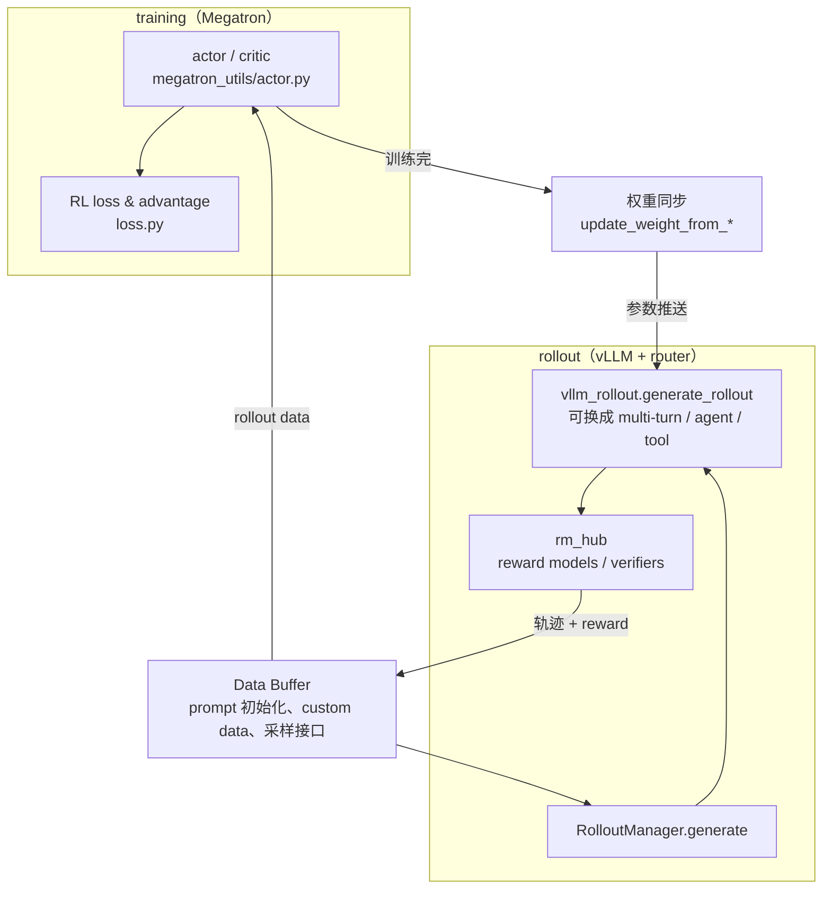
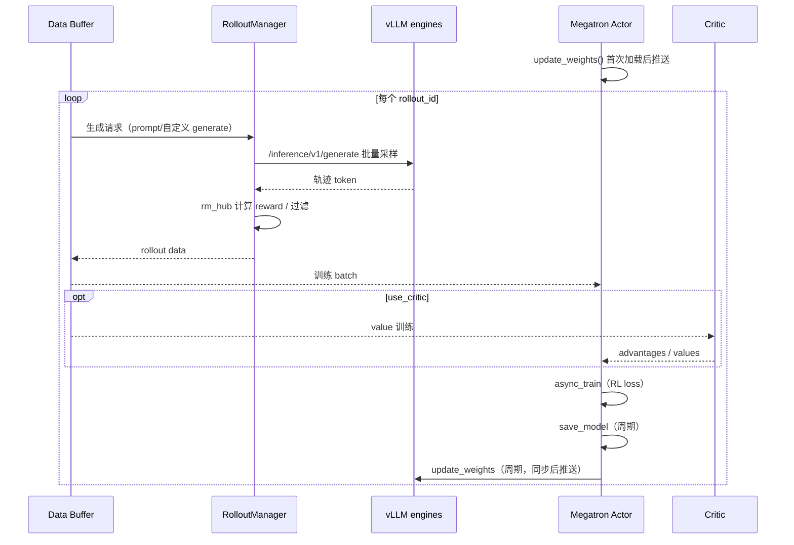

# Vime：vLLM rollout 的 RL 后训练框架

> **TL;DR**：Vime 是 vLLM 社区的 **RL scaling 后训练框架**，从 slime 演化而来：训练侧保留 **Megatron**，rollout（数据生成）侧默认换成 **vLLM + vllm-router**。它解决的是「RL 后训练里采样要占多少 GPU、采样与训练怎么耦合」这一工程问题——用 vLLM 做高性能生成，用 Megatron 做高效训练，中间用 Data Buffer 与权重同步把闭环接起来。同步（`train.py`）与异步（`train_async.py`）是两种吞吐/稳定性的折中，不是两个功能。

## 1. 为什么 RL 后训练要用 vLLM 做 rollout

RL 后训练（PPO/GRPO/RLOO 等）每一步都要**采样大量轨迹 → 算 reward/advantage → 更新策略 → 再采样**。采样阶段就是推理：如果用训练框架自己的 generate 逐步跑，decode 是访存受限的（见 [投机解码](../../vllm/concepts/speculative-decoding.md) 的同一背景），吞吐远低于专用推理引擎。

分工因此变得自然：

| 角色 | 引擎 | 擅长 | 不擅长 |
|---|---|---|---|
| 训练（actor/critic） | Megatron | 大模型并行训练、高效反向 | 自回归生成吞吐 |
| **rollout（采样）** | **vLLM + vllm-router** | 连续批处理、PagedAttention、高吞吐 generate、多轮/工具调用封装 | 参数更新 |
| 桥梁 | Vime 的 Data Buffer / Ray 编排 | prompt 初始化、custom generate、reward、权重同步 | — |

vLLM 社区同时对接 NeMo RL、OpenRLHF、prime-rl、SkyRL、verl 等框架；Vime 的定位是**把 slime 经过验证的训练范式原样带进 vLLM 生态**，保持两边 release 节奏可对齐。换引擎不换训练算法：算法层（GRPO、advantage、critic）仍在 Megatron 侧的 `loss.py`。

## 2. 架构：训练、rollout、Data Buffer



对应 README 的模块说明：

- **training (Megatron)**：从 Data Buffer 读数据，训练完把参数同步给 rollout；
- **rollout (vLLM + router)**：起 vLLM 引擎并路由请求；`--custom-generate-function-path` 可在 generate 外包一层多轮循环、工具调用、沙盒交互、verifier 奖励；
- **data buffer**：桥梁模块，管理 prompt 初始化、custom data 与 rollout 生成方法，agentic 工作流也走同一接口。

## 3. 同步 vs 异步训练

入口只有两个文件，差别就在**采样和训练是否重叠**。

### 3.1 同步：`train.py`

核心循环（摘自 `train.py`，有删节）：

```python
for rollout_id in range(args.start_rollout_id, args.num_rollout):
    # 1) 等这一轮 rollout 真正做完
    rollout_data_ref = ray.get(rollout_manager.generate.remote(rollout_id))
    if args.offload_rollout:
        ray.get(rollout_manager.offload.remote())   # 可选：采样完卸载 vLLM 显存

    # 2) 再训练
    if args.use_critic:
        value_refs = critic_model.async_train(rollout_id, rollout_data_ref)
        ray.get(actor_model.async_train(rollout_id, rollout_data_ref,
                                        external_data=value_refs))
    else:
        ray.get(actor_model.async_train(rollout_id, rollout_data_ref))

    # 3) 周期性 save / eval
    ...
    # 4) 周期性把 actor 权重推给 vLLM
    actor_model.update_weights()
```

语义是严格的「采样 → 训练 → 同步权重」串行。优点是数据永远是当前策略的 on-policy 语义清晰、调试容易（README 强调支持 rollout-only / train-only 分离排障）；缺点是采样和训练互相等待，GPU 空转。

### 3.2 异步：`train_async.py`

```python
# 先预取第 0 轮
rollout_data_next_future = rollout_manager.generate.remote(args.start_rollout_id)
for rollout_id in range(args.start_rollout_id, args.num_rollout):
    # 收割上一轮
    rollout_data_curr_ref = ray.get(rollout_data_next_future)
    # 立刻开下一轮采样，与本轮训练重叠
    if rollout_id + 1 < args.num_rollout:
        rollout_data_next_future = rollout_manager.generate.remote(rollout_id + 1)

    ray.get(actor_model.async_train(rollout_id, rollout_data_curr_ref))
    ...
    # 权重更新前必须先同步正在生成的请求，避免训到一半参数被换掉
    if (rollout_id + 1) % args.update_weights_interval == 0:
        rollout_data_curr_ref = ray.get(x) if (x := rollout_data_next_future) is not None else None
        rollout_data_next_future = None
        actor_model.update_weights()
```

关键细节：**`update_weights` 前会先 `ray.get` 掉在飞的 generate**——否则权重会在采样中途被替换，轨迹分布变成「半新半旧」，reward/advantage 统计被污染。异步吞吐更高，但语义上更接近 off-policy，`--update_weights-interval` 变大时要注意策略滞后。

另有 **fully async**（`examples/fully_async`、`vime/rollout/fully_async_rollout.py`）面向长尾 agent 生成：不要求每轮轨迹都等齐，适合 coding-agent 这类耗时差异巨大的任务。

### 3.3 怎么选

| 场景 | 建议 |
|---|---|
| 调 loss、查 reward bug、首次打通 | `train.py` 同步 |
| 采样耗时远大于训练（长生成、工具调用） | `train_async.py` 或 fully async |
| 需要严格 on-policy（如对照论文复现） | 同步 + 小 `update_weights_interval` |
| 想省显存 | 同步 + `--offload-rollout` / `--offload-train` / `--colocate` |

## 4. 训练-采样闭环



对应源码阅读路径（README 推荐）：

```text
train.py: train
├─ vime/ray/placement_group.py       Ray 资源与 worker
├─ vime/ray/rollout.py              RolloutManager.generate
│  └─ vime/rollout/vllm_rollout.py  采样与 reward
└─ vime/ray/actor_group.py          RayTrainGroup.async_train
   └─ vime/backends/megatron_utils/actor.py
      ├─ model.py
      └─ loss.py
```

## 5. 权重同步：闭环里最脏的一段

Megatron 参数布局 ≠ vLLM 加载布局，且 rollout 可能与训练分卡、分机、甚至独立集群。`vime/backends/megatron_utils/update_weight/` 提供四种路径：

| 文件 | 传输方式 | 适用 |
|---|---|---|
| `update_weight_from_tensor.py` | NCCL / 张量直传 | 同集群、低延迟 |
| `update_weight_from_distributed.py` | 分布式集合通信 | 多节点训练 |
| `update_weight_from_disk.py` | 落盘再加载 | 训练/推理环境隔离 |
| `update_weight_from_disk_delta.py` | **磁盘增量** | 分离部署的大模型，只推 delta |

进阶能力见 `docs/advanced/`：PD 分离（prefill/decode 资源不同）、外部 rollout 引擎（serving 独立环境、无 NCCL group）、delta weight sync。注意：**不同 GPU 型号/厂商仍需模型格式、精度与 vLLM 硬件支持兼容**，不是「落盘就万能」。

## 6. 参数面与模型支持

参数分三类（README「Arguments Walkthrough」）：

1. **Megatron 参数**原样透传：`--tensor-model-parallel-size 2` 等；
2. **vLLM / router 参数**加前缀：`--vllm-gpu-memory-utilization`、`--router-policy round_robin`、`--vllm-router-ip/port`（完整面见 `vime/backends/vllm_utils/arguments.py`）；
3. **Vime 框架参数**：`--actor-num-nodes`、`--rollout-num-gpus`、`--rollout-num-gpus-per-engine`（即每个 vLLM engine 的 TP）、`--colocate`、`--offload`、RL 算法与数据路径（`vime/utils/arguments.py`）。

默认 rollout 入口是 `vime.rollout.vllm_rollout.generate_rollout`；`--custom-generate-function-path` 可换成 multi-turn / agent 版本。

### 6.1 Data Buffer 与 reward

Data Buffer 不只是「存 prompt」。它管理：

- prompt 初始化与全局/按 rollout 数据集（`--rollout-global-dataset` 时周期性 `rollout_manager.save`）；
- custom generate 产出的轨迹规范化为 `Sample`（token、prompt、multimodal inputs）；
- `rm_hub`：reward model / verifier 打分；`filter_hub`：动态过滤（不满足格式、超长、无工具结果等直接丢弃）。

RL 算法侧（GRPO/PPO 类）的 advantage 与 loss 在 Megatron 的 `loss.py`；rollout 只负责「产生带 reward 的轨迹」。因此**换 reward 函数不需要改训练代码**，但 reward 尺度变化会影响 critic（若启用）的数值稳定性。

### 6.2 Agentic RL 扩展点

| 示例 | 扩展方式 | 适用 |
|---|---|---|
| `examples/multi_agent` | `--custom-generate-function-path` | 多 agent 协作生成 |
| `examples/fully_async` | fully async rollout | 长尾 agent 生成 |
| `examples/coding_agent_rl` | 沙盒 + 测试奖励 + 轨迹切分 | 编码 agent RL（Claude Code/Codex） |
| `examples/on_policy_distillation` | 自定义 rollout + distill loss | 蒸馏式后训练 |
| `examples/tau-bench`、`geo3k_vlm` | 基准/多模态任务 | 评测与 VLM |

沙盒契约是共享的 `vime.agent.sandbox.Sandbox`，coding-agent 示例内置 E2B 后端，也可换成 Docker、Modal、本地虚拟机。

**模型支持**（继承自 slime）：

- Qwen 系列：Qwen3.6、Qwen3.5、Qwen3Next、Qwen3MoE、Qwen3、Qwen2.5
- DeepSeek V3 系列：V3、V3.1、R1
- Llama 3

Agentic 示例（`examples/`）：`multi_agent`、`fully_async`、`coding_agent_rl`（Claude Code/Codex + 沙盒 + 测试奖励）、`dspark`、`on_policy_distillation`、`tau-bench`、`geo3k_vlm` 等——**agentic RL 不是独立框架**，只是换 custom generate 与 reward 的标准闭环。

## 7. 代码片段：最小启动形态

```bash
# 概念示例：Megatron 参数 + vLLM 参数 + Vime 编排参数
python train.py \
  --tensor-model-parallel-size 2 \
  --actor-num-nodes 1 --actor-num-gpus-per-node 8 \
  --rollout-num-gpus 8 --rollout-num-gpus-per-engine 1 \
  --vllm-gpu-memory-utilization 0.85 \
  --router-policy round_robin \
  --update-weights-interval 1 \
  --num-rollout 100 --save-interval 20 --eval-interval 10
```

```python
# 简化的自定义生成函数签名（agentic 扩展点）
# 通过 --custom-generate-function-path 指向你的函数，
# 在 vLLM generate 之上包装多轮循环 / 工具 / verifier reward。
def my_generate_rollout(...):
    ...
    # 产出与默认 generate_rollout 兼容的 rollout data
```

`vime/rollout/vllm_rollout.py` 对外导出 `generate_rollout`、`get_model_url`、`prime_encoder`；请求侧走 vLLM 的 `/inference/v1/generate`（token id 列表），支持多模态 `Sample.multimodal_inputs`。多轮 agent 的 session affinity 用 router policy 配置，避免同一会话被路由到不同引擎时 KV/工具状态错位。

调试建议（README「Correctness, Stability, and CI」）：RL bug 可能不报错；用 **rollout-only / train-only 分离调试**，并跑 customization hook 契约测试。Buildkite 的 CPU 绿灯**不代表** GPU 端到端通过。

### 7.1 显存与拓扑

| 开关 | 效果 | 代价 |
|---|---|---|
| `--colocate` | 训练与 vLLM 同 GPU | 会隐含 `--offload`；**不能与 async 同用** |
| `--offload-rollout` | 训练时把 vLLM 权重/KV 卸下 | 权重来回升降有开销 |
| `--offload-train` | 训练完自动卸训练权重 | 与 `release_train` 配合 |
| `--rollout-num-gpus-per-engine` | 单引擎 TP | 决定单请求延迟与总并发 |
| `--rollout-num-gpus 0` | 只起 router、不起本地 vLLM | 外部 serving（external engines） |

容量粗估（同机 non-colocate）：

```
训练显存 ≈ 参数 + 优化器状态 + 梯度 + 激活        （Megatron 并行可拆）
rollout 显存 ≈ 权重 + KV cache(gpu-memory-utilization) + workspace
总需求 = 训练 + rollout （分卡时各算各的）
```

PD 分离（`docs/advanced/pd-disaggregation.md`）把 prefill 与 decode 拆到不同资源池，适合多轮 agent：prefill 吃算力、decode 吃带宽，比例随任务变化。

### 7.2 权重同步的正确性检查

`--check-weight-update-equal` 会在首次推送后调用 `rollout_manager.check_weights(action="compare")`，比对训练侧与 vLLM 侧权重是否一致——**换同步路径后应先开这个开关跑一轮**，再关掉省时间。磁盘增量（delta）路径尤其要验证切片/专家路由与 Megatron→HF 的映射没有错位。

## 8. 常见坑

1. **异步更新权重与采样竞态**：自己改 `train_async.py` 循环时，若去掉「先同步在飞 generate 再 `update_weights`」这一步，会得到静默污染的 off-policy 数据。
2. **`--colocate` 与 async 互斥**：`train_async.py` 开头 `assert not args.colocate`。想异步就分卡。
3. **奖励/过滤器只在 rollout 侧生效**：`rm_hub`、`filter_hub` 改的是采样结果，不改 loss；质量差要回头查数据与 reward 设计，不是调 Megatron LR。
4. **权重同步路径选错**：大模型 + 分离部署却走 tensor 直传会 OOM 或极慢；用 disk delta。反过来，同机小模型走落盘白白丢吞吐。
5. **参数前缀混淆**：`--router-*` 是 vllm-router 原生选项，`--vllm-router-*` 是 Vime 编排（router 在哪）；两者混用会被静默忽略或起不来。
6. **CPU CI ≠ GPU 验证**：分布式 dead lock、NCCL 超时只在 GPU suite 暴露；上线前手动开 GPU gate。
7. **on-policy 期望与异步现实**：`update_weights_interval` 大时，部分轨迹来自旧策略；评估指标（如 KL、reward 曲线）要按「采集时策略版本」解读。
8. **filter_hub 静默丢样本**：动态过滤过严会让有效 batch 远小于 `num_rollout` 预期，训练「看起来在跑」但梯度方向被少数幸存样本主导；定期看过滤率。
9. **外部 rollout 引擎的版本漂移**：disk transport 免 NCCL，但 vLLM 版本/量化格式不兼容时权重加载行为会变；固定镜像与 checkpoint 哈希。
10. **critic 冷启动**：`--num-critic-only-steps` 阶段 actor 不训练；过早混训会让 advantage 方差污染 actor。

## 9. 与相邻条目的关系

RL 后训练产出的是「更好的策略权重」；推理加速（投机解码、量化）改变的是「同一权重怎么跑得更快」。二者可叠加：例如用 Vime 做领域 RL 后，再用 [Speculators](speculators.md) 训草稿、用 [LLM Compressor](llm-compressor.md) 量化，但每一步都要用接受率/质量指标重新验证，不能假设误差不叠加。

一句话定位：**Megatron 负责“学”，vLLM 负责“采”，Vime 负责把两者接成可扩展的 RL 闭环**——需要换算法时改 loss，需要换采样行为时改 custom generate，需要换拓扑时改部署配置。

### 9.1 快速对照

| 你要做的事 | 改哪里 |
|---|---|
| 换 RL 算法 / advantage | `vime/backends/megatron_utils/loss.py` |
| 换采样逻辑（多轮/工具/agent） | `--custom-generate-function-path` |
| 换 reward | `vime/rollout/rm_hub/` |
| 调采样与训练重叠 | `train.py` vs `train_async.py`、`--update-weights-interval` |
| 调推理拓扑 | `--rollout-num-gpus-per-engine`、`--router-*`、YAML vLLM Config |
| 调权重同步 | `vime/backends/megatron_utils/update_weight/` |
| 调显存 | `--colocate`、`--offload-rollout`、`--offload-train` |

## 相关条目

- [投机解码](../../vllm/concepts/speculative-decoding.md)（decode 访存受限背景，为什么 rollout 值得用 vLLM）
- [PTQ：GPTQ / AWQ / SmoothQuant](../../quantization/concepts/ptq-gptq-awq-smoothquant.md)（rollout 引擎可加载量化模型降显存，但要测 reward 一致性）
- [Speculators 草稿模型训练与评测](speculators.md)（推理加速侧；与 RL 后训练正交，可叠加）

## 溯源

- 主源：vllm-project/vime 仓库 README.md、README_zh.md、`train.py`、`train_async.py`、`vime/rollout/vllm_rollout.py`、`vime/utils/arguments.py`、`vime/backends/megatron_utils/update_weight/`、`examples/`、`docs/en/`。
- 交叉源：THUDM/slime（上游训练栈与文档）、vLLM 生态其他 RL 框架列表（README「Positioning」）。
