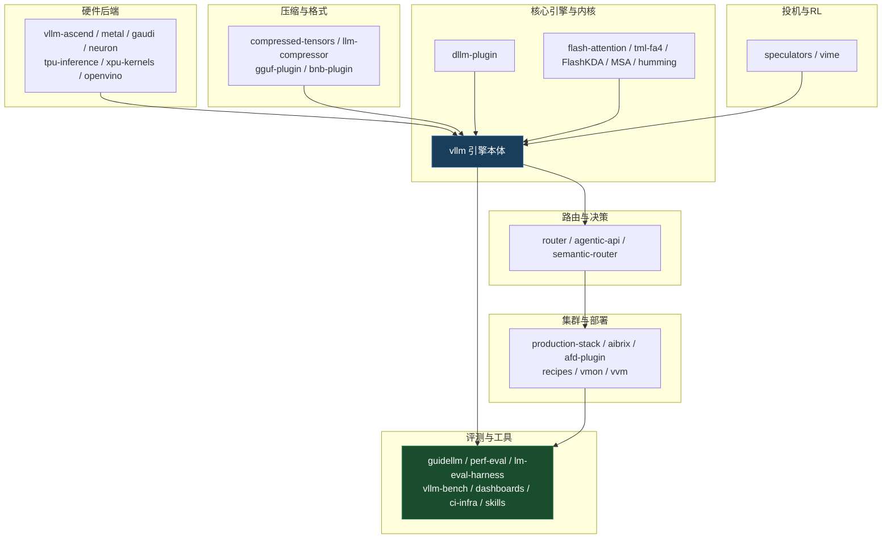

# vllm-project 生态域 — 47 仓全景索引

> 领域索引。**知识本体在 `concepts/` 深度概念篇**;本页放定位、47 仓分组地图、关键事实与导航。
> 源码基准:`/data/cold/repo/` 本地浅克隆(每仓单 commit 快照,2026-10 上旬);star 数为公开量级估计,以 GitHub 实时为准。

## 一句话定位

**vllm-project** 是围绕 vLLM 推理引擎形成的**完整生产生态**:核心引擎与注意力内核 → 硬件后端插件 → 量化与权重格式 → 路由/集群/运维 → 投机与 RL 后训练 → SLO 评测与容量规划 → 文档/RFC/CI。本域记录「**引擎之外那一圈仓库各自解决什么、怎么互相咬合**」。

与库内 [`vllm/`](../vllm/index.md) 的分工:**vllm/ 域讲引擎内部原理**(PagedAttention、连续批处理、V1 架构、量化分派);**本域讲引擎外部的生态构件**(插件、路由、压缩格式、评测平台)。读引擎内核去 vllm/,读「怎么把 vLLM 用起来/扩起来」来本域。

---

## 1. 生态全景(mermaid)

---

## 2. 47 仓分组地图(一句话定位)

### 2.1 核心引擎与内核(8)

| 仓库 | 一句话 | 主语言 |
|---|---|---|
| **vllm** | 高吞吐 LLM 推理与服务引擎本体(PagedAttention / 连续批处理 / V1) | Python(+Rust) |
| **flash-attention** | vLLM 维护的 FlashAttention 内核 fork(主线依赖) | CUDA/C++ |
| **tml-fa4** | FlashAttention-4 forward CuTeDSL 内核(相对偏置/分块稀疏/SM100) | Python/CuTe |
| **FlashKDA** | Flash Kimi Delta Attention 高性能 KDA 内核(CUTLASS,SM90+) | CUDA/C++ |
| **MSA** | MiniMax 稀疏注意力:dense FMHA + sparse top-k(SM100,CuTe-DSL+Csrc JIT) | Python/CUDA |
| **humming** | 面向量化推理的轻量 JIT GEMM 内核库(FP8/FP4/INT8/INT4,SM75+) | Python/CUDA |
| **vllm-nccl** | NCCL 通信插件(**已废弃**,修复并入主线 vllm#5091) | Python |
| **dllm-plugin** | 块扩散语言模型(dLLM)插件:`vllm.general_plugins` + ModelRegistry 注册 | Python |

### 2.2 全模态(2)

| 仓库 | 一句话 | 主语言 |
|---|---|---|
| **vllm-omni** | 全模态统一服务运行时:文/音/图/视频/动作,双工实时、AR-DiT 分页 KV | Python |
| **bart-plugin** | BART / Florence-2 等 encoder-decoder 与视觉模型的 vLLM 插件 | Python |

### 2.3 路由与决策(3)

| 仓库 | 一句话 | 主语言 |
|---|---|---|
| **router** | 高性能轻量请求转发:一致性哈希/缓存感知/PD 分离感知负载均衡 | Rust |
| **agentic-api** | 有状态 agentic API 层(Responses/Messages、服务端工具、多轮编排) | Rust |
| **semantic-router** | 语义路由/可编程决策层:分类→路由→安全/成本 | Go |

### 2.4 集群与部署(6)

| 仓库 | 一句话 | 主语言 |
|---|---|---|
| **production-stack** | vLLM 生产部署参考栈(Helm/监控/路由一站式) | YAML/Python |
| **aibrix** | K8s 原生 GenAI 推理基建积木(路由、扩缩、多引擎) | Go |
| **afd-plugin** | Attention-FFN 分离(AFD)插件:自研 worker/connector,不改 vllm 源码 | Python/C++ |
| **recipes** | vLLM 部署配方库(recipes.vllm.ai) | YAML |
| **vmon** | 轻量终端仪表盘:监控单机或 Slurm 集群上的 vLLM | Rust |
| **vvm** | 多 vLLM 安装/多环境管理,按 release/commit/PR 秒切换 | Rust |

### 2.5 压缩与格式(4)

| 仓库 | 一句话 | 主语言 |
|---|---|---|
| **compressed-tensors** | 扩展 safetensors 的**统一压缩张量格式**(GPTQ/AWQ/FP8/NVFP4/稀疏/旋转) | Python |
| **llm-compressor** | 部署导向的量化/压缩训练后处理库(与 compressed-tensors 配套) | Python |
| **vllm-gguf-plugin** | 树外 GGUF 量化支持(主线 in-tree 已弃用后的承接) | Python |
| **vllm-bnb-plugin** | 树外 bitsandbytes 4/8-bit 量化插件(in-flight 4-bit) | Python |

### 2.6 投机与RL(2)

| 仓库 | 一句话 | 主语言 |
|---|---|---|
| **speculators** | 投机解码草稿模型的生产级训练框架,训完直接上 vLLM | Python |
| **vime** | RL 后训练框架(基于 slime),Megatron 训练 + vLLM rollout | Python |

### 2.7 硬件后端(7)

| 仓库 | 一句话 | 主语言 |
|---|---|---|
| **vllm-ascend** | 华为昇腾 NPU 生产插件(platform+模型+连接器全注册) | Python/C++ |
| **vllm-metal** | Apple Silicon 插件:MLX 主算力 + PyTorch 统一 lowering | Python/Metal |
| **vllm-gaudi** | Intel Gaudi HPU 硬件插件 | Python |
| **vllm-neuron** | AWS Trainium/Inferentia 插件(AWS 推荐服务路径) | Python |
| **tpu-inference** | Google TPU 支持独立仓(内核/运行时/文档) | Python/Pallas |
| **vllm-xpu-kernels** | Intel GPU(XPU)自定义内核库(补 kernel 不换平台) | Python/C++ |
| **vllm-openvino** | OpenVINO 后端:x86 CPU(AVX2+)/Intel iGPU/dGPU | Python |

### 2.8 评测与工具(8)

| 仓库 | 一句话 | 主语言 |
|---|---|---|
| **guidellm** | SLO-aware 基准评测与容量规划平台(本域概念篇) | Python |
| **perf-eval** | YAML recipe 驱动的「精度+性能」CI 回归流水线 | YAML/Python |
| **vllm-bench** | Rust 微基准(**已归档**,并入主线 `rust/src/bench`) | Rust |
| **lm-evaluation-harness** | 语言模型精度评测 harness(下游任务/基准) | Python |
| **perf-dashboard** | perf.vllm.ai 新仪表盘基建(WIP) | Python/YAML |
| **vllm-dashboard** | Buildkite CI 观测仪表盘(构建/队列/成本/性能趋势) | TypeScript |
| **ci-infra** | CI 基础设施即代码(Buildkite + AWS/GCP 自动扩缩) | Python/YAML |
| **vllm-skills** | 部署与基准评测 skills 集(Claude Code 插件形态) | Markdown |

### 2.9 文档与RFC(7)

| 仓库 | 一句话 | 主语言 |
|---|---|---|
| **vllm-docs** | 文档站源(docs.vllm.ai 站点工程) | TS/Python |
| **rfcs** | vLLM RFC 提案库 | Markdown |
| **vllm-project.github.io** | 项目官网/博客 | Markdown |
| **vllm-project.github.io-static** | 静态博客编译产物 | Markdown |
| **vllm-daily** | 日报/资讯聚合(288+ md) | Markdown |
| **media-kit** | 官方 logo 资产(各格式/样式) | 资产 |
| **vLLM-in-PyTorch-Conference-2025** | PyTorch 大会 2025 中 vLLM 相关演讲索引(53+/117 视频) | Markdown |

> 计数:8+2+3+6+4+2+7+8+7 = **47** 个 vllm-project 本地仓;`/data/cold/repo/` 另含 DeepSeek* 等非本域仓(归 deepseek-infra 域)。

---

## 3. 条目索引(本域 concepts/ 已写概念篇)

> 源码一手实读 + 官方文档综合,打开一篇能读懂。**只列实际存在的文件**。

| 篇目 | 类型 | 一句话 |
|---|---|---|
| [vLLM 硬件后端插件体系](concepts/hardware-plugins.md) | concept | entry points 双通道(platform_plugins 探测 + general_plugins 注册);七家后端定位;vllm-ascend 与 deepseek-infra 昇腾篇分层对照 |
| [GuideLLM 基准评测与容量规划](concepts/guidellm-bench.md) | howto | SLO-aware 负载模拟:六种 profile、TTFT/ITL 分布、SLO 达成率、sweep 找容量拐点;与 vllm-bench/perf-eval 分工 |
| [vLLM Router 高性能路由](concepts/router.md) | concept | 多副本请求该发给谁:一致性哈希/缓存感知/PD 分离感知的 LLM 专用负载均衡 |
| [AIBrix K8s 原生推理基建](concepts/aibrix.md) | concept | GenAI 推理基建积木:路由、扩缩、多引擎调度 |
| [vLLM Production Stack](concepts/production-stack.md) | concept | 从单机到集群的生产参考部署 |
| [LLM Compressor 压缩工具链](concepts/llm-compressor.md) | concept | 部署导向量化/压缩训练后处理 |
| [Semantic Router 可编程决策层](concepts/semantic-router.md) | concept | 分类→路由→安全/成本的模型上游决策层 |
| [Speculators 草稿模型训练](concepts/speculators.md) | concept | 投机解码草稿模型生产级训练与评测 |
| [Vime RL 后训练框架](concepts/vime.md) | concept | Megatron 训练 + vLLM rollout 的 RL 后训练 |
| [vLLM-Omni 全模态服务](concepts/vllm-omni.md) | concept | text/audio/image/video/action 统一 serving 运行时 |

---

## 4. 关键事实速记

- **体量量级**(公开估计,本地浅克隆无法核实 star):`vllm` 万级(生态核心,2000+ 贡献者);`flash-attention` 万级;`lm-evaluation-harness` 万级;`aibrix`/`production-stack`/`llm-compressor`/`vllm-ascend` 千级;其余多为百~千级或新生仓。
- **主语言分布**:引擎与压缩/评测以 **Python** 为主;路由与新一代工具(agentic-api/router/vmon/vvm/vllm-bench)偏 **Rust**;aibrix/semantic-router 为 **Go**;内核仓为 **CUDA/C++/CuTe**;vllm 本体已出现 **Python+Rust 混合**(`rust/src/bench` 等)。
- **活跃度**(以本地快照最后提交日,2026-10 上旬):vllm / vllm-ascend / vllm-metal / vllm-omni / router / agentic-api / aibrix / semantic-router / guidellm / production-stack / recipes / flash-attention 等主力仓均为**当周活跃**;`vllm-nccl`(2024-06)、`vllm-bench`(已归档)、`vllm-project.github.io-static`(2025-02)为**低活跃/冻结**;`rfcs` 本地无有效 git 历史(浅快照)。
- **架构事实**:硬件扩展走 `vllm.platform_plugins` + `vllm.general_plugins` entry points;量化格式统一到 compressed-tensors;GGUF/bitsandbytes 已外置成插件仓;vllm-bench 并入主线 Rust workspace;vllm-nccl 并入主线。
- **插件安装约定**:装即注册(`pip install` 后 entry points 可被 `importlib.metadata` 发现);`VLLM_PLUGINS` 环境变量可做白名单。

---

## 5. 相关条目(跨域互链)

- **引擎内部原理**: [`vllm/`](../vllm/index.md)(PagedAttention、连续批处理、V1、量化分派、投机解码)
- **量化与权重格式**: [`quantization/`](../quantization/index.md)(compressed-tensors/GPTQ/AWQ/FP8 的算法与格式细节)
- **DeepSeek 基础设施(昇腾/算子/通信)**: [`deepseek-infra/`](../deepseek-infra/index.md) — 与 vllm-ascend 分层互补,见 [ascend-port-principles](../deepseek-infra/concepts/ascend-port-principles.md)
- **模型架构**: [`model-architecture/`](../model-architecture/index.md)(被这些引擎/插件服务的模型本体)

---

## 6. 扩展位(尚未落稿)

| 拟写篇目 | 归属 | 状态 |
|---|---|---|
| agentic-api 有状态 API 层 | 待认领 | 待入库 |
| compressed-tensors 格式规范 | 待认领 | 待入库 |
| afd-plugin Attention-FFN 分离 | 待认领 | 待入库 |
| humming JIT GEMM | 待认领 | 待入库 |
| MSA / FlashKDA / tml-fa4 稀疏与新一代注意力内核 | 待认领 | 待入库 |
| production-stack 监控清单 / perf-eval recipe 机制 | 待认领 | 待入库 |

> 说明:原规划中的 aibrix / production-stack / router / llm-compressor / speculators / vime / semantic-router / vllm-omni 概念篇**已入库**(见条目索引),不再占扩展位。

---

## 溯源

- 仓库归属以本地 git remote(`github.com/vllm-project/*`)为准,共 47 仓;
- 一句话定位取自各仓 README 一手描述(2026-10 本地浅克隆快照);
- 插件机制细节来自 `vllm/vllm/plugins/__init__.py`、`vllm/vllm/platforms/__init__.py` 与 vllm-ascend/vllm-metal 的 entry points 声明;
- 分组为本库自定的阅读地图,与 GitHub org 目录不完全同构;
- ⚠ 浅克隆每仓仅 1 commit,「活跃度」按快照内最后提交时间线判断;star 数据请查 GitHub 实时页面。
