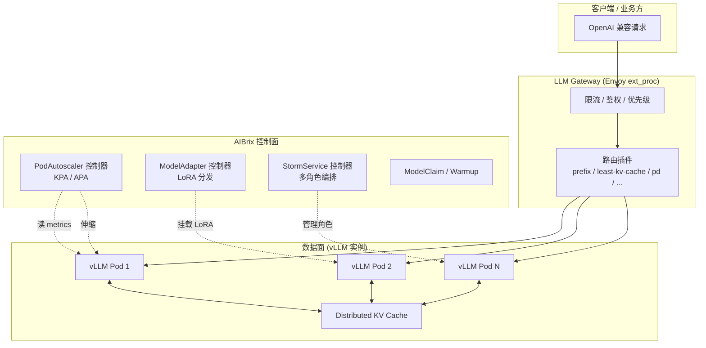
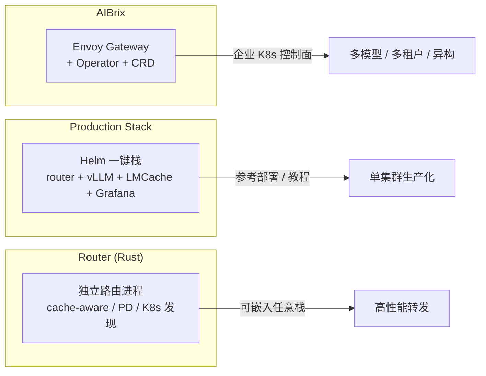

# AIBrix:K8s 原生的 GenAI 推理基础设施

## TL;DR

AIBrix 是 vLLM 生态里面向**生产集群**的控制面:它不替换 vLLM 引擎本身,而是补齐「多副本怎么放、怎么扩、怎么路由、怎么共享 LoRA/KV、怎么抗故障」这一层 Kubernetes 原生组件。核心抽象是几组 CRD(`PodAutoscaler` / `ModelAdapter` / `StormService` / `ModelClaim` …)+ 一个基于 Envoy ext_proc 的 **LLM Gateway**。设计目标与论文口径见白皮书 arXiv:2504.03648。

> **心法**:单副本 vLLM 的瓶颈在引擎内(调度、显存、算子);多副本之后瓶颈立刻搬到**集群层**(谁接流量、何时扩缩、LoRA 放哪、KV 怎么共享)。AIBrix 管的是后者——所以它与 [vLLM Production Stack](production-stack.md)、[Router](router.md) 是同一问题域的不同切面,不是互相替代的引擎。

---

## 1. 解决什么问题

把一个 `vllm serve` 变成「可上线的模型服务」,至少要回答:

| 问题 | 只靠 K8s 原生 | AIBrix 的补位 |
|---|---|---|
| **多副本调度/路由** | Service 轮询,不感知 KV/负载 | LLM Gateway + 十余种 LLM-aware 路由算法 |
| **扩缩容** | HPA 只看 CPU,对 GPU 推理失真 | `PodAutoscaler`(KPA/APA)直读 vLLM 指标(如 `gpu_cache_usage_perc`) |
| **网关/配额/鉴权** | 要另接 API 网关 | Envoy ext_proc 插件:限流、优先级、API key、模型列表 |
| **LoRA 多租户** | 手工挂载,无法热切换 | `ModelAdapter` CRD:声明式分发 LoRA 到匹配 Pod |
| **PD 分离/异构混部** | 手写 StatefulSet + 亲和性 | `StormService`/`RoleSet` 多角色编排 + PD 路由 |
| **GPU 硬件故障** | 只看 Pod Ready | 硬件故障检测 + 摘流 |

一句话:**vLLM 管「一台 GPU 上怎么算得快」,AIBrix 管「一群 GPU 上怎么服务得稳」**。

---

## 2. 关键组件

### 2.1 组件地图

| 组件 | 位置(源码) | 职责 |
|---|---|---|
| **Gateway(路由/网关)** | `pkg/plugins/gateway/` | Envoy external processor:按模型/会话/前缀/KV 负载选副本;限流、鉴权、优先级 |
| **Controllers(Operator)** | `pkg/controller/` | 调和 `PodAutoscaler` / `ModelAdapter` / `StormService` / `ModelClaim` 等 CRD |
| **Autoscaler** | `pkg/controller/podautoscaler/` | KPA/APA 策略,读 vLLM `/metrics` 做目标值控制 |
| **Model Adapter** | `pkg/controller/modeladapter/` | LoRA 工件下载与热加载,按 `podSelector` 分发 |
| **Distributed KV Cache** | `pkg/cache/`, `pkg/kvevent/` | 跨引擎 KV 事件与前缀感知路由支撑 |
| **Unified AI Runtime** | sidecar | 指标标准化、模型下载、运行时管理 |
| **GPU 故障检测** | observability 侧 | 硬件异常主动发现并摘除 |

### 2.2 CRD 分组(`api/`)

源码里 API 按三组拆分,读类型定义就能看清职责边界:

| API Group | 类型 | 用途 |
|---|---|---|
| `autoscaling.aibrix.ai/v1alpha1` | `PodAutoscaler` | 扩缩容(策略 HPA / KPA / APA) |
| `model.aibrix.ai/v1alpha1` | `ModelAdapter` / `ModelClaim` / `ModelWarmup` | LoRA、模型认领、预热 |
| `orchestration.aibrix.ai/v1alpha1` | `StormService` / `RoleSet` / `PodSet` / `RayClusterFleet` / `KVCache` | 多角色编排(PD、异构)、Ray 分布式、KV 池 |

### 2.3 控制面架构

> 下图把控制面架构拆成两条路径:流量路径(客户端→Gateway→vLLM Pod)与控制路径(Operator→Pod),回答「流量给谁、副本怎么管」两个问题。

<div class="archify-figure">
<iframe src="../../../diagrams/vm-aibrix-controlplane.workflow.html"
        style="width:100%;height:720px;border:1px solid rgba(0,0,0,.08);border-radius:14px"
        loading="eager" title="AIBrix 控制面:流量路径与控制路径分离"></iframe>
</div>



要点:

1. **数据面仍是 vLLM**,AIBrix 不改引擎;观测走 `/metrics`,扩缩容与路由都基于引擎真实负载。
2. **Gateway 是流量入口**,路由算法可插拔(`pkg/plugins/gateway/algorithms/` 下有 `prefix_cache`、`least_kv_cache`、`power_of_two`、`pd_disaggregation`、`vtc` 等)。
3. **控制面与数据面解耦**:CRD 声明期望状态,控制器调和;卸载 CRD 与卸载 Operator 是分开的(README 明确 `config/crd` 单独 apply,避免误删用户 CR)。

---

## 3. 一份简化 CRD 示例

### 3.1 模型副本:用 label 交给 Gateway 发现

`samples/quickstart/model.yaml` 的核心约定——**label 与 served-model-name 必须一致**:

```yaml
apiVersion: apps/v1
kind: Deployment
metadata:
  name: deepseek-r1-distill-llama-8b
  labels:
    model.aibrix.ai/name: deepseek-r1-distill-llama-8b   # 必须与 Service / served-model-name 一致
    model.aibrix.ai/port: "8000"
spec:
  replicas: 1
  selector:
    matchLabels:
      model.aibrix.ai/name: deepseek-r1-distill-llama-8b
  template:
    metadata:
      labels:
        model.aibrix.ai/name: deepseek-r1-distill-llama-8b
        model.aibrix.ai/port: "8000"
    spec:
      containers:
        - name: vllm-openai
          image: vllm/vllm-openai:v0.11.0
          command: ["vllm", "serve",
                    "--model", "deepseek-ai/DeepSeek-R1-Distill-Llama-8B",
                    "--served-model-name", "deepseek-r1-distill-llama-8b",
                    "--max-model-len", "12288"]
          ports:
            - containerPort: 8000
          resources:
            limits: { nvidia.com/gpu: "1" }
          livenessProbe:
            httpGet: { path: /health, port: 8000 }
```

### 3.2 GPU 感知扩缩容:`PodAutoscaler`

> 下图是 PodAutoscaler 的扩缩容循环:为什么不用 CPU 而要直读 gpu_cache_usage_perc,以及缩容为什么要过 cooldown。

<div class="archify-figure">
<iframe src="../../../diagrams/vm-aibrix-autoscale.workflow.html"
        style="width:100%;height:720px;border:1px solid rgba(0,0,0,.08);border-radius:14px"
        loading="eager" title="PodAutoscaler 的 GPU 感知扩缩容循环"></iframe>
</div>

`samples/autoscaling/kpa.yaml`——不看 CPU,直接盯 `gpu_cache_usage_perc`:

```yaml
apiVersion: autoscaling.aibrix.ai/v1alpha1
kind: PodAutoscaler
metadata:
  name: deepseek-r1-distill-llama-8b-kpa
  annotations:
    autoscaling.aibrix.ai/scale-down-cooldown-window: 3m
spec:
  scalingStrategy: KPA            # HPA | KPA | APA
  minReplicas: 1
  maxReplicas: 8
  metricsSources:
    - metricSourceType: pod
      protocolType: http
      port: "8000"
      path: metrics
      targetMetric: gpu_cache_usage_perc   # vLLM 的 KV cache 使用率
      targetValue: "0.5"
  scaleTargetRef:
    apiVersion: apps/v1
    kind: Deployment
    name: deepseek-r1-distill-llama-8b
```

三种策略的分工(定义见 `api/autoscaling/v1alpha1/podautoscaler_types.go`):

| 策略 | 全称 | 特点 |
|---|---|---|
| **HPA** | Kubernetes 原生 | 兼容既有 HPA 语义 |
| **KPA** | Knative Pod Autoscaling | 短窗口 + panic 模式,适合流量尖刺 |
| **APA** | AiBrix Pod Autoscaling | 带上下波动容忍(`up/down-fluctuation-tolerance`) |

### 3.3 LoRA 多租户:`ModelAdapter`

> 下图是 ModelAdapter 的生命周期:Pending → Scheduled → Running,以及 replicas 只允许省略或 1 这一约束落在哪一步。

<div class="archify-figure">
<iframe src="../../../diagrams/vm-aibrix-lora-adapter.lifecycle.html"
        style="width:100%;height:720px;border:1px solid rgba(0,0,0,.08);border-radius:14px"
        loading="eager" title="ModelAdapter 的 LoRA 分发生命周期"></iframe>
</div>

```yaml
apiVersion: model.aibrix.ai/v1alpha1
kind: ModelAdapter
metadata:
  name: qwen-code-lora
spec:
  baseModel: qwen-coder-1-5b-instruct
  podSelector:
    matchLabels:
      model.aibrix.ai/name: qwen-coder-1-5b-instruct
      adapter.model.aibrix.ai/enabled: "true"
  artifactURL: huggingface://ai-blond/Qwen-Qwen2.5-Coder-1.5B-Instruct-lora
  schedulerName: default          # 或 least-adapters
```

生命周期:`Pending → (Scheduled) → Running / Failed`;`replicas` 只支持省略(全部匹配 Pod)或 `1`(单 Pod)。

### 3.4 PD 分离编排:`StormService`

> 下图回答 StormService 如何把 prefill/decode 做成两个 role 并靠 NIXL 传输 KV——以及只配角色不配传输时退化成什么。

<div class="archify-figure">
<iframe src="../../../diagrams/vm-aibrix-pd-storm.workflow.html"
        style="width:100%;height:720px;border:1px solid rgba(0,0,0,.08);border-radius:14px"
        loading="eager" title="StormService 的 PD 分离编排"></iframe>
</div>

`samples/quickstart/pd-model.yaml` 把 prefill/decode 做成同一资源的两个 role,并带上 NIXL KV 传输:

```yaml
apiVersion: orchestration.aibrix.ai/v1alpha1
kind: StormService
metadata:
  name: vllm-1p1d
spec:
  replicas: 1
  updateStrategy: { type: InPlaceUpdate }
  stateful: true
  template:
    spec:
      roles:
        - name: prefill
          replicas: 1
          template:
            spec:
              containers:
                - name: prefill
                  image: aibrix/vllm-openai:v0.9.2-cu128-nixl-v0.4.1
                  args:
                    - |
                      vllm serve --model deepseek-ai/DeepSeek-R1-Distill-Llama-8B \
                        --served-model-name deepseek-r1-distill-llama-8b \
                        --kv-transfer-config '{"kv_connector":"NixlConnector","kv_role":"kv_both"}'
                  env:
                    - name: VLLM_NIXL_SIDE_CHANNEL_HOST
                      value: "0.0.0.0"
                    - name: VLLM_NIXL_SIDE_CHANNEL_PORT
                      value: "5558"
        - name: decode
          replicas: 1
          # …结构同 prefill,KV 传输配置对侧
```

PD 路由与传输语义的通用背景,见库内 [PD 分离清单](../practices/pd-disaggregation.md)。

---

## 4. Gateway 路由算法速查

> 下图是路由算法的选型思路:按「共享前缀/多轮」与「异构混部/负载不均」两个特征,把十余种算法归到各自适用场景。

<div class="archify-figure">
<iframe src="../../../diagrams/vm-aibrix-routing-algo.workflow.html"
        style="width:100%;height:720px;border:1px solid rgba(0,0,0,.08);border-radius:14px"
        loading="eager" title="Gateway 路由算法选型"></iframe>
</div>

`pkg/plugins/gateway/algorithms/` 源码中的算法(节选):

| 算法名 | 思路 | 适用 |
|---|---|---|
| `random` | 随机健康副本(默认 fallback) | 无状态、压测 |
| `least-request` / `least-request-top-k` | 在途请求最少 | 通用负载均衡 |
| `least-latency` | 最近延迟最低 | 延迟敏感 |
| `least-kv-cache` / `least-gpu-cache` | KV/GPU 缓存最空 | 长生成、避免缓存挤压 |
| `least-busy-time` / `least-utilization` | 空闲时间/利用率 | 异构混部 |
| `prefix-cache` | 前缀命中优先(PreBLE 等) | 共享 system prompt |
| `power-of-two` | 两随机选更空 | 简单有效防热点 |
| `pd` | prefill/decode 分池路由 | PD 分离 |
| `vtc` / session affinity | 会话粘滞 | 多轮对话 |

**和 Router 的对照**:AIBrix Gateway 是 Envoy 生态的 L7 插件,能力面更宽(限流/鉴权/优先级/PD);[Router](router.md) 是独立高性能转发进程,策略更聚焦(consistent_hash / cache_aware / power_of_two)。选型见 §5。

---

## 5. 与 production-stack / router 的分工



| 维度 | AIBrix | Production Stack | Router |
|---|---|---|---|
| **定位** | K8s 原生控制面(Operator + 网关) | 参考部署栈(Helm 一键) | 高性能请求转发组件 |
| **交付形态** | CRD + controller + Envoy 插件 | Helm chart(vllm-stack) | Rust 二进制 / `vllm-router` 包 |
| **强项** | 多租户 LoRA、GPU 感知扩缩容、PD 编排、故障检测 | LMCache 分层缓存、开箱 dashboard、教程完整 | 负载均衡算法、K8s 服务发现、PD 路由 |
| **弱项** | 学习曲线陡,组件多 | 路由能力相对基础 | 不含扩缩容/Operator |
| **适合** | 企业级多模型平台 | 快速验证生产拓扑 | 已有平台,只缺路由层 |

可以叠用:例如 Production Stack 的 Helm 栈 + 独立 Router 做前缀感知路由;或 AIBrix 控制面内嵌自定义路由策略。

---

## 6. 安装与最小闭环

```bash
# 依赖(Redis、Envoy Gateway 等)
kubectl apply -k config/dependency --server-side

# CRD 单独安装(卸载 Operator 不会误删用户 CR)
kubectl apply -k config/crd --server-side

# 核心组件
kubectl apply -k config/default

# 部署模型 → 建 PodAutoscaler / ModelAdapter → 经 Gateway 访问
kubectl apply -f samples/quickstart/model.yaml
kubectl apply -f samples/autoscaling/kpa.yaml
```

---

## 7. 常见坑

1. **label 与 served-model-name 不一致**:`model.aibrix.ai/name`、Service 名、`--served-model-name` 三者任一漂移,Gateway 就找不到后端——这是 sample 注释里反复强调的第一坑。
2. **把 HPA 策略当 GPU 策略用**:CPU 利用率对 LLM 推理几乎没有信息量,要用 `gpu_cache_usage_perc`、QPS、KV 命中等引擎指标。
3. **CRD 与 Operator 一起卸载**:`config/crd` 必须与 `config/default` 分开管理,否则用户 CR 会被连带删除。
4. **ModelAdapter 的 `replicas` 乱填**:只支持省略或 `1`,填其他值会被 admission 拒绝。
5. **PD 场景只配角色不配传输**:StormService 分了 prefill/decode role,但 `kv_transfer_config` / NIXL 环境变量没对齐,KV 交不出去,退化成「慢一倍的单体」。
6. **扩缩容抖动**:缩容要有 cooldown(如 `scale-down-cooldown-window`),否则指标一抖就反复拉起昂贵的 GPU Pod。
7. **路由算法选错**:`prefix-cache` 适合共享 system prompt,但对完全随机 prompt 反而增加簿记开销;无状态压测用 `random`/`least-request` 即可。

---

## 8. 溯源

- **AIBrix 白皮书**:《AIBrix: A Scalable and Affordable System for Serving Generative AI Models》,arXiv:2504.03648——控制面设计动机、组件划分与大规模服务口径(README 直接链接的官方白皮书)。
- **源码基线**:`github.com/vllm-project/aibrix`(README 指向 v0.7.0 / v0.8.0-rc 系列发布);CRD 字段以 `api/**/v1alpha1/*_types.go` 为准,示例以 `samples/` 为准。
- **官方文档**:https://aibrix.readthedocs.io/latest/(阅读日期 2026-10)。
- **KubeCon 议题**:KubeCon NA 2025 keynote、KubeCon China 2025 "Cost-Effective and Scalable Kubernetes Control Plane for vLLM"——对「为什么是 K8s 控制面」的动机阐述。

## 相关条目(库内互链)

- **[vLLM Production Stack 参考部署](production-stack.md)**:同一问题域的「Helm 一键参考栈」切面;AIBrix 侧重控制面与 CRD,Production Stack 侧重可复制的部署拓扑与 LMCache。
- **[vLLM Router 高性能请求路由](router.md)**:纯路由组件;AIBrix Gateway 的算法谱系与之有重叠(`power_of_two`、prefix/pd),但 Router 更轻、可嵌入。
- **[PD 分离清单](../practices/pd-disaggregation.md)**:StormService 的 prefill/decode 角色与 KV 传输语义,落在该清单的「拓扑与缓冲 / 监控指标」框架内。
- **[连续批处理](../concepts/continuous-batching.md)** / **[PagedAttention](../concepts/paged-attention.md)**:引擎内层;AIBrix 的 `gpu_cache_usage_perc` 扩缩容直接依赖这些引擎行为的可观测性。
