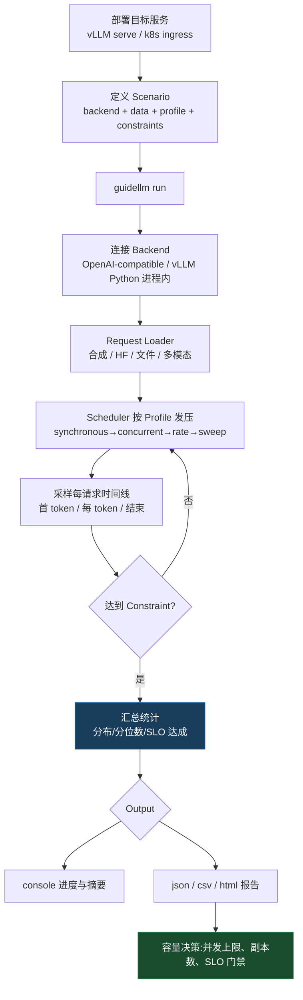

# GuideLLM 基准评测与容量规划 — SLO-aware 负载模拟实战

## TL;DR

GuideLLM 是 vLLM 官方的 **SLO-aware 基准评测与容量规划平台**:它不只测「最快多少 tok/s」,而是模拟**真实生产流量形态**(同步/并发/定速率/泊松/扫参),给出 **TTFT / ITL / 端到端延迟的完整分布** 和 **SLO 达成率**,回答「这套部署在什么并发下还能守住 P99 TTFT≤200ms」这种容量问题。

> **心法**:LLM 服务的性能是**分布**,不是均值。一个「平均 TTFT 150ms」的系统,可能有 5% 的请求卡到 2s——而 SLO 说的是「99% 的请求」。GuideLLM 的价值在于把**负载形态、延迟分布、SLO 达成**三件事绑在一次评测里,直接输出「安全运行区间」。

| 你关心的问题 | GuideLLM 给的答案 |
|---|---|
| 能扛多少并发还不破 SLO? | `sweep` profile 扫出安全工作区(knee detection) |
| 用户体感的首字/出字延迟? | TTFT / ITL(≈TPOT) 全分布 + 分位数 |
| 稳态吞吐与成本效率? | 请求速率、token 吞吐、goodput |
| 换量化/换并行后有没有回归? | 标准化 JSON/CSV/HTML 报告可对比 |

---

## 1. 为什么用 SLO-aware benchmark

传统 `llama-bench` / 简单并发脚本测的是「**端点能跑多快**」;生产上真正要守的是「**在目标流量下延迟还合不合格**」。二者差异:

| 维度 | 普通压测脚本 | GuideLLM |
|---|---|---|
| 流量形态 | 固定并发一拥而上 | 同步 / 并发 / 定速率 / 泊松 / sweep |
| 延迟指标 | 一个平均 latency | TTFT、ITL、E2E **全分布** + 分位数 |
| SLO | 无 | 可配置目标,输出 **SLO Attainment**、Goodput |
| 数据 | 常是假 prompt | 合成 / HuggingFace / 本地文件 / 多模态 / 轨迹回放 |
| 输出 | 打印几行 | console + json/csv/html,可回归对比 |

GuideLLM 官方对比表里,inference-perf / genai-bench / llm-perf 等都缺「Full Metrics + 多 profile」组合;`vllm/benchmarks` 里的脚本能力更窄(无 API、profile 少)。

**SLO 从哪来?** 官方指南给了参考量级(示例,不是硬标准):

| 场景 | TTFT 目标 | ITL 目标 |
|---|---|---|
| 实时聊天(Chat) | ≤ 200ms @ P99 | ≤ 50ms @ P99 |
| RAG / 企业助手 | 数百 ms 量级 | 与流式体验相关 |
| 离线批处理 | 可放宽 | 以吞吐/成本优先 |

---

## 2. 工作负载模拟:Profile 是什么

一次评测 = **Backend(打哪)+ Data(打什么)+ Profile(怎么打)+ Constraint(何时停)+ Metrics(看什么)**。CLI 用统一的 `kind=...,key=value` 注册表格式。

### Profile 类型(负载形态)

| kind | 行为 | 典型用途 |
|---|---|---|
| `synchronous` | 一次只发一个请求,等完再发 | 功能验证、单请求延迟底线 |
| `concurrent` | 固定 N 条流(streams)并发 | 模拟「固定在线人数」 |
| `throughput` | 追求最大吞吐,可限 max_concurrency | 找峰值吞吐、压满 GPU |
| `constant` | 恒定请求速率 rate | 模拟定长入口流量 |
| `poisson` | 泊松到达过程 | 更接近真实随机流量 |
| `sweep` | **扫参**(默认),逐步加压找最优工作点 | **容量规划主力** |
| `knee` | **拐点检测**专司 | 找「吞吐不再涨、延迟开始飞」的拐点(见 §8 步骤 3) |

### 数据形态

- **合成文本**:`kind=synthetic_text,prompt_tokens=256,output_tokens=128`
- **HuggingFace 数据集**:`kind=huggingface,source=org/dataset,...`
- **本地文件 / JSONL**
- **合成图像/短视频**(多模态)、**工具调用**、**多轮对话**
- **轨迹回放**:Mooncake / WEKA / OTEL trace

### 约束与停止条件

- `kind=max_duration,seconds=60`
- `kind=max_requests,n=1000`
- 过饱和自动停止(over-saturation stopping):吞吐不再上升只加延迟时提前收手

下图是七种负载形态 Profile：从功能验证（synchronous）到稳态加压（concurrent/throughput/constant/poisson），再到容量规划主力 sweep 与拐点检测 knee。

<div class="archify-figure">
<iframe src="../../../diagrams/vm-guidellm-profiles.workflow.html"
        style="width:100%;height:560px;border:1px solid rgba(0,0,0,.08);border-radius:14px"
        loading="eager" title="七种负载形态 Profile"></iframe>
</div>

---

## 3. 报告维度:TTFT / ITL(≈TPOT) / 吞吐

| 指标 | 含义 | 对应用户体感 |
|---|---|---|
| **TTFT**(Time To First Token) | 请求发出 → 收到第一个 token | 「点了半天没反应」 |
| **ITL**(Inter-Token Latency) | 相邻两个输出 token 的间隔 | 「字蹦得快不快」;流式场景≈TPOT |
| **E2E Latency** | 请求全程 | 整轮等待 |
| **Request Rate / Concurrency** | 吞吐与在飞并发 | 系统压力 |
| **SLO Attainment** | 同时满足所有延迟目标的请求占比 | **容量红线** |
| **Request Goodput** | 满足 SLO 的有效吞吐(不是裸吞吐) | 成本效率 |
| Token Metrics | prompt/output token 分布 | 校准负载是否像生产 |

**SLO Attainment 语义**(metrics.md 原文要点):分母是**可评测且未被时长限制截断**的请求;报错算不达标;非流式后端上 TTFT 之类无法评测的目标会被剔除。它是比率、不随测量窗口漂移——适合做发布门禁。

下图是报告维度全景：TTFT / ITL(≈TPOT) / E2E 延迟是分布不是均值，SLO Attainment 是容量红线，Request Goodput 才是有效吞吐。

<div class="archify-figure">
<iframe src="../../../diagrams/vm-guidellm-metrics.tree.html"
        style="width:100%;height:560px;border:1px solid rgba(0,0,0,.08);border-radius:14px"
        loading="eager" title="报告维度：TTFT / ITL / SLO / Goodput"></iframe>
</div>

控制台结果分三块:**Benchmarks Metadata**(配置快照)→ **Benchmarks Info**(每个 profile 一张表:类型/时长/请求成功-未完成-错误)→ **Metrics**(延迟分布与分位数)。文件报告可用 `GenerativeBenchmarksReport` 重载回 Python 继续分析。

---

## 4. 评测流程(mermaid)



下图是单次评测的执行流程：从部署目标服务、定义 Scenario，到 Request Loader 载入数据、Scheduler 按 Profile 发压、逐请求采样时间线，最后汇总统计并输出容量决策。

<div class="archify-figure">
<iframe src="../../../diagrams/vm-guidellm-run-flow.workflow.html"
        style="width:100%;height:560px;border:1px solid rgba(0,0,0,.08);border-radius:14px"
        loading="eager" title="一次评测的执行流程"></iframe>
</div>

---

## 5. CLI 实战示例

### 5.1 安装与起服务

```bash
pip install guidellm[recommended]
# Python 3.10–3.13;Linux / macOS

# 另开终端起 vLLM(OpenAI 兼容端点)
vllm serve meta-llama/Llama-3.1-8B-Instruct --port 8000
```

### 5.2 最小可跑:sweep 找容量拐点

```bash
guidellm run \
  --backend kind=openai_http,target=http://localhost:8000 \
  --data kind=synthetic_text,prompt_tokens=256,output_tokens=128 \
  --constraint kind=max_duration,seconds=60
```

默认就是 `sweep` profile:自动加压找最优工作点;每种策略最长 60s。(独立的 `knee` profile 专做拐点检测,`sweep` 内部由 synchronous+throughput 子策略组合;默认 profile 取决于 CLI 默认配置,以 benchmark.md 为准。)

### 5.3 带 SLO 的定速率评测

```bash
guidellm run \
  --backend kind=openai_http,target=http://localhost:8000 \
  --data kind=synthetic_text,prompt_tokens=512,output_tokens=128 \
  --profile kind=constant,rate=20 \
  --metrics '[{"kind":"ttft","max":0.2,"percentile":0.99},{"kind":"itl","max":0.05,"percentile":0.99}]' \
  --constraint kind=max_duration,seconds=300 \
  --output kind=json,path=./report.json \
  --output kind=html,path=./report.html
```

### 5.4 容器化(官方 Containerfile 路线)

```bash
podman run --rm -it \
  -v "./results:/results:rw" \
  -e GUIDELLM__SPEC__BACKEND='{"kind":"openai_http","target":"http://localhost:8000"}' \
  -e GUIDELLM__SPEC__PROFILE='{"kind":"sweep"}' \
  -e GUIDELLM__SPEC__CONSTRAINTS='[{"kind":"max_duration","seconds":30}]' \
  ghcr.io/vllm-project/guidellm
```

### 5.5 YAML scenario(可复用、可做发布门禁)

```yaml
# capacity-sweep.yaml
backend:
  kind: openai_http
  target: http://vllm.internal:8000
data:
  kind: synthetic_text
  prompt_tokens: 256
  output_tokens: 128
profile:
  kind: sweep
constraints:
  - kind: max_duration
    seconds: 60
outputs:
  - kind: json
    path: ./results/sweep.json
```

```bash
guidellm run --config capacity-sweep.yaml
# CLI 参数可覆盖 scenario 内任何字段
```

---

## 6. Python API 示例

```python
from guidellm.benchmark import GenerativeBenchmarksReport

# 事后重载报告,继续做分析/画图/回归比对
report = GenerativeBenchmarksReport.from_file("./results/sweep.json")
print(report)
```

自定义数据源 / 程序化发压(示意,详见 `docs/en/guides/datasets.md`):

```python
from guidellm.benchmark import benchmark_generative_text

# 以 Python 函数封装一次可复用的评测
# 典型用法:CI 里跑完拿 summary 数值,与上周基线比 delta
```

**和 CLI 的分工**:探索式评测用 CLI(快、可脚本化);回归门禁、自定义数据变换、与调度器联动用 Python API。报告格式统一,两边互通。

---

## 7. 与 vllm-bench / perf-eval 的分工

| 工具 | 角色 | 现状 |
|---|---|---|
| **GuideLLM** | **交互式/CI 外**的 SLO-aware 评测与容量规划;开发、方案验证、容量决策 | 本篇主角,独立产品,文档完善 |
| **vllm-bench** | Rust 高性能微基准 | **已归档**,并入主线 [`vllm/rust/src/bench`](https://github.com/vllm-project/vllm/tree/main/rust/src/bench) |
| **perf-eval** | 组织内部「精度+性能」回归流水线 | YAML recipe(`workloads/`)定义 (model, hardware, tasks),Buildkite 自动拾取;适合做**发布回归**而非交互探索 |

一句话:**要回答「能上多少量」用 GuideLLM;要回答「有没有回归」用 perf-eval 的 recipe;要测内核极限用主线 rust/src/bench。**

---

## 8. 容量规划怎么落地(建议流程)

1. **定 SLO**:先写清 TTFT/ITL 目标与分位数(P99/P95)——没有 SLO 的 benchmark 只是好看的数字;

下图是容量规划的六步落地:先定 SLO、再贴近生产造负载,sweep 找拐点后在 70-80% 拐点确认,归档报告并把 SLO Attainment 做成 CI 门禁。

<div class="archify-figure">
<iframe src="../../../diagrams/vm-guidellm-capacity-plan.workflow.html"
        style="width:100%;height:560px;border:1px solid rgba(0,0,0,.08);border-radius:14px"
        loading="eager" title="容量规划六步"></iframe>
</div>
2. **造负载**:prompt/output token 长度分布尽量贴生产(别全用 256/128);
3. **sweep 加压**:找到「吞吐不再涨、延迟开始飞」的拐点;
4. **在 70–80% 拐点做定速率/泊松确认**:这是上线安全区;
5. **输出报告归档**:JSON 进对象存储,HTML 给人看,做版本间 diff;
6. **把 SLO Attainment 做成 CI 门禁**:低于阈值卡发布(perf-eval 的 YAML recipe 亦可承载)。

---

## 相关条目

- **硬件后端换卡后怎么评**:[`hardware-plugins.md`](hardware-plugins.md)
- **引擎原理(V1/连续批处理)**:[`vllm/index.md`](../index.md)
- **生产部署清单**:[`vllm/practices/production-serving.md`](../practices/production-serving.md)
- **Router 与负载均衡**:[`router.md`](router.md)

## 溯源

- 定位与对比表:guidellm README「Why GuideLLM / Comparisons」;
- CLI 与 profile 语法:`docs/en/getting-started/benchmark.md`(`kind=...,key=value` 注册表格式);
- 指标语义(SLO Attainment 分母规则):`docs/en/guides/metrics.md`;
- SLO 场景示例(聊天 TTFT≤200ms@P99 等):`docs/en/guides/service_level_objectives.md`;
- 报告重载:`docs/en/guides/outputs.md` 的 `GenerativeBenchmarksReport`;
- vllm-bench 归档声明与其 README;perf-eval 的 YAML recipe 机制与其 README;
- ⚠ CLI 参数以官方文档当前版为准。
