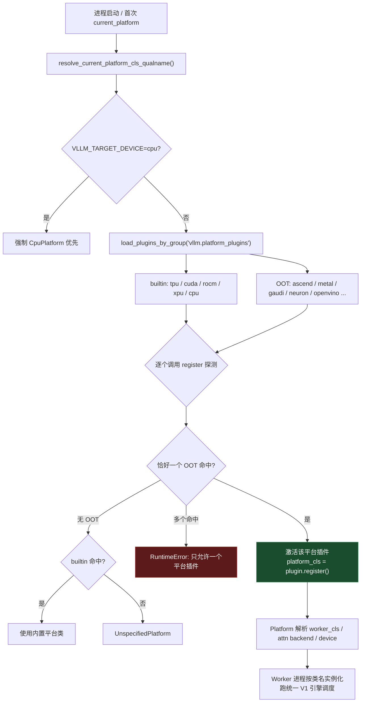
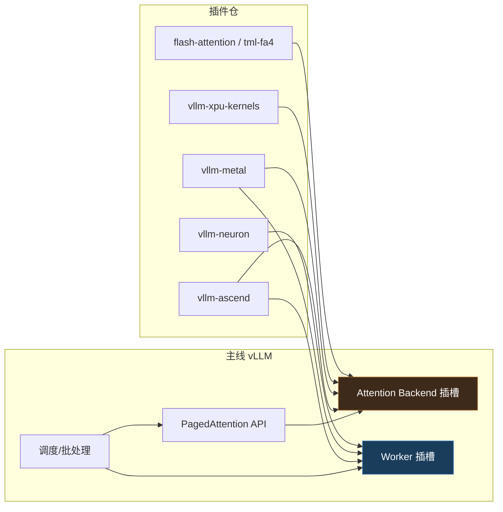

# vLLM 硬件后端插件体系 — Platform/worker 注册与七家后端

## TL;DR

vLLM 本体只内置 TPU / CUDA / ROCm / XPU / CPU 五个平台探测器;其余加速卡(昇腾 NPU、Apple Silicon、Intel Gaudi、AWS Trainium/Neuron、OpenVINO CPU/GPU 等)全部走 **out-of-tree 插件**:各自独立仓、独立发版,通过 Python packaging 的 **entry points** 把 `register()` 挂进 vLLM,探测到本家硬件后返回一个 **Platform 类**,再由 Platform 解析出 **worker_cls / attention backend / 量化路径**。

> **心法**:vLLM 的硬件抽象不是「一个庞大的 HAL 层」,而是「**平台探测 + 类名注入**」——插件只负责在进程启动时回答两件事:「这台机器是不是我的卡?」和「是的话用哪个 Worker/Platform 类?」。剩下的一切(调度、PagedAttention、OpenAI API)都复用主线,不重写。

| 后端 | 仓库 | 硬件 | 一句话 |
|---|---|---|---|
| **Ascend** | `vllm-ascend` | 华为昇腾 NPU | 生产级昇腾插件,平台+模型+连接器全注册,与本库 deepseek-infra 昇腾篇正交互补 |
| **Metal** | `vllm-metal` | Apple Silicon | MLX 主算力 + PyTorch 统一 lowering,面向 Mac 单机 |
| **Gaudi** | `vllm-gaudi` | Intel Gaudi HPU | Habana HPU 硬件插件 |
| **Neuron** | `vllm-neuron` | AWS Trainium/Inferentia | AWS 官方推荐的 Neuron 服务方案 |
| **TPU** | `tpu-inference` | Google TPU | TPU 支持拆仓独立演进(内核/运行时) |
| **XPU** | `vllm-xpu-kernels` | Intel GPU(XPU) | 只补 XPU 自定义 kernel,平台探测在主线内 |
| **OpenVINO** | `vllm-openvino` | x86 CPU(AVX2+)/Intel iGPU/dGPU | OpenVINO 后端,decoder-only 文本生成 |

---

## 1. 插件机制:entry points 两条通道

vLLM 用标准 Python packaging 的 **entry points** 做发现,主要分组见 `vllm/plugins/__init__.py`:

| entry point 组 | 作用 | 加载时机 |
|---|---|---|
| `vllm.platform_plugins` | **硬件平台探测**,返回 Platform 类全名 | 首次访问 `current_platform` 时 |
| `vllm.general_plugins` | 通用副作用注册(模型、连接器、量化、loader…) | 进程启动即加载(多进程各自一份) |
| `vllm.io_processor_plugins` | IO 处理器 | 仅 process0 |
| `vllm.stat_logger_plugins` | 统计日志 | 仅 async serve 的 process0 |
| `vllm.endpoint_plugins` | API Server 前端端点 | 仅 API server 进程 |

核心代码骨架(`vllm/plugins/__init__.py`):

```python
DEFAULT_PLUGINS_GROUP = "vllm.general_plugins"
PLATFORM_PLUGINS_GROUP = "vllm.platform_plugins"

def load_plugins_by_group(group: str) -> dict[str, Callable[[], Any]]:
    from importlib.metadata import entry_points
    discovered_plugins = entry_points(group=group)
    ...
    for plugin in discovered_plugins:
        if allowed_plugins is None or plugin.name in allowed_plugins:
            func = plugin.load()   # import 并拿到 register 可调用对象
            plugins[plugin.name] = func
    return plugins
```

插件侧声明(以 vllm-ascend 的 `setup.py` 为例,**五个 general 插件 + 一个 platform 插件**):

```python
entry_points={
    "vllm.platform_plugins": ["ascend = vllm_ascend:register"],
    "vllm.general_plugins": [
        "ascend_kv_connector = vllm_ascend:register_connector",
        "ascend_model_loader = vllm_ascend:register_model_loader",
        "ascend_service_profiling = vllm_ascend:register_service_profiling",
        "ascend_model = vllm_ascend:register_model",
    ],
},
```

vllm-metal 的 `pyproject.toml` 同构(还顺手补了 GGUF 层):

```toml
[project.entry-points."vllm.platform_plugins"]
metal = "vllm_metal:register"

[project.entry-points."vllm.general_plugins"]
gguf_metal = "vllm_metal.gguf.vllm_integration:register"
```

**约定**:platform 插件的 `register()` 是个**探测函数**——不是我的硬件就返回 `None`,是我的就返回 Platform 类的 **全限定类名字符串**(不是类对象,方便跨进程/懒加载)。

下图是 entry points 两条通道的分工:platform_plugins 换平台(探测 + 返回 Platform 类全名 + 解析 worker/attention),general_plugins 补能力(算子/格式/模型,平台仍是主线)。

<div class="archify-figure">
<iframe src="../../../diagrams/vm-hwp-entrypoints.workflow.html"
        style="width:100%;height:560px;border:1px solid rgba(0,0,0,.08);border-radius:14px"
        loading="eager" title="entry points 两条通道"></iframe>
</div>

---

## 2. 插件加载路径(mermaid)



关键约束(vllm/platforms/__init__.py):**out-of-tree 平台插件同时激活 ≥2 个直接报错**;builtin 同理。多卡异构不是设计目标,「一台机器一个加速卡族」。

下图是插件加载路径:进程启动先查 CPU 优先,再经 entry_points 发现插件,逐个 register 探测;恰一个命中才激活,多个命中直接 RuntimeError,无命中回落到 UnspecifiedPlatform。

<div class="archify-figure">
<iframe src="../../../diagrams/vm-hwp-load-path.workflow.html"
        style="width:100%;height:560px;border:1px solid rgba(0,0,0,.08);border-radius:14px"
        loading="eager" title="插件加载路径与单激活约束"></iframe>
</div>

---

## 3. 各后端定位详解

| 仓库 | 定位 | 注册面 | 计算栈 | 备注 |
|---|---|---|---|---|
| **vllm-ascend** | 昇腾 NPU 生产插件 | platform + 4×general(模型/连接器/loader/profiling) | torch_npu / CANN / Ascend C | 体量最大(1800+ py),有 A3/A5/310p 多 Dockerfile |
| **vllm-metal** | Apple Silicon Mac | platform + GGUF general | MLX + PyTorch 统一 lowering | 2026-08 用上 M5 NAX tensor 单元;TTFT 相比 v0.1 有 83× 级改进(README) |
| **vllm-gaudi** | Intel Gaudi HPU | platform 类 | Habana SynapseAI | 「vLLM × Gaudi」联合品牌仓 |
| **vllm-neuron** | AWS Trainium/Inferentia | platform + Neuron SDK | AWS Neuron SDK | Beta;推荐的 AWS LLM 服务路径 |
| **tpu-inference** | Google TPU | 平台探测在主线 builtin,本仓补 TPU 内核/运行时 | Pallas / TPU runtime | 文档挂在 docs.vllm.ai/projects/tpu |
| **vllm-xpu-kernels** | Intel GPU 自定义 kernel | 不注册 platform(主线有 xpu builtin) | SYCL/oneAPI kernels | 「补 kernel」而非「换平台」 |
| **vllm-openvino** | x86 CPU / Intel iGPU+dGPU | platform 类 | OpenVINO 2026.3+ | 无预编译 wheel,需源码安装;要求 AVX2+ |

**两类插件要分清**:
- **换平台**(platform_plugins):Ascend / Metal / Gaudi / Neuron / OpenVINO —— 接管 device、worker、attention;
- **补能力**(general_plugins 或独立 kernel 仓):XPU kernels、GGUF/bitsandbytes 量化插件、模型插件 —— 平台仍是主线的,只是多注册了算子/模型/格式。

---

## 4. 重点:vllm-ascend 与本库昇腾篇的分工

vllm-ascend 是**服务引擎侧**的昇腾适配;本库 deepseek-infra 的昇腾篇讲**算子/通信/训练侧**的适配原理。两者是同一条「NVIDIA → 昇腾」移植链的不同层:

| 层 | 本文/本仓 | 本库姊妹篇 |
|---|---|---|
| 引擎/服务 | vllm-ascend:Platform、Worker、KV connector、模型注册 | 本文 §4 |
| 算子与矩阵 | — | [`deepseek-infra/concepts/deepgemm-ascend.md`](../../deepseek-infra/concepts/deepgemm-ascend.md) |
| 集合通信 EP | — | [`deepseek-infra/concepts/deepep-ascend.md`](../../deepseek-infra/concepts/deepep-ascend.md) |
| 编程模型对照 | — | [`deepseek-infra/concepts/ascend-port-principles.md`](../../deepseek-infra/concepts/ascend-port-principles.md)(CUDA↔Ascend C/MAD/fractal/HCCL) |

vllm-ascend 的 `register()` 返回 Platform 类后,Worker 类还可按硬件画像分派(`vllm_ascend/platform.py`):

```python
# 伪代码摘自 platform.py 的 worker 选择逻辑
if parallel_config.worker_cls == "auto":
    if xlite_enabled:
        parallel_config.worker_cls = "vllm_ascend.xlite.xlite_worker.XliteWorker"
    else:
        parallel_config.worker_cls = hardware_profile.default_worker_cls
```

即 **worker_cls 不是写死一个字符串**,而是「硬件画像(310p / A3 / A5…) → 默认 Worker」的映射;这是比「一个 Platform 一个 Worker」更细的一层。

下图是 vllm-ascend 的 worker_cls 分派:worker_cls=auto 时先判 xlite,否则按硬件画像(310p/A3/A5)映射到默认 Worker,而不是写死一个字符串。

<div class="archify-figure">
<iframe src="../../../diagrams/vm-hwp-worker-dispatch.workflow.html"
        style="width:100%;height:560px;border:1px solid rgba(0,0,0,.08);border-radius:14px"
        loading="eager" title="worker_cls 硬件画像分派"></iframe>
</div>

---

## 5. 环境与启动示例(以 vllm-ascend 为例)

### 5.1 安装(容器 + 插件)

```bash
# 官方 Dockerfile 按代际分: a3 / a5 / 310p / openEuler 变体
docker pull quay.io/ascend/vllm-ascend:latest

# 或源码安装(会把 entry_points 写进环境)
git clone https://github.com/vllm-project/vllm-ascend.git
cd vllm-ascend
pip install -e .
# 验证插件被发现:
python -c "from importlib.metadata import entry_points; \
  print([e.name for e in entry_points(group='vllm.platform_plugins')])"
```

### 5.2 启动服务

```bash
export VLLM_USE_V1=1
# 可用 VLLM_PLUGINS 白名单只加载需要的插件
# export VLLM_PLUGINS=ascend

vllm serve Qwen/Qwen3-8B \
  --device npu \
  --tensor-parallel-size 2 \
  --additional-config '{"ascend_scheduler_config":{}}'   # 部署示意;ascend_scheduler_config 为 vllm-ascend 运行时解析配置项,以 vllm-ascend 最新 README/--help 为准
```

```yaml
# production-stack / k8s 场景下的资源约定(示意)
apiVersion: v1
kind: Pod
spec:
  containers:
    - name: vllm-ascend
      image: quay.io/ascend/vllm-ascend:latest
      resources:
        limits:
          huawei.com/Ascend910B: 2
      env:
        - name: VLLM_PLUGINS
          value: "ascend"
```

**排错三查**:
1. `entry_points(group='vllm.platform_plugins')` 里有没有你的插件名(装没装上);
2. 日志有没有 `Platform plugin xxx is activated`(探测有没有命中);
3. 是否两个 platform 插件同时激活(会直接 RuntimeError)。

---

## 6. 一张图看懂「谁负责什么」



下图回答「谁负责什么」：调度/批处理/PagedAttention API 复用主线，插件仓只接管 Worker 与 Attention Backend 两个插槽，不重写引擎。

<div class="archify-figure">
<iframe src="../../../diagrams/vm-hwp-responsibility.workflow.html"
        style="width:100%;height:560px;border:1px solid rgba(0,0,0,.08);border-radius:14px"
        loading="eager" title="主线 vs 插件仓谁负责什么"></iframe>
</div>

---

## 相关条目

- **引擎本体与 V1 架构**:[`vllm/index.md`](../index.md)
- **昇腾算子/通信适配原理**:[`deepseek-infra/concepts/ascend-port-principles.md`](../../deepseek-infra/concepts/ascend-port-principles.md)
- **量化与格式插件**(GGUF/bitsandbytes/compressed-tensors)见 [quantization/](../../quantization/index.md)
- **评测这些后端**:[`guidellm-bench.md`](guidellm-bench.md)

## 溯源

- 平台加载源码:`vllm/vllm/platforms/__init__.py` 的 `resolve_current_platform_cls_qualname()`(builtin 五探测器 + OOT 单激活约束);
- 插件组定义:`vllm/vllm/plugins/__init__.py`(五个 entry point 组);
- vllm-ascend 注册面:`setup.py` entry_points(1 platform + 4 general + 1 metric provider);
- 其余后端定位均取自各自 README 一手描述(2026-10 本地浅克隆快照);
- ⚠ 各仓本地为浅克隆,活跃度以快照日最后提交为准;star 数请以 GitHub 实时页面为准。
