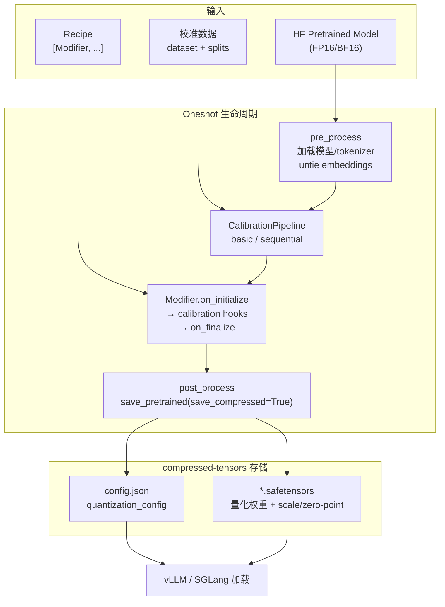
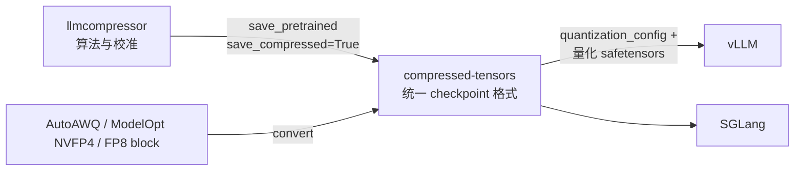

# LLM Compressor 压缩工具链

> **TL;DR**：LLM Compressor（`llmcompressor`）是面向 vLLM 部署的**离线模型压缩工具链**：用一份 `Recipe`（一组 Modifier）对 Hugging Face 模型做量化/稀疏/旋转等变换，再以 **compressed-tensors** 格式保存，交给 vLLM/SGLang 直接加载。它解决的是「怎么把 FP16 模型变成可部署的低精度 checkpoint」，不做训练、不做在线推理优化。理解它要抓住三件事：**Modifier = 算法原语、Recipe = 算法编排、Pipeline = 校准数据怎么流过模型**。

## 1. 它在工具链中的位置

LLM Compressor 属于「训练之后、推理之前」的中间层。与库内量化原理条目的关系是：[PTQ：GPTQ / AWQ / SmoothQuant](../../quantization/concepts/ptq-gptq-awq-smoothquant.md) 讲算法本身为什么有效；本条目讲**工程上怎么把它们串成可复现的压缩流水线**。

| 问题 | 谁负责 | 产物 |
|---|---|---|
| 模型预训练 / SFT / RL | Megatron、HF Trainer、slime/Vime 等 | FP16/BF16 checkpoint |
| **量化 / 稀疏 / 低秩变换** | **LLM Compressor** | compressed-tensors 格式模型 |
| 存储格式与反量化语义 | compressed-tensors | `config.json` + 量化后的 safetensors |
| 运行时 kernel 与调度 | vLLM / SGLang | 在线服务 |

设计上的几个硬约束（README 明确声明）：

- 算法输出必须能被 vLLM 直接加载 → 统一落到 compressed-tensors；
- 与 Hugging Face `AutoModelForCausalLM` 无缝集成 → 不要求改模型代码；
- 大模型压缩要能跑 → 提供 DDP、disk offload、sequential onloading。

## 2. 核心抽象：Modifier / Recipe / Pipeline

### 2.1 Modifier：算法原语

`Modifier` 是「对模型做一次状态改变」的算法单元。库内 `src/llmcompressor/modifiers/README.md` 把它们分成三类：

| 类别 | 代表 | 是否需要校准数据 | 作用 |
|---|---|---|---|
| 稀疏（pruning） | SparseGPT、WANDA、Magnitude、REAP | SparseGPT/WANDA 需要 | 引入非结构化或 2:4 结构化稀疏 |
| 量化（quantization） | QuantizationModifier、GPTQ、AutoRound | GPTQ 需要；RTN/FP8 动态可不需要 | 权重/激活量化 |
| 辅助变换（transform/helper） | SmoothQuant、Logarithmic Equalization、AWQ、SpinQuant、QuIP | 需要 | 先把分布「弄平」再量化，本身不输出低比特权重 |

关键点：**SmoothQuant/AWQ 属于 transform，不是量化本身**。它们要在量化 Modifier 之前执行，把激活离群值或敏感通道处理掉，再由 QuantizationModifier/GPTQ 落地低比特。

### 2.2 Recipe：算法编排

Recipe 就是一段声明式配置：可以是 Python 对象列表，也可以是 YAML/JSON。核心语义是**顺序执行**——前面的 Modifier 改变模型状态，后面的 Modifier 在新状态上继续：

```python
recipe = [
    AWQModifier(duo_scaling="both"),          # 第一步：AWQ 缩放变换
    QuantizationModifier(                     # 第二步：真正量化
        targets=["Linear"],
        scheme="FP8_BLOCK",
        ignore=["lm_head"],
    ),
]
```

（摘自 `examples/awq/fp8_block_llama_example.py`。注意是**列表有序**，不是「并行叠加」。）

### 2.3 Pipeline：校准数据怎么流

Pipeline 决定校准 batch 如何穿过模型、Modifier 在哪些 hook 点收激活统计。`src/llmcompressor/pipelines/` 下主要有：

- **basic**：整模型一次前向，适合不需要逐层 Hessian 的场景（FP8 RTN、SmoothQuant 的激活统计）；
- **sequential**：按子图/逐层串行压缩，主要给 GPTQ、SparseGPT 用——它们要为每层缓存 Hessian，一次装不下整模型时靠 sequential 降峰值显存；
- **data_free / independent**：无校准或层间独立的特殊路径。

选错 Pipeline 通常表现为显存爆掉或校准统计错误，而不是报错——这是最隐蔽的一类坑。

Pipeline 与算法的匹配关系：

| Pipeline | 数据流 | 典型 Modifier | 显存特征 |
|---|---|---|---|
| basic | 整模型前向一次/批 | QuantizationModifier(RTN/FP8)、SmoothQuant | 激活统计小，整模型驻留 |
| sequential | 按层/子图切开，逐段校准 | GPTQ、SparseGPT | 峰值≈单层 Hessian + 权重切片 |
| data_free | 不喂真实样本 | 纯权重量化、部分 transform | 最低 |
| independent | 层间独立处理 | 某些 per-layer 量化 | 低 |

对 GPTQ 的 Hessian 设一层权重 W ∈ R^{d_out×d_in}，校准激活 X ∈ R^{d_in×n}，则

```
H = 2 · X Xᵀ    （d_in×d_in）
```

每列量化误差按 `δ = (w_q − ŵ_q)/[H⁻¹]_qq · (H⁻¹)_:,q` 补偿到未量化列——这要求 H（或其 Cholesky）能装进显存，因此 sequential pipeline 通过「只保留当前工作集」把峰值压到单层级。这也是为什么 GPTQ recipe 换到 basic pipeline 会在中等模型上 OOM。

## 3. 压缩流水线全景



对应 `entrypoints/oneshot.py` 的三阶段生命周期：**Preprocessing**（模型与 tokenizer 初始化、embedding untie）→ **Model optimization**（Recipe 驱动的校准与压缩）→ **Postprocessing**（保存）。

## 4. 真实 Recipe 示例

### 4.1 GPTQ W4A16（weight-only）

来自 `examples/quantization_w4a16/llama3_example.py`：

```python
from compressed_tensors.offload import dispatch_model
from transformers import AutoModelForCausalLM, AutoTokenizer

from llmcompressor import oneshot
from llmcompressor.modifiers.gptq import GPTQModifier

model_id = "meta-llama/Meta-Llama-3-8B-Instruct"
model = AutoModelForCausalLM.from_pretrained(model_id)
tokenizer = AutoTokenizer.from_pretrained(model_id)

# 权重 4-bit、group size 由 scheme 隐含（W4A16 默认 G128），跳过 lm_head
recipe = GPTQModifier(targets="Linear", scheme="W4A16", ignore=["lm_head"])

oneshot(
    model=model,
    dataset="perfectblend",
    splits="train[:512]",
    recipe=recipe,
    max_seq_length=2048,
    num_calibration_samples=512,
)

# 保存为 compressed-tensors 格式
SAVE_DIR = model_id.rstrip("/").split("/")[-1] + "-W4A16-G128"
model.save_pretrained(SAVE_DIR, save_compressed=True)
tokenizer.save_pretrained(SAVE_DIR)
```

要点：GPTQ 需要**真实校准数据**（`dataset` + `splits` + `num_calibration_samples`），因为要算每层 Hessian；`ignore=["lm_head"]` 几乎是通用做法，输出头对量化最敏感。

### 4.2 FP8 动态量化（无需校准集语义）

来自 `examples/quantization_w8a8_fp8/llama3_example.py`：

```python
from llmcompressor import oneshot
from llmcompressor.modifiers.quantization import QuantizationModifier

recipe = QuantizationModifier(
    targets="Linear", scheme="FP8_DYNAMIC", ignore=["lm_head"]
)
oneshot(model=model, recipe=recipe)   # 无 dataset → 权重量化用 RTN
model.save_pretrained(SAVE_DIR)       # 默认 save_compressed
```

`FP8_DYNAMIC` 表示权重 per-channel FP8、激活 per-token 动态 FP8。权重 scale 直接从权重算（round-to-nearest），因此可以不给校准集；但若要做静态激活量化或 KV cache 量化，仍需要校准。

### 4.3 SmoothQuant → 量化的两段式

SmoothQuant 是 helper Modifier，必须排在量化之前：

```python
from llmcompressor.modifiers.smoothquant import SmoothQuantModifier
from llmcompressor.modifiers.quantization import QuantizationModifier

recipe = [
    SmoothQuantModifier(smoothing_strength=0.8),
    QuantizationModifier(targets="Linear", scheme="W8A8", ignore=["lm_head"]),
]
```

变换的数学语义（与库内 [PTQ 条目](../../quantization/concepts/ptq-gptq-awq-smoothquant.md) 同源）：对每个通道找缩放因子 s，使得

```
Y = (X · diag(s)^{-1}) · (diag(s) · W)  ≈  X̂ · Ŵ
```

激活除以 s、后继权重乘以 s，输出等价，但激活的离群通道被压平，后续 per-tensor/per-channel 量化误差显著下降。代价是权重分布被拉宽——所以 strength 不能无脑拉满。

### 4.4 GPTQ / AWQ / FP8 / 稀疏的选型对照

| Recipe 组合 | 典型 scheme | 校准需求 | 目标场景 |
|---|---|---|---|
| `GPTQModifier(scheme="W4A16")` | W4A16 G128 | 512+ 样本 | 显存受限、中低 batch |
| `AWQModifier + QuantizationModifier(FP8_*)` | W8A8 / FP8_BLOCK | 256+ 样本 | 高吞吐、有 FP8 kernel |
| `QuantizationModifier(FP8_DYNAMIC)` | FP8 动态 | 可无 | 快速试水、硬件 FP8 |
| `SmoothQuant + QuantizationModifier(W8A8)` | W8A8 | 需要 | 激活离群严重的模型 |
| `SparseGPT + GPTQ` | 稀疏+量化 | 需要 | 进一步砍权重体积/算量 |

## 5. 与 compressed-tensors 的关系

**LLM Compressor 是「怎么压」，compressed-tensors 是「压完怎么存」**。二者是上下游，不是可选替代：



compressed-tensors 在 safetensors 之上扩展了：

- **统一 quantization_config**：config_groups、ignore、scheme（bit 数、group size、对称性、per-channel/per-group）、KV cache 与 attention 量化；
- **非均匀方案**：不同层可以不同精度/不同算法（mixed precision）；
- **稀疏与 transform 元数据**：2:4 mask、旋转矩阵（Hadamard 等）可一并描述；
- **checkpoint 转换**：AutoAWQ、ModelOpt NVFP4、FP8 block 等格式可转进来；
- **offload 支持**：CPU/disk/分布式卸载，压缩大于显存的模型。

对初学者的实际含义：**看到 `quantization_config` 出现在 `config.json`，就说明这个模型是 compressed-tensors 语义**；vLLM 按这个字段分派 kernel，而不是按文件名猜。

保存时的典型调用形态：

```python
# 压缩语义由 compressed-tensors 的 save hook 实现
model.save_pretrained(SAVE_DIR, save_compressed=True)  # 写出量化权重 + quantization_config
tokenizer.save_pretrained(SAVE_DIR)
# 之后 vLLM：
#   vllm serve ./Meta-Llama-3-8B-Instruct-W4A16-G128
```

`save_compressed=True` 会把训练时挂在模块上的 `QuantizationScheme`（scale/zero-point/group size）折叠进 safetensors；若误存成未压缩 FP16，体积和加载行为都会不对。部分入口（如 FP8 示例）默认已压缩，显式传参更稳妥。

### 5.1 scheme 字符串速查

| scheme | 权重 | 激活 | 是否需校准 | 常见 kernel |
|---|---|---|---|---|
| `W4A16` | INT4 per-group | FP16 | 是（GPTQ） | GPTQ/Marlin |
| `W8A8` / `W8A8_INT8` | INT8 | INT8 | 是 | CUTLASS INT8 |
| `FP8_DYNAMIC` | FP8 per-channel | FP8 per-token 动态 | 否 | FP8 GEMM |
| `FP8_BLOCK` | FP8 block-wise | FP8 | 视算法 | Block FP8 |
| `NVFP4` / `MXFP4` | FP4 microscale | FP4/FP8 混合 | 视算法 | Blackwell FP4 |
| `W4A8_FP8` | INT4 | FP8 | 是 | 混合路径 |

**不要凭字符串猜精度**：`W4A16` 的 group size、对称性、zero point 由 scheme 默认值与 recipe 覆盖项共同决定，最终以 `quantization_config` 为准。

## 6. 常见坑

1. **Recipe 顺序写反**：`[QuantizationModifier, AWQModifier]` 会在已量化权重上再做缩放，结果既不是 AWQ 也不是干净的 RTN。Transform 永远在前。
2. **校准集分布不匹配**：GPTQ 的 Hessian、SmoothQuant 的通道 max 都来自校准数据。用短英文样本人为「标定」中文业务模型，量化后长上下文/代码能力会莫名掉点。
3. **`ignore` 漏层**：`lm_head`、embedding、MoE router、MTP 头对精度极敏感。README 中的生产 checkpoint（如 GLM-5.3 FP4）会显式保留 router/embedding/DSA indexer/output head 原精度。
4. **只看 checkpoint 体积**：W4A16 文件约 1/4，但服务显存还有激活、KV cache、workspace；kernel 不支持的 group size 会走慢路径，吞吐反而更差。
5. **Pipeline 与 Modifier 不匹配**：GPTQ/SparseGPT 走 sequential 才能压大模型；塞进 basic 容易 OOM 或统计错误。
6. **scheme 字符串写错/不被 kernel 支持**：`W4A16` 与 `W4A16_A16`、`FP8_DYNAMIC` 与 `FP8_BLOCK` 语义不同，部署前用 vLLM 实际加载验证，不要只 `save` 成功就交付。
7. **Distributed / offload 参数遗漏**：大模型只起单卡 `oneshot` 会在加载阶段 OOM；确认 `dispatch_model`、DDP 启动方式与 `disk_offloading` 配置和模型规模匹配。
8. **MoE 路由头被量化**：router 通常对量化极敏感；生产 recipe 多写 `ignore=["lm_head", "router", ..."]` 或分组到原精度 scheme。
9. **把 transform 当量化交付**：只跑 `AWQModifier` 不跑 `QuantizationModifier`，得到的仍是高精度权重 + 缩放因子，体积几乎不减。
10. **校准样本数与序列长度**：`num_calibration_samples` 太小 → Hessian/激活统计噪声；`max_seq_length` 远小于业务长度 → 长上下文激活分布未被标定。

## 7. 什么时候用它

- 需要为 vLLM 产出生产级量化 checkpoint（INT4/INT8/FP8/FP4/MXFP*）；
- 需要组合「变换 + 量化」或「稀疏 + 量化」的可复现 Recipe；
- 模型大到要 DDP + disk offloading 才能压得动；
- 希望研究 GPTQ/AWQ/SmoothQuant/SpinQuant 等算法但不想自己写校准循环。

不适用：需要 QAT/继续训练（那是训练框架的事）、需要在线自适应量化、目标引擎不是 vLLM/SGLang 且不认 compressed-tensors。

### 7.1 大模型压缩的工程路径

README 明确支持 DDP 与 disk offloading，`examples/` 下有对应目录：

| 目录 | 做法 | 何时用 |
|---|---|---|
| `big_models_with_sequential_onloading/` | 权重逐段上 GPU → 压 → 卸下 | 单机放不下整模型 |
| `disk_offloading/` | 权重常驻 CPU/磁盘，按需上卡 | 显存极紧 |
| `llama3_ddp_example.py` | 多卡 DDP 并行校准 | 多卡吞吐、加速 GPTQ |
| `quantizing_moe/` | MoE 专家层/路由差异化处理 | GLM、Qwen MoE、Kimi-K3 等 |

生产 checkpoint（README「Model highlights」）反复出现同一模式：**MoE 专家层压到 FP4/FP8，router、embedding、output head、MTP 头保留原精度**。这是精度与体积的经验平衡，不是算法硬性要求。

### 7.2 与量化原理条目的分工

```
[PTQ：GPTQ / AWQ / SmoothQuant]  →  为什么这样量化（Hessian、缩放保护、离群迁移）
[LLM Compressor 压缩工具链]      →  怎么写 recipe、怎么跑校准、怎么存、怎么给 vLLM
[vLLM GPTQ / AWQ / FP8]          →  推理侧 kernel 与支持矩阵
```

三条一起读，才能从算法推到可上线 checkpoint。

## 相关条目

- [PTQ：GPTQ / AWQ / SmoothQuant](../../quantization/concepts/ptq-gptq-awq-smoothquant.md)（算法原理与误差补偿）
- [KV Cache 量化](../../quantization/concepts/kv-cache-quantization.md)（LLM Compressor 也支持 KV/attention 量化 recipe）
- [SpQR：稀疏+量化混合表示](../../quantization/concepts/spqr-sparse-quantized.md)
- [vLLM GPTQ / AWQ / FP8](../concepts/quantization-gptq-awq-fp8.md)（部署侧 kernel 与支持矩阵）

## 溯源

- 主源：vllm-project/llm-compressor 仓库 README、`src/llmcompressor/modifiers/README.md`、`src/llmcompressor/recipe/`、`src/llmcompressor/pipelines/`、`src/llmcompressor/entrypoints/oneshot.py`、`examples/quantization_w4a16/llama3_example.py`、`examples/quantization_w8a8_fp8/llama3_example.py`、`examples/awq/fp8_block_llama_example.py`。
- 交叉源：vllm-project/compressed-tensors README（统一格式、转换与 offload 能力）。
