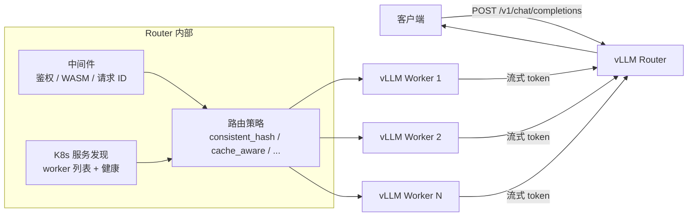
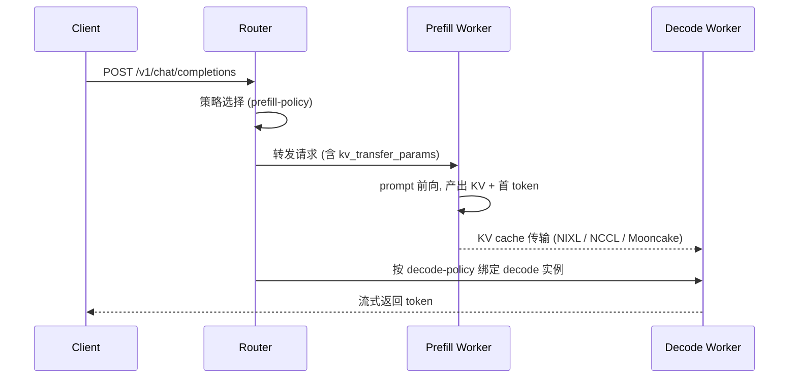
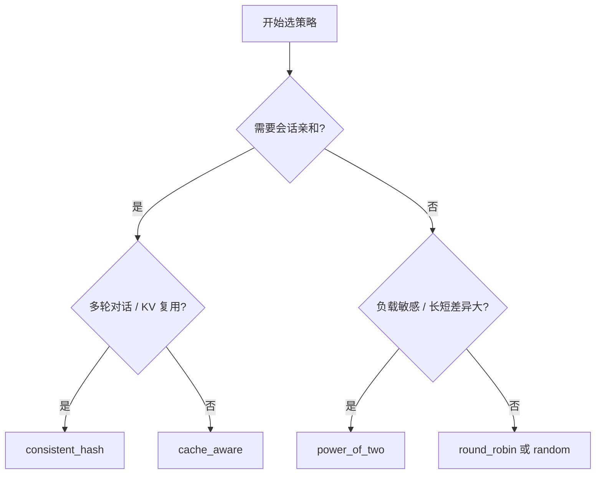

# vLLM Router:高性能请求路由与负载均衡

## TL;DR

vLLM Router 是面向大规模 vLLM 部署的**轻量高性能请求转发层**(Rust 实现,另有 `vllm-router` Python 包)。它解决的核心问题很简单:**多份 vLLM 副本摆在那,一个请求该发给谁**。答案不是轮询就完事——LLM 负载有「会话亲和」「前缀缓存命中」「prefill/decode 异构」这些通用网关看不见的结构;Router 用一组针对性策略把这些结构吃掉。

> **心法**:通用负载均衡(nginx/Envoy round-robin)把请求当无状态短连接;LLM 请求带着**前缀、会话、KV 所有权**。路由选错,等于亲手把 prefix cache 打冷、把多轮对话的 KV 扔掉。Router 的价值在于「让请求去它已经有缓存/有状态的地方」。

---

## 1. 为什么需要专门的 Router

| 维度 | 通用 LB | vLLM Router |
|---|---|---|
| **路由依据** | 连接/权重 | 会话 ID、前缀树、实时负载、KV 命中 |
| **会话亲和** | IP hash 粗粒度 | `X-Session-ID` 等 11 级 hash key |
| **前缀缓存** | 无感知 | `cache_aware` 维护近似 radix tree |
| **PD 分离** | 不理解 | prefill/decode 分池 + connector 感知 |
| **服务发现** | 静态配置/Consul | K8s watcher,自动增删 worker |
| **故障处理** | 被动健康检查 | 熔断 + 重试 + 指标 |
| **实现** | 通用 | Rust,异步流式,面向推理 |

核心能力(README):

- Load Balancing:cache-aware / power-of-two / consistent-hash / random / round-robin
- Prefill-Decode Disaggregation:专用路由
- Service Discovery:Kubernetes 原生 worker 管理与健康监控
- Enterprise:熔断、重试、Prometheus 指标
- gRPC workers:对接 vLLM Rust Inference workers

---

## 2. 请求路径



PD 分离模式下,请求会先落到 prefill 池、再由 decode 池接管输出:



PD 路由的原理、传输层与监控口径见库内 [PD 分离清单](../practices/pd-disaggregation.md)。

---

## 3. 负载均衡算法

`docs/load_balancing/README.md` 的总表:

| Policy | 最适合 | 会话亲和 | 负载感知 |
|---|---|---|---|
| `round_robin` | 通用、均匀分发 | 否 | 否 |
| `random` | 简单部署 | 否 | 否 |
| `consistent_hash` | 多轮对话、KV 复用 | 是 | 否 |
| `power_of_two` | 负载敏感 | 否 | 是 |
| `cache_aware` | 前缀缓存优化 | 是(缓存驱动) | 是 |

### 3.1 consistent_hash:会话粘滞

**做什么**:同一 session/user 的请求始终打到同一 worker,保住该 worker 上的 KV。

**Hash key 优先级**(高 → 低,共 11 级):

| 优先级 | 来源 | 字段 |
|---|---|---|
| 1 | HTTP Header | `X-Session-ID` |
| 2 | HTTP Header | `X-User-ID` |
| 3 | HTTP Header | `X-Tenant-ID` |
| 4–6 | HTTP Header | `X-Request-ID` / `X-Correlation-ID` / `X-Trace-ID` |
| 7–10 | Request Body | `session_params.session_id` / `user` / `session_id` / `user_id` |
| 11 | Fallback | 整个 request body 的 hash |

```bash
# 推荐用 Header(免 JSON 解析,兼容 Nginx/Envoy/Ingress)
curl -X POST http://router:8000/v1/chat/completions \
  -H "X-Session-ID: conversation-12345" \
  -H "Content-Type: application/json" \
  -d '{"model": "llama-3", "messages": [{"role": "user", "content": "Hello!"}]}'
```

行为细节:目标 worker 不健康时回退到第一个健康 worker;**每 worker 160 个虚拟节点**;支持 DP-aware URL(如 `http://worker:8000@0`)。

### 3.2 cache_aware:前缀命中优先

**做什么**:为每个 worker 维护近似 radix tree(请求前缀树),把「和谁前缀重合最多」的请求发给谁——直接提高 vLLM prefix cache 命中率。

```bash
vllm-router --policy cache_aware \
  --cache-threshold 0.5 \
  --balance-abs-threshold 32 \
  --balance-rel-threshold 1.1 \
  --worker-urls http://worker1:8000 http://worker2:8000
```

| 参数 | 默认 | 含义 |
|---|---|---|
| `cache_threshold` | 0.5 | 前缀匹配率超过此值才走缓存路由 |
| `balance_abs_threshold` | 32 | 负载差绝对阈值 |
| `balance_rel_threshold` | 1.1 | 负载比相对阈值 |
| `eviction_interval_secs` | 30 | 缓存树淘汰周期 |
| `max_tree_size` | 10000 | 每 worker 树节点上限 |

**两种模式**:

1. **均衡模式**:找前缀匹配最高的 worker;匹配率 > 阈值则粘上去,否则发给树最小(缓存最空)的 worker;
2. **失衡模式**:负载偏斜时改发队列最短的 worker,但仍更新树。

### 3.3 power_of_two:两随机选更空

随机抽两个健康 worker,选 pending 更少的那个——**O(1) 防热点**,不需要全局负载表。要求至少 2 个 worker。

### 3.4 round_robin / random

无状态、无亲和。压测与纯单轮场景够用;多轮对话用它们等于主动放弃 KV 复用。

### 3.5 策略选择决策树



| 场景 | 推荐 |
|---|---|
| 聊天应用(有会话历史) | `consistent_hash` |
| 批式推理(无状态) | `round_robin` |
| 请求复杂度差异大 | `power_of_two` |
| 重复 system prompt / few-shot | `cache_aware` |
| 开发调试 | `random` |

---

## 4. PD 分离路由

### 4.1 三种 connector 形态

```bash
# 1) NIXL connector:显式列出 prefill / decode URL
cargo run --release -- \
  --policy consistent_hash \
  --vllm-pd-disaggregation \
  --prefill http://127.0.0.1:8081 \
  --prefill http://127.0.0.1:8082 \
  --decode http://127.0.0.1:8083 \
  --decode http://127.0.0.1:8084 \
  --host 127.0.0.1 --port 8090

# 2) NCCL connector:ZMQ 服务发现
cargo run --release -- \
  --policy consistent_hash \
  --vllm-pd-disaggregation \
  --vllm-discovery-address 0.0.0.0:30001 \
  --prefill-policy consistent_hash \
  --decode-policy consistent_hash

# 3) Mooncake connector:查询 bootstrap server,注入 kv_transfer_params
cargo run --release -- \
  --policy consistent_hash \
  --vllm-pd-disaggregation \
  --kv-connector mooncake \
  --prefill http://127.0.0.1:8081 \
  --decode http://127.0.0.1:8083
```

Mooncake 模式下,Router 启动时会查每个 prefill 节点的 bootstrap server,拿到 **engine_id per DP rank**,并在请求里注入 `transfer_id / remote_bootstrap_addr / remote_engine_id` 到 `kv_transfer_params`,完成 P/D 协同。

### 4.2 双侧策略可独立配置

```bash
vllm-router \
  --mode pd \
  --prefill-policy consistent_hash \
  --decode-policy round_robin \
  --prefill-workers http://prefill1:8000,http://prefill2:8000 \
  --decode-workers http://decode1:8000,http://decode2:8000
```

- **Prefill 侧**:`consistent_hash` 换缓存局部性(共享 system prompt 落同一实例);
- **Decode 侧**:`round_robin` / `power_of_two` 做负载摊平(生成长短不一)。

---

## 5. Kubernetes 服务发现

`src/service_discovery.rs` 用 kube-rs watcher 监听 Pod,自动增删 worker:

```bash
vllm-router \
  --service-discovery \
  --selector app=vllm-worker role=inference \
  --service-discovery-namespace default
```

| 参数 | 默认 | 说明 |
|---|---|---|
| `--service-discovery` | 关 | 开启 K8s 发现 |
| `--service-discovery-port` | 8000 | worker 端口 |
| `--service-discovery-namespace` | 全部 | 监听的 namespace |
| `--selector` | — | `key1=value1 key2=value2` 标签选择器 |

PD 模式下有独立的 `prefill_selector` / `decode_selector`;Mooncake 还支持 `vllm.ai/bootstrap-port` 注解读取 bootstrap 端口。`check_interval` 默认 60s,配合健康检查做故障容忍。

---

## 6. 启动与配置示例

### 6.1 基础启动

```bash
# Rust 构建
cargo build --release

# 或 Python 包
pip install vllm-router

# 标准 DP 路由(每 worker URL 8 个 DP 副本)
./target/release/vllm-router \
  --worker-urls http://worker1:8000 http://worker2:8000 \
  --policy consistent_hash \
  --intra-node-data-parallel-size 8
```

### 6.2 企业级开关

```bash
vllm-router \
  --worker-urls http://localhost:8000 http://localhost:8001 \
  --policy cache_aware \
  # 鉴权:Bearer token 校验
  --api-key-validation-urls https://auth.example.com/validate \
  # 指标
  --prometheus-host 0.0.0.0 --prometheus-port 9000 \
  # 重试(默认开,指数退避+抖动)
  --retry-max-retries 3 \
  --retry-initial-backoff-ms 100 \
  --retry-max-backoff-ms 10000 \
  # 熔断
  --cb-failure-threshold 5 \
  --cb-success-threshold 2 \
  --cb-timeout-duration-secs 30 \
  --cb-window-duration-secs 60
```

**熔断状态机**:`Closed` → 连续失败 N 次 → `Open` → 超时后 `HalfOpen` → 连续成功 M 次 → `Closed`。重试覆盖 408/429/500/502/503/504。

Prometheus 默认在 `127.0.0.1:29000` 暴露。

---

## 7. 常见坑

1. **多轮对话用 round_robin**:每一轮都换 worker,前缀缓存全冷,TTFT 变差——这是最常见的错配。
2. **Header 与 body 的 session 字段混用**:`X-Session-ID` 优先级最高,客户端又在 body 里塞了不同 `user`,会得到「看起来粘了又没粘」的诡异分布。
3. **cache_aware 阈值乱调**:`cache_threshold` 过高几乎从不走缓存路由,过低则忽略负载均衡;先按 `0.5` 默认跑,看命中率再动。
4. **PD 模式漏 `--vllm-pd-disaggregation` 或 connector 不匹配**:NIXL/NCCL/Mooncake 三者的参数集不同,配错启动就报或运行时 `kv_transfer_params` 缺失。
5. **服务发现 selector 太宽**:把非 vLLM Pod 也收进 worker 列表,健康检查打到无关端口;用明确的 `role=inference` 之类标签。
6. **单 Router 成为单点**:Router 本身要多副本 + Service;consistent_hash 的虚拟节点环在副本间需一致(同一配置启动)。
7. **忽略 body hash fallback**:客户端什么会话字段都不给时,退到整 body hash——请求体里若有随机字段(时间戳、nonce),亲和完全失效。
8. **把 Router 当缓存**:Router 只维护路由视图(前缀树/负载),真正 KV 在 vLLM 引擎或 LMCache;Router 重启丢的是路由状态,不是权重。

---

## 8. 溯源

- **源码基线**:`github.com/vllm-project/router`(Rust 二进制 + `vllm-router` Python 包);负载均衡策略以 `docs/load_balancing/README.md` 与 `src/policies/` 为准,服务发现以 `src/service_discovery.rs` 为准。
- **上游演进**:Production Stack roadmap 明确提到「更高性能路由(非 Python)、KV-cache-aware 算法」,Router 项目即该方向的落地形态(见 [Production Stack](production-stack.md))。
- **PD 路由**:支持 NIXL / NCCL(ZMQ 发现)/ Mooncake(`--kv-connector mooncake`)三类 connector,字段随 vLLM 与 connector 版本变化,以当前 main 为准。
- **文档入口**:https://deepwiki.com/vllm-project/router 与仓库内 `docs/`。

## 相关条目(库内互链)

- **[PD 分离清单](../practices/pd-disaggregation.md)**:Router 的 PD 模式(prefill/decode 分池、`kv_transfer_params`、双侧指标)是该清单「配对路由 / 传输层监控」的具体实现层。
- **[vLLM Production Stack 参考部署](production-stack.md)**:Router 在 Helm 栈中的集成形态(`routerSpec`、`lmcache/lmstack-router` 镜像)。
- **[AIBrix:K8s 原生 GenAI 推理基础设施](aibrix.md)**:Gateway 侧有更宽的算法谱系(least-kv-cache、prefix-cache、vtc 等)与限流/鉴权;Router 更轻、可嵌入。
- **[连续批处理](../concepts/continuous-batching.md)** / **[PagedAttention](../concepts/paged-attention.md)**:路由要「送对地方」的最终目的,是让这些引擎内机制(前缀复用、KV block 复用)真正吃到命中。
