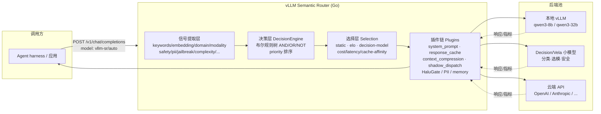
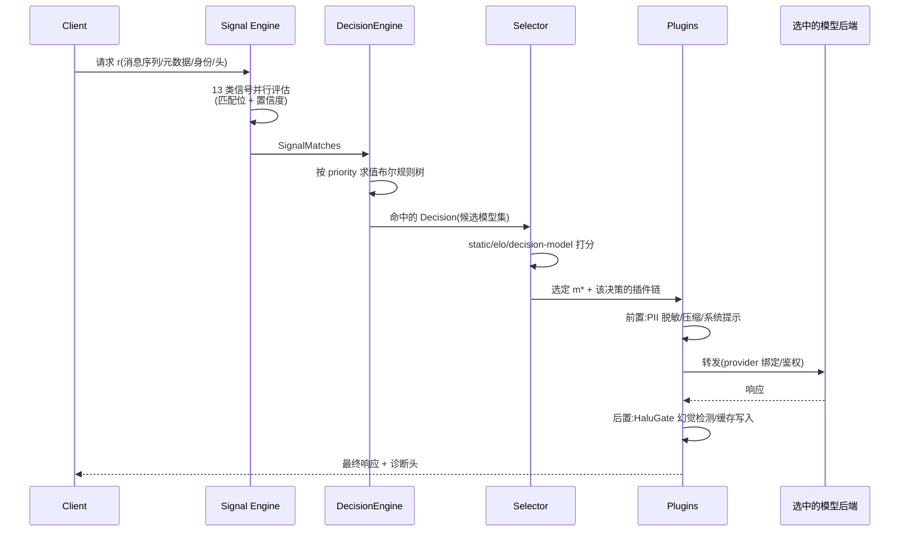

# vLLM Semantic Router 可编程决策层

## TL;DR

**Semantic Router(SR)是模型与算力之上的「可编程决策层」**:在请求抵达具体模型之前,先做**信号提取(分类/打分)→ 布尔决策(路由策略)→ 插件执行(安全/成本/缓存/压缩)**,把「这条请求该由谁答、在哪答、怎么答」从硬编码 if-else 变成**声明式配置**。它用一套三层架构(信号层 / 决策层 / 插件层)覆盖多云、隐私合规、成本优先等完全不同的部署场景——**同一架构,不同配置**。实现是 **Go** 写的路由服务,可作独立网关/Envoy extproc 旁路;模型侧用 **Decision / Vela 系列小模型**做语义分类、选模、安全检测,大模型(含本地 vLLM 与云端 API)只是它调度的后端池。

> **先记住一个反转直觉**:多模型时代的瓶颈不只是「模型不够强」,而是**「哪条请求用哪个模型」这件事本身是一个系统问题**。SR 把它做成可组合的信号-决策管道,而不是每个应用自己写路由 if。

---

## 1. 为什么需要「模型与算力的决策层」

### 1.1 碎片化的现实

| 维度 | 今天碎片化的样子 | 有 SR 之后 |
|---|---|---|
| **模型** | 不同模型各有所长(代码/长文/多模态/推理) | 按请求**选择或组合**模型 |
| **算力** | 硬件速度与容量各异(CPU 分类器 / GPU 生成) | 在配置的后端池里选 |
| **位置** | 边缘、私有、云混布 | 按合规要求**把请求留在批准的位置** |
| **偏好** | 不同任务优先级不同(质量/延迟/成本) | 按任务设定优先级 |

Agent harness(agent 循环、工具、任务状态)留在调用方;SR 只做**一次调用选谁**——API 形如 `vllm-sr/auto`,背后是一次决策。

### 1.2 朴素做法为什么不够

- **静态指定**:所有请求走一个大模型——贵、慢,简单请求浪费;
- **单维路由**(只看难度/只看长度):忽略安全、隐私、模态、用户等级等**正交信号**;
- **每个业务自己写 if-else**:策略散落代码,无法审计、无法 A/B、无法热更。

SR 的论点:生产路由需要**同时推理多个正交信号维度**,且不同路由结果要挂**不同的策略链**(安全阈值、缓存、提示增强、模型池)——并且这些策略必须**可组合**,才能不改架构就换场景(paper `sections/architecture.tex`)。

**类比**:SR 像医院的**分诊台**——病人(请求)先量体温、问症状、查过敏史(信号),分诊规则决定去门诊/急诊/隔离(决策),并附带皮试、禁食等前置处理(插件);医生(模型)只管看病,不管分诊。

---

## 2. 三层架构:信号 → 决策 → 插件

### 2.1 问题形式化(paper)

给定模型池 `M`(各带能力、成本、延迟画像)与 provider 绑定 `B`(本地 vLLM / OpenAI / Anthropic / Azure / Bedrock…),对请求 `r`:

1. 选模型 `m*` 最大化质量,满足成本与延迟约束;
2. 在调用前后施加安全/隐私变换 `T(r)`;
3. 经配置的 provider/cluster 绑定转发(鉴权、负载均衡归基础设施)。

### 2.2 架构图(mermaid)



### 2.3 决策流(一次请求)



---

## 3. 信号层:十三类异构信号

信号规则 `ρ = (类型 τ, 规则名 n, 评估函数 f)`,f 输出 `(匹配位, 置信度∈[0,1])`。`pkg/decision/engine.go` 的 `SignalMatches` 直接列出了信号家族:

| 类别 | 信号类型(节选) | 例子 |
|---|---|---|
| **启发式(亚毫秒)** | keywords(BM25/ngram/fuzzy)、language、structure、metadata | `code_keywords`、`urgent_keywords`、`fuzzy_sensitive_keywords` |
| **语义学习型** | embeddings(原型打分)、domain、complexity、modality、preference | `technical_support`、`code_complexity:hard` |
| **安全合规** | safety、pii、jailbreak、authz、fact-check | 信用卡号、越狱置信度、`premium_tier` |
| **会话/记忆** | conversation、reask、user-feedback、KB、event、action | 多轮不满信号、检索知识库绑定 |
| **模型侧** | classifier、decision-model answers、input-modality、projection | Decision 模型的 `rule:choice` 答案 |

配置示意(`config/config.yaml` `routing.signals`):

```yaml
routing:
  strategy: priority
  signals:
    keywords:
      - name: code_keywords
        operator: OR
        method: bm25
        keywords: ["code", "function", "debug", "algorithm", "refactor"]
        bm25_threshold: 0.1
      - name: fuzzy_sensitive_keywords
        operator: OR
        method: fuzzy
        keywords: ["social security", "credit card", "password", "api key"]
        fuzzy_threshold: 82
    embeddings:
      - name: technical_support
        threshold: 0.75
        aggregation_method: max
        candidates:
          - how to configure the system
          - installation guide
          - troubleshooting steps
```

**心法**:信号层只回答「**这条请求命中了哪些事实**」,不做选择;把「事实」与「策略」分开,是可组合性的关键。

---

## 4. 决策层:布尔规则树 + 优先级

### 4.1 Decision 模型(paper `sections/decision_engine.tex`)

一个决策 `d = (名字, 布尔公式 φ, 候选模型集, 插件配置, 优先级)`。规则节点是**表达式树**:

- **叶子**:引用某类信号的某条规则名;
- **复合**:`and` / `or` / `not`(not 严格一元)。

评价按结构递归——叶子查 SignalMatches,`and/or/not` 走对应逻辑。Shannon 1938 的结论被直接借用:{∧,∨,¬} **功能完备**,任意可由信号表达的路由策略都能合成,无需改信号层或执行层。深度 1 的扁平 AND/OR 仍是简单策略的推荐形态;嵌套可表达 `nor`/`nand`/`xor`,YAML 缩进即逻辑嵌套,可读可审计。

### 4.2 Go 实现形状

```go
// 文件: src/semantic-router/pkg/decision/engine.go (节选)
type DecisionEngine struct {
    keywordRules   []config.KeywordRule
    embeddingRules []config.EmbeddingRule
    categories     []config.Category
    decisions      []config.Decision
    strategy       config.RoutingStrategy   // 默认 priority
    routingScope   config.RecipeName
}

// SignalMatches: 13+ 族匹配名 + SignalConfidences("embedding:ai" → 0.88)
```

多决策按 **priority 有序求值**解决冲突——先命中的高优先级决策决定路由,天然支持「先安全拦截、再业务路由、最后兜底」的组织方式。

### 4.3 配置示例(决策 + 选择 + 插件)

```yaml
# 文件: config/config.yaml (节选,结构对齐)
decisions:
  - name: static_business_route
    priority: 200
    rules:
      operator: AND
      conditions:
        - type: domain
          name: business
    modelRefs:
      - model: qwen3-8b
        use_reasoning: false
    algorithm:
      type: static            # 也支持 elo / decision-model 等
    plugins:
      - type: shadow_dispatch # 小流量影子模型,不影响主响应
        configuration: { enabled: true, model: qwen3-32b, sample_rate: 0.05 }
      - type: system_prompt
        configuration: { enabled: true, mode: insert, system_prompt: "You are a senior business consultant..." }
      - type: response_cache
        configuration: { enabled: true, mode: exact, scope: user, ttl_seconds: 7200 }
      - type: context_compression
        configuration: { enabled: true, mode: auto, budget: { trigger_tokens: auto } }
```

---

## 5. Decision / Vela 系列模型:把「选谁」也变成可服务的小模型

SR 自带一整条**决策/分类小模型**产品线,可由内置 `model_runtime` 在私有 Unix socket 上拉起(`config/config.yaml` `model_catalog.deployments`):

| 系列 | 代表 artifact | 角色 |
|---|---|---|
| **Decision 2.0** | `vllm-sr/Decision-2.0-Kai-0.6B`、`Decision-2.0-Vega-27B` | 对候选集做 **Choice 题**的选模/决策(`pkg/selection/decision_model.go`:返回 `Choice` + `Probabilities` + `Confidence`) |
| **Vela 2.0 / 1.0 Encoder** | `Vela-2.0-0.3B`、`Vela-1.0-Encoder-307M-Hazard`、`...-Reranker`、`...-Embedding` | 嵌入、内容风险、重排;HF 上 Decision 2.0 曾登 Trending #1 |
| **HalutGate / LettuceDetect** | — | 三段幻觉检测 / 生成式幻觉检测(可作 vLLM endpoint) |

选模接口(Go):

```go
// 文件: src/semantic-router/pkg/selection/decision_model.go (节选)
type DecisionModelAnswer struct {
    Choice        string
    Probabilities map[string]float64
    Confidence    float64
}
// DecisionModelSelector: 概率即候选打分;失败则走 Router 的 selection fallback
```

配置上,Decision 模型就是一个 `provider: model_runtime` 的 deployment,可 replicas、可远程 endpoint:

```yaml
model_catalog:
  deployments:
    decision-kai:
      provider: model_runtime
      artifact: vllm-sr/Decision-2.0-Kai-0.6B
      device: auto
      profile: exact
    content-risk:
      provider: model_runtime
      artifact: vllm-sr/Vela-1.0-Encoder-307M-Hazard
      device: cpu
```

**类比**:如果说大模型是「专家」,Decision/Vela 就是**前台接待与分诊护士**——便宜、快、专职判断「这事归谁管」;用 27B 的 Decision-Vega 做复杂选模,用 0.3–0.6B 做默认分类,分层部署成本才可控。

---

## 6. 旁路/插件位置:它站在哪里

SR 作为**可编程决策层**,部署形态灵活:

| 形态 | 位置 | 说明 |
|---|---|---|
| **独立网关** | 应用前挂一个 HTTP 端点 | 监听 8899 等,`model: vllm-sr/auto` 即可路由;standalone 可限制允许的 model 名 |
| **Envoy extproc** | 旁路(sidecar)进程 | `pkg/extproc/` 实现外部处理:改写请求/响应头、注入 provider 鉴权、记录诊断(`XSR-Protocol-Warnings` 等) |
| **Kubernetes** | Ingress/网关层 | `pkg/k8s/`、deploy/ 清单;端点成员与 LB 仍归 Envoy/K8s |
| **CLI 管理** | `vllm-sr` CLI | 安装、配置校验、`vllm-srun serve` 拉起 worker、playground |

监听器配置(`config/config.yaml`):可 TLS、可 `api_keys`、可 `identity.trust_headers` 信任上游代理注入的客户端身份——**安全边界写在配置里**。

**注意**:SR **不接管 agent 循环**——工具调用、任务状态仍在 harness;它只在「一次推理调用」的粒度上决策。MCP、session tools 等扩展(`pkg/mcp`、`pkg/sessiontools`)是插件生态,不是核心路径。

---

## 7. 与 vLLM 多模型部署、production-stack 的关系

- **本地多模型**:SR 的 `providers.models` + `backend_refs` 直接指向多份 vLLM 实例(权重、lb_policy、重试、熔断、健康检查都在配置里),并带 `pricing`(prompt/cached/completion 每 1M 价格)支撑**成本感知路由**(`cost_aware_routing: true`)。
- **多模态模型池**:`routing.modelCards` 标注 `modality: ar | omni | diffusion` 与输入输出模态,SR 可把图像类请求路由到 omni/diffusion 后端——与 vLLM-Omni 这类全模态 serving 是**上下游**关系(见 [`vllm-omni.md`](vllm-omni.md))。
- **production-stack**:官方 News 明确 **2025-10 与 vLLM Production Stack 团队协作**——production-stack 管集群部署/负载均衡/自动扩缩,SR 管**语义层选模与策略**;两者叠加即「算力编排 + 智能决策」。
- **训练闭环**:`src/training/` 含 model_classifier / model_selection / kv_mapper 等,可微调分类器、训练选模器、导出数据集——路由策略可以**数据驱动迭代**,而不是永远手写规则。

**一句话**:production-stack 解决「**怎么把模型跑起来、跑稳**」;Semantic Router 解决「**每条请求该跑哪个、怎么跑**」。

### 相关条目

- [`production-stack.md`](production-stack.md) — 集群部署/Helm/LMCache/监控,SR 的**算力侧底座**;两者协作是官方明确路线。
- [`router.md`](router.md) — vLLM Router 做**负载均衡/缓存亲和/PD 分流**(怎么把请求摊到实例);SR 做**语义选模/安全/成本**(该由谁答)。一个偏 L4/L7 流量,一个偏策略决策,可串联。
- [`aibrix.md`](aibrix.md) — K8s 原生 GenAI 基础设施(自动扩缩、gateway 插件、LoRA adapter);与 SR 同属「推理平台层」,AIBrix 更偏编排与弹性。
- [`vllm-omni.md`](vllm-omni.md) — 全模态后端池的 serving 运行时;SR 的 `modality` 信号与 modelCards 可把请求路由到 omni/diffusion 模型。
- [`../concepts/api-server-openai-compat.md`](../concepts/api-server-openai-compat.md) — SR 对外保持 OpenAI 兼容契约,便于 agent harness 无感接入。

---

## 8. 常见坑(checklist)

1. **信号 ≠ 决策**:别在信号层写策略。信号只陈述事实(`code_keywords` 命中);路由意图写进 `decisions` 的布尔树——混在一起会失去可组合性与可审计性。
2. **优先级是冲突解决的唯一机制**:多条决策同时命中时,靠 `priority` 数值顺序(先命中先赢)。写规则前先想清楚「安全拦截必须优先于业务路由」这类偏序。
3. **置信度阈值要按信号类型调**:embedding 的 `threshold: 0.75` 与 fuzzy 的 `82` 量纲完全不同;用 `SignalConfidences` 观测实际分数,不要抄默认值。
4. **Decision 模型会失败,要有 fallback**:`DecisionModelSelector` 明确「任何失败走 selection fallback」——生产上不要假设决策模型永远在线。
5. **插件有成本**:`response_cache` 的 semantic 模式、`context_compression`、`shadow_dispatch` 都会加延迟/带宽;`shadow_dispatch` 用 `sample_rate` 控制,且主响应不等待影子。
6. **身份与鉴权在配置里**:standalone 监听器默认拒绝未列出的 model;`trust_headers` 打开前确认上游确实在做认证——否则等于信任伪造头。
7. **观测先行**:SR 带 metrics/observability 包与诊断头;上生产前先看信号命中分布与决策分布,再调规则——盲调布尔树极易过拟合到样本。

---

## 9. 溯源

- **README(定位、Decision/Vela 新闻、production-stack 协作)**: https://github.com/vllm-project/semantic-router (仓库根 README.md)
- **Paper 章节(三层架构、信号模型、Decision 布尔树、DSL)**: `paper/sections/{abstract,architecture,signal_engine,decision_engine}.tex`
- **决策引擎实现**: `src/semantic-router/pkg/decision/engine.go`;选模 `src/semantic-router/pkg/selection/decision_model.go`
- **extproc 旁路**: `src/semantic-router/pkg/extproc/`
- **示例配置**: `config/config.yaml`(listeners / providers / routing.signals / decisions / model_catalog)
- **公开论文**: arXiv:2510.08731(*When to Reason: Semantic Router for vLLM*)、arXiv:2510.26835(*Category-Aware Semantic Caching*);Vision paper / White paper 见 https://vllm-sr.ai/vision-paper 、https://vllm-sr.ai/white-paper/
- **Decision 2.0 / Vela 2.0**: https://huggingface.co/collections/vllm-sr/decision-20 、https://vllm-sr.ai/blog/vela-2-0-open-foundation-routing-models/

> **路径基准**:仓库内相对路径均相对 `semantic-router/` 仓库根;库内相对路径相对本领域 `vllm/concepts/`。
