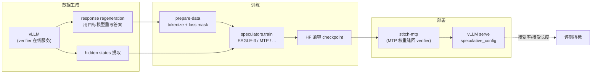
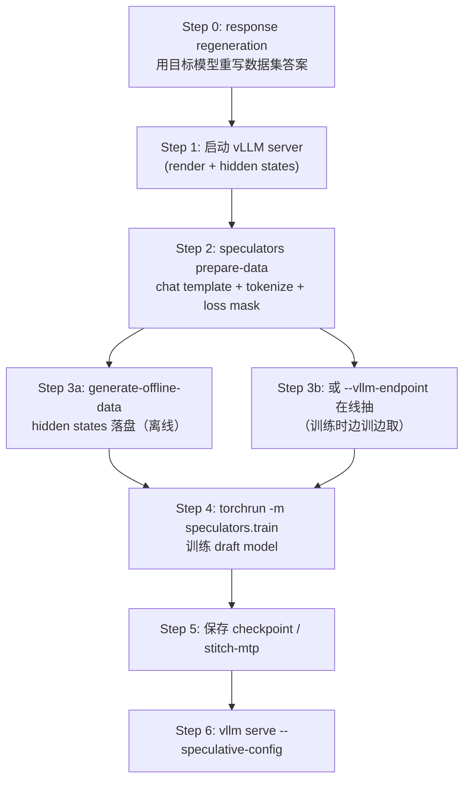

# Speculators 草稿模型训练与评测

> **TL;DR**：Speculators 是 vLLM 社区的**草稿模型（draft model / speculator）端到端训练框架**：用 vLLM 生成训练数据与 verifier hidden states，训练 EAGLE-3 / MTP / DFlash / DSpark / P-EAGLE 等草稿模型，导出为 HF 兼容格式后直接在 vLLM 里做投机解码。它把「论文里的 draft 训练脚本」产品化成可复用流水线；**加速收益的唯一硬指标是接受率与接受长度**，训练只是手段。

## 1. 原理回顾：为什么需要草稿模型

投机解码（speculative decoding）用小而快的草稿模型先猜 γ 个候选 token，大模型一次前向并行验证，接受多少用多少、拒绝处回退。因为大模型 decode 访存受限、算力闲置，「一次验证 γ 个」几乎不额外花时间，却一步产出多个 token——**不改输出分布、不重训目标模型**。

投机解码的机制、期望 token 数公式 `E = (1−α^(γ+1))/(1−α)`、无偏性（拒绝采样）在库内条目 [投机解码](../concepts/speculative-decoding.md) 已展开，**此处不重复**。本条目只强调训练侧要用到的三个结论：

1. **接受率 α 是第一驱动**：草稿再快，接受率低就是负优化；训练目标应直接对齐「目标模型会接受哪些 token」。
2. **草稿模型吃的是 verifier 的中间表示**：EAGLE 类方法用目标模型多层 hidden states 而不是只用 token id，因此训练数据必须包含 hidden states。
3. **部署格式要与引擎对齐**：草稿结构（层数、vocab 映射、aux layer ids）决定 vLLM 的 speculative config；训练框架若只产出研究 checkpoint，上线还要再写适配层。

## 2. Speculators 是什么

Speculators（PyPI 包名 `speculators`，Python 3.10–3.13）是 vLLM 项目下的独立库，把草稿模型训练从「论文附带脚本」提升为可复用基础设施：统一配置（`SpeculatorsConfig`）、统一数据（hidden states + loss mask）、统一产物（HF 兼容 checkpoint）、统一部署（vLLM speculative_config）。Red Hat 等团队已用它产出 Llama、Qwen3、gpt-oss、Mistral Small 等公开 speculator 权重。



核心特性（README）：

- **离线数据生成**：用 vLLM 批量产出 hidden states 存盘，训练与采样解耦；
- **端到端训练**：单层/多层 draft、MoE、非 MoE、VLM 均支持；
- **标准化格式**：HF 兼容的 `SpeculatorsConfig`，可从外部研究仓库转换；
- **直接进 vLLM**：Red Hat 已发布 Llama-3.1/3.3、Qwen3 8B–235B、gpt-oss、Mistral Small 等 speculator 权重。

## 3. 草稿模型家族

| 算法 | 结构要点 | 草稿方式 | 备注 |
|---|---|---|---|
| **EAGLE-3** | 小型 decoder + `fc` 融合多层 aux hidden states | 串行自回归 | 仓库主力路径，`models/eagle3/` |
| **MTP** | 模型原生 Multi-Token Prediction 头 | 每步一个 token | 微调 Qwen3.5 等原生 MTP 头，体量 ~100M–400M |
| **DFlash** | anchored-block drafting，多层 aux hidden states | 块内并行/锚点 | 支持滑窗注意力，vLLM PR #38300 起可部署 |
| **DSpark** | DFlash + Markov 头 + confidence 头 | 块内条件生成 | 可从 DFlash warm-start |
| **P-EAGLE** | EAGLE-3 架构 + Conditional-On-Distribution 并行预测 | 一次前向多 token | 降低 drafting 延迟 |

补充：早期/研究向草稿头还有 MLP、LSTM draft 等轻量结构（库内 [LSTM 低秩压缩](../../quantization/concepts/lstm-lowrank-compression.md) 是另一条压缩线索）；Speculators 当前主推上表中与 vLLM 生产部署对齐的算法。`src/speculators/models/` 下每个算法一个子包（`eagle3/`、`mtp/`、`dflash/`、`dspark/`、`peagle/`、`xpress/`），共享 `SpeculatorModel` 基类与 `GreedyTokenProposal` 提议配置。

EAGLE-3 的关键结构（`models/eagle3/core.py`）示意：

```python
@SpeculatorModel.register("eagle3")
class Eagle3DraftModel(DraftVocabMixin, SpeculatorModel):
    def __init__(self, config: Eagle3SpeculatorConfig):
        ...
        # 把 verifier 多层 aux hidden states 拼接后投到 draft hidden size
        num_aux = len(config.eagle_aux_hidden_state_layer_ids) or 3
        self.fc = torch.nn.Linear(
            num_aux * self.hidden_size, self.hidden_size, bias=False
        )
        # 之后是若干层小型 decoder layer + lm_head（draft vocab 可与 verifier 不同）
```

`DraftVocabMixin` 处理 draft/verifier 词表不一致时的 `d2t`/`t2d` 映射——这是部署时最容易踩的兼容点之一。

### 3.1 训练目标：对齐「会被接受」而不是「像目标模型」

草稿模型的朴素目标是模仿目标模型下一词分布；但投机解码真正关心的是**每位置是否被接受**。Speculators 的 loss 配置（`speculators/losses/`）因此可组合：

- **逐位置交叉熵**（对齐 verifier 的 next-token 分布）；
- **步权重复合权重**（MTP 的 `step_weight_beta`）：第 k 步 loss 权重 ∝ β^k，靠前位置更重要；
- **confidence / Markov 辅助头**（DSpark）：显式预测接受概率，训练时对齐接受率形态。

期望接受长度与接受率的关系（与 [投机解码](../concepts/speculative-decoding.md) 同一公式）：

```
E[每步 token 数] = (1 − α^(γ+1)) / (1 − α)     # γ = 草稿长度, α = 每位置接受率(独立近似)
```

训练时若只降 token-level perplexity 而 α 不升，墙钟加速不会改善——**评测要看接受率，不是只看 loss**。

### 3.2 历史草稿头：MLP / LSTM draft

更早的研究把 draft 做成极浅结构：在目标模型 hidden state 上接一层 MLP 预测后续 token，或用小 LSTM 拿过去 token 状态贪心出草稿。优点是参数极少（百万级）、训练便宜；缺点是**只用最后 hidden state 或 token 序列，缺少多层 aux 信息**，接受率上限明显低于 EAGLE 类。Speculators 的 `models/` 目录以 EAGLE-3/MTP/DFlash/DSpark/P-EAGLE/Xpress 为主，对应当前 vLLM 生产部署路径；MLP/LSTM 更多出现在论文对比或极端延迟预算场景。

## 4. 用户流程：训练 → 导出 → vLLM

### 4.1 全流程



**离线 vs 在线**：离线把 hidden states 存盘后关掉 vLLM 再训（省 GPU、可复用数据）；在线训练时 vLLM 与 Trainer 并存，hidden states 经 `--vllm-endpoint` 或 `hs_connectors`（文件/Mooncake 后端）实时传输，适合多机无共享存储的场景。

### 4.2 真实训练脚本（离线 EAGLE-3，节选自 `examples/train/eagle3_llama3_8b_ultrachat_offline_5k.sh`）

```bash
MODEL="meta-llama/Llama-3.1-8B-Instruct"
# Step 1: 启动 vLLM
python scripts/launch_vllm.py "$MODEL" -- --data-parallel-size 2 --port 8000 &
# Step 2: 准备数据
speculators prepare-data \
    --model "$MODEL" --data "$DATASET" \
    --render-endpoint "http://localhost:8000" \
    --max-samples 5000 --output "$OUTPUT_DIR" --seq-length 8192
# Step 3: 生成 hidden states
speculators generate-offline-data \
    --preprocessed-data "$OUTPUT_DIR" \
    --endpoint "http://localhost:8000/v1" \
    --output "$HIDDEN_STATES_DIR" --concurrency 32 --validate-outputs
# Step 5: 训练（关掉 vLLM 后）
torchrun --standalone --nproc_per_node 2 -m speculators.train \
    --verifier-name-or-path "$MODEL" \
    --data-path "$OUTPUT_DIR" \
    --hidden-states-path "$HIDDEN_STATES_DIR" \
    --save-path "$OUTPUT_DIR/checkpoints" \
    --draft-vocab-size 32000 --epochs 5 --lr 1e-4 \
    --total-seq-len 8192 --on-missing raise
```

该脚本注释中的实测（2×H100，5k UltraChat 样本）：全流程约 9.5 分钟；MT-Bench 接受率 16.32%、接受长度 1.49——**5k 样本只够验证流水线通了，不是可用 draft**。对照：同目录 `mtp_qwen3_5_9b_gsm8k_online.sh` 在 GSM8K 上微调原生 MTP 头后，3 条 prompt 接受率 89.36%、接受长度 3.23——**领域匹配 + 从原生头热启动**差距巨大。

### 4.3 MTP 微调与缝合

MTP 不从零训练，而是提取 verifier 原生 MTP 头再微调，结束后 `stitch-mtp` 把权重缝回 verifier checkpoint：

```bash
python -m speculators.train \
    --verifier-name-or-path "$MODEL" \
    --data-path "$OUTPUT_DIR" \
    --vllm-endpoint "http://localhost:8000/v1" \
    --speculator-type mtp \
    --num-speculative-steps 3 \
    --target-layer-ids 32 \
    --step-weight-beta 0.6 \
    --epochs 3 --lr 1e-4

speculators stitch-mtp "$OUTPUT_DIR/checkpoints/checkpoint_best" "$MODEL" \
    --output-path "$STITCHED_DIR"
# 部署：
# vllm serve $STITCHED_DIR \
#   --speculative-config '{"method":"mtp","num_speculative_tokens":3}' \
#   --no-enable-chunked-prefill
```

`--step-weight-beta 0.6` 是按预测步指数衰减的 loss 权重：靠前的位置（更容易被接受）权重更高，与「接受长度」指标直接对齐。

### 4.4 Python API 侧的配置对象

训练入口在 `speculators/train/cli.py`，配置用 Pydantic 校验（`speculators/config.py`）：

```python
from speculators.config import SpeculatorsConfig, VerifierConfig

# 从 verifier 的 config.json 读真实 architectures，校验兼容性
verifier = VerifierConfig.from_pretrained("meta-llama/Llama-3.1-8B-Instruct")
# SpeculatorsConfig 聚合：algorithm + token proposals + verifier 兼容性
```

`VerifierConfig.architectures` 来自 verifier 的 `config.json`（例如 `["Qwen3ForCausalLM"]`），用于在加载 draft 时做架构兼容校验——**不要手写这个字段**，否则会在部署期才爆兼容错误。

### 4.5 评测：接受率是唯一硬指标

`examples/evaluate/` 与训练脚本注释中的指标含义：

| 指标 | 含义 | 读法 |
|---|---|---|
| acceptance rate | 草稿 token 被接受的比例 | 第一驱动，低了加速为负 |
| acceptance length | 每步平均接受的 token 数（含 bonus） | 直接对应 E[token/step] |
| per-position acceptance | 第 0/1/2… 位的接受率 | 决定 γ 该多大；后位骤降就别拉长 |
| output throughput | 端到端 tok/s | 最终要看的墙钟收益 |

评测要在**真实部署形态**下做（vLLM + 目标 KV cache + 并发），离线 teacher-forcing 的 token accuracy 只能做训练监控。

### 4.6 从外部仓库转换

Speculators 提供 `speculators convert`（`cli/convert.py`）把研究仓库 checkpoint 转成标准 `SpeculatorsConfig` + HF 权重格式，便于「论文算法 → 生产格式」迁移；与 DeepSpec 的 checkpoint 也可在算法层互相参照（结构同源时需核对 vocab 映射与 aux layer ids）。

多机在线训练的 hidden states 传输由 `hs_connectors` 承担：file backend 走共享文件系统，Mooncake backend 走分布式存储，适合没有共享盘的集群。

### 4.7 词表映射公式

draft 与 verifier 词表可能不同（压缩过的 embedding、多语言裁剪）。映射矩阵定义为：

```
t2d: verifier token → draft token     （训练时标签对齐）
d2t: draft token → verifier token     （验证前把草稿 id 换回 verifier id）
```

训练日志里 `--draft-vocab-size`、`--on-missing raise|generate` 控制映射缺失时的行为：`raise` 要求映射完备（生产推荐），`generate` 允许现场补全（探索用）。映射错误的典型症状是 loss 正常但接受率恒为 0。

### 4.8 训练超参经验

| 超参 | 示例值 | 影响 |
|---|---|---|
| `--lr` | 1e-4 | 过大 → draft 分布抖动、接受率骤降 |
| `--epochs` | 3–5（小数据） | 过拟合 verifier 的采样噪声 |
| `--total-seq-len` | 8192 | 与部署上下文对齐 |
| `--num-speculative-steps` | 3 | 对应部署 `num_speculative_tokens` |
| `--step-weight-beta` | 0.6 | 前位更重要；太大则后位欠拟合 |
| `--target-layer-ids` | e.g. 32 | 从 verifier 哪层抽 hidden states |

经验：先用 5k 样本跑通流水线并记录 per-position 接受率曲线，再决定加数据、加草稿步数还是换算法（EAGLE-3 vs DFlash vs MTP）。

### 4.9 在线 vs 离线怎么选

| 维度 | 离线（offline） | 在线（online） |
|---|---|---|
| hidden states | 一次生成存盘 | 训练时从 vLLM 抽 |
| GPU 用法 | 采样与训练可串行复用同一批卡 | 必须分卡（vLLM / Trainer） |
| 数据复用 | 高，可多组超参反复训 | 低，边采边训 |
| 与策略对齐 | 固定 verifier 版本 | verifier 可随训练步刷新（进阶） |
| 多机 | 需要共享盘或搬运 | `hs_connectors` file / Mooncake |
| 典型场景 | 首次打通、算法对比 | 领域微调、大规模持续训练 |

脚本注释里的实测数据可以当量级参考：5k 样本离线 EAGLE-3 全流程约 9.5 分钟（2×H100）；MTP 在线微调 + 缝合约 7 分钟（2×H200）。真正的成本在「数据是否是目标模型生成、样本量是否够」。

## 5. 与 DeepSpec 对比

[DeepSpec](https://github.com/deepseek-ai/DeepSpec)（deepseek-ai）同样是「草稿模型训练 + 评测」全栈，算法覆盖 Eagle3 / DFlash / DSpark，论文给出 Qwen3-4B/8B/14B 与 Gemma-4-12B 的公开 checkpoint。两者定位不同：

| 维度 | Speculators（vLLM 社区） | DeepSpec（deepseek-ai） |
|---|---|---|
| 目标 | 训练产物**直接进 vLLM 生产服务** | 研究对比 + 基准评测全栈 |
| 数据管线 | vLLM server + prepare-data + hidden states / hs_connectors | 数据准备 + target cache（默认 Qwen3-4B 约 38 TB） |
| 算法面 | EAGLE-3、MTP、DFlash、DSpark、P-EAGLE、Xpress | Eagle3、DFlash、DSpark |
| 评测 | 接受率/接受长度 + vLLM 线上吞吐 | gsm8k、math500、aime25、humaneval、mt-bench 等固定榜单 |
| 部署 | `speculators` 格式 ↔ vLLM speculative_config，有 stitch-mtp | checkpoint 直接给推理引擎做接受率评测 |
| 训练数据规模 | 示例 5k 即可跑通流水线 | 强调完整 target cache 与论文复现设置 |

**怎么选**：要在生产 vLLM 服务里挂草稿、要 MTP 缝合、要多机 hidden states 传输 → Speculators。要复现论文表格、横向比较 DSpark/DFlash/Eagle3、用固定 benchmark 做算法研究 → DeepSpec。二者算法同源（DSpark/DFlash/Eagle3 均有），但**工程闭环的终点不同**（服务 vs 论文）。

## 6. 常见坑

1. **训练数据必须是目标模型自己生成的**。用别人模型的答案去训 draft，接受率会系统性偏低——脚本里的 response regeneration 不是可选装饰。
2. **5k 样本 ≠ 可用 draft**。流水线验证用小样本没问题；上线前按领域/规模重训，thinking 模式目标模型尤其要单独微调（DeepSpec README 也明确提醒）。
3. **draft vocab 映射**：`--draft-vocab-size`、`d2t/t2d`、`--on-missing raise|generate` 要一致；vocab 不对齐时训练 loss 正常但部署时乱码或接受率为 0。
4. **GPU 分工**：离线模式可串行复用 GPU；在线模式 vLLM 与 Trainer 必须分卡（脚本里 `VLLM_GPU` / `TRAIN_GPU`）。
5. **MTP 部署要关 chunked prefill**（示例命令中的 `--no-enable-chunked-prefill`），且 `num_speculative_tokens` 要与训练 `--num-speculative-steps` 匹配。
6. **接受率指标要看 per-position**。position 0 很高、position 2 骤降是正常形态；只看平均接受长度会误判草稿长度 γ 是否该调大。
7. **sliding window**：DFlash/DSpark 默认滑窗注意力以省 KV cache，`--sliding-window` / `--full-attention-indices` 要和 verifier 长上下文场景一起权衡。

8. **hs_connectors 后端选错**：有共享盘用 file backend 即可；无共享盘却硬走 file 会写失败或读到半截样本。Mooncake 需要分布式存储服务先就绪。

## 7. 选型速查

| 你的情况 | 建议路径 |
|---|---|
| 从未训过 draft，想先跑通 | 离线 EAGLE-3 + 5k 样本 + `--on-missing raise` |
| 目标模型自带 MTP 头（Qwen3.5 等） | 在线 MTP 微调 + `stitch-mtp`，省从零训练成本 |
| 长上下文、KV cache 紧张 | DFlash/DSpark + sliding window |
| 追求最低 drafting 延迟 | P-EAGLE（并行多 token） |
| 生产 vLLM 服务 | Speculators 格式 → `speculative_config` |
| 论文对比 / 固定榜单 | DeepSpec 的 train + eval 流水线 |

一句话定位：**Speculators 把「怎么训一个会被接受的草稿模型」产品化**——数据来自 verifier 自己的生成与 hidden states，训练目标对齐接受率，产物直接进 vLLM 的 speculative config。

## 相关条目

- [投机解码](../concepts/speculative-decoding.md)（机制、无偏性、期望 token 数）
- [LSTM 低秩压缩](../../quantization/concepts/lstm-lowrank-compression.md)（轻量草稿/压缩结构的另一条线）
- [PTQ：GPTQ / AWQ / SmoothQuant](../../quantization/concepts/ptq-gptq-awq-smoothquant.md)（目标模型也可先量化再挂草稿，需一起测接受率）

## 溯源

- 主源：vllm-project/speculators 仓库 README、`src/speculators/config.py`、`src/speculators/models/eagle3/core.py`、`src/speculators/models/mtp/core.py`、`src/speculators/train/cli.py`、`examples/train/eagle3_llama3_8b_ultrachat_offline_5k.sh`、`examples/train/mtp_qwen3_5_9b_gsm8k_online.sh`。
- 交叉源：deepseek-ai/DeepSpec README（算法覆盖、评测集、target cache 规模、checkpoint 表）。
