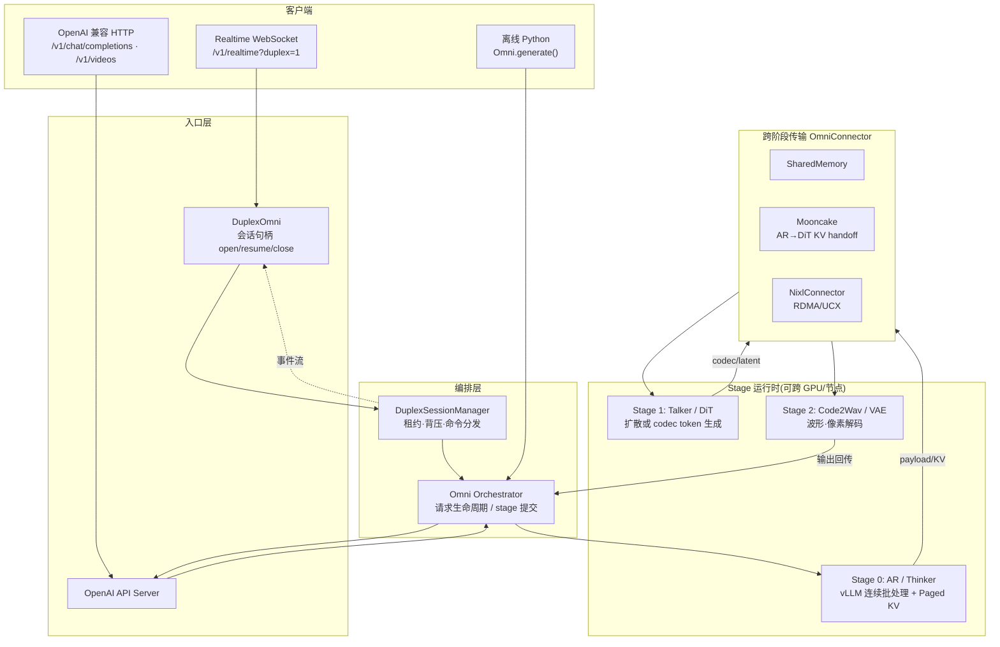
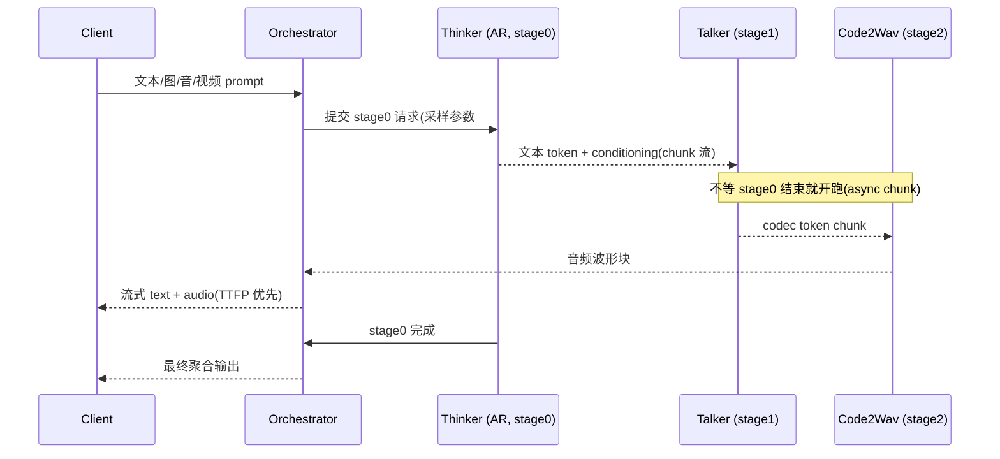

# vLLM-Omni 全模态推理服务

## TL;DR

**vLLM-Omni 是 vLLM 的全模态扩展**:在文本自回归(AR)引擎之上,用**阶段(stage)流水线**把文本/图像/音频/视频/动作的输入输出、AR 与 DiT(扩散)生成、实时全双工会话统一到一个 serving 运行时。核心三件事:**① stage 化的异构流水线**(Thinker→Talker→Code2Wav 这类多组件模型被拆成可独立放置/批处理的阶段);**② 引擎持有的会话(engine-owned session)**(全双工实时对话的长会话身份、租约、账本归引擎管,而不是每个模型手搓);**③ 跨阶段传输**(AR 的 paged KV 与多模态 payload 可经 Mooncake/NIXL/共享内存交给下游 DiT 或解码器,而不走 CPU 序列化)。它按 **偶数小版本对齐上游 vLLM**(当前 0.30.0 rebase),复用 vLLM 的调度/KV cache/分布式原语,再把非文本、非 AR 的部分用 stage runtime 接上。

> **先记住一个类比**:vLLM 本体像一家只做「文字代写」的高速工作室——单工位、流水线极快,但只会写字。vLLM-Omni 把它扩成**一家全媒体制作公司**:写字(AR)、画图(DiT)、配音(TTS/Code2Wav)、剪视频、出机器人动作各占一个「工位」(stage),中间用传送带(OmniConnector)传半成品;而全双工会话则像一位**不挂断的电话接线员**,始终握着通话状态。

---

## 1. 什么是 omni-modality:五种数据、两类生成、一条流水线

vLLM 官方对 omni-modality 的定义是 **Text / image / audio / video / action 的处理与生成**(README「About」)。它不只是「多模态理解」(把图/音喂给 LLM),而是**任何模态进、任何模态出**(any-to-any):

| 维度 | 传统 vLLM 文本引擎 | vLLM-Omni |
|---|---|---|
| 输入 | text(+ 简单 mm token) | text / image / audio / video / action 轨迹 |
| 输出 | text token 流 | text / 图像 / 音频波形 / 视频帧 / 机器人动作 |
| 生成范式 | 自回归(AR) | AR + DiT(扩散/并行生成)+ 非 AR 解码(如 Code2Wav) |
| 会话形态 | 单轮请求 | 单轮 + **全双工长会话**(可打断、可续传) |
| 部署拓扑 | 单引擎(可 TP/PP/DP) | **多 stage 异构流水线**,可跨 GPU/节点拆分 |

典型模型与 stage 映射(`docs/design/architecture_overview.md`):

| 模型 | 模型自带组件 | vLLM-Omni stage 视角 | 主指标 |
|---|---|---|---|
| **Qwen3-Omni** | Thinker→Talker→Code2Wav | 三阶段异步 chunk 流水 | TTFT/TTFP/TPOT/RTF |
| **HunyuanImage-3.0** | 多模态 AR + 图像 DiT | AR-only / DiT-only / AR→DiT 拆分 | DiT E2EL、图吞吐 |
| **MiniMax H3** | 文本编码 + FL2VA/Ref2VA DiT + VAE 解码 | 一个 diffusion stage 内三段逻辑边界 | 视频/音频 E2EL、RTF |
| **Cosmos3 / LingBot World** | 统一 reasoner + 扩散生成塔(世界模型) | 单 diffusion pipeline 物化双塔 | 图/视频/动作 E2EL |

**类比**:AR 阶段像「写剧本」(逐 token 推进),DiT 阶段像「整幅画同时上色」(去噪并行),Code2Wav 像「把分镜稿配音成音轨」。三者节奏完全不同——所以必须拆成 stage,各自用各自的批处理与注意力后端。

---

## 2. 与 vLLM 文本引擎的关系:rebase 对齐,不是 fork 重写

vLLM-Omni **不是另起炉灶的推理引擎**,而是「vLLM + 全模态 stage 运行时」:

- **版本对齐**:从 0.14.0 起,每个**偶数小版本**对齐上游 vLLM(0.16/0.18/.../0.26/0.28/**0.30.0**)。0.30.0 即 **rebase 到 vLLM 0.30.0**,并带出全双工框架、Mooncake AR-to-DiT、NIXL connector 等能力。
- **复用原语**:AR 阶段直接用 vLLM 的**连续批处理、PagedAttention/KV cache、TP/PP/DP/EP、CUDA Graph、量化**(见库内 [`v1-architecture.md`](../concepts/v1-architecture.md)、[`paged-attention.md`](../concepts/paged-attention.md))。
- **扩展面**:非 AR、非文本的部分由 `vllm_omni/` 包补上——`core/sched`(Omni AR 调度)、`model_executor/models/**`(各模型实现)、`engine/**`(stage 运行时/编排)、`experimental/fullduplex|ar_diffusion|world_models`、`platforms/**`(CUDA/ROCm/NPU/XPU/MUSA)。

**心法**:理解 vLLM-Omni 的钥匙是「**哪些仍走 vLLM,哪些是 Omni 自己的**」——凡属单个 AR 阶段内部的调度/KV/并行,大体是 vLLM;凡属**跨阶段的生命周期、传输、会话、DiT/扩散执行**,是 Omni 的增量。

---

## 3. 架构总览:stage 流水线 + 编排器 + connector

### 3.1 架构图(mermaid)



### 3.2 一条 Qwen3-Omni 请求的时序(异步 chunk)



**要点**:async chunk 的价值是**级间重叠**——Talker/Code2Wav 在 Thinker 还在解码时就消费已到的 chunk,把「首包音频时间 TTFP」压下来;同步路径(`async_chunk: false`)则等上游完成再启动下游,吞吐实现更简单但交互延迟差。

### 3.3 层次关系(继承链)

`docs/design/fullduplex.md` 给出清晰的「双工叠在轮次栈之上、永不反向依赖」:

```
OmniBase → Omni(turn) / AsyncOmni → DuplexOmni
EngineBase → AsyncOmniEngine(turn) → DuplexOmniEngine(session msgs)
Orchestrator → Orchestrator(turn admission) → DuplexOrchestrator(+ SessionManager)
```

双工类**只扩展、不污染**通用 turn-based 路径——这是重要的架构纪律。

---

## 4. 全双工 real-time 与 engine-owned sessions

### 4.1 问题:全双工模型需要「不挂断的会话」

全双工模型**边听边说**:音频流入的同时在产出音频,模型自己决定何时开口,用户可随时打断(barge-in)。这要求一个**长生命周期会话**,带:

- **身份**:session id、epoch、turn;
- **账本**:输入、response、playback、history;
- **租约**:idle TTL、断线宽限、resume;
- **绑定**:把会话音频绑到可续传(resumable)的 stage 请求上。

### 4.2 解法:会话归引擎所有(engine-owned)

`DuplexOrchestrator` 内的 **DuplexSessionManager** 管准入/背压/租约回收,每个 **DuplexSessionRunner** 持有一份 `DuplexEngineSession`(唯一状态所有者)。同一份会话暴露给三类消费者:

1. OpenAI Realtime WebSocket 路由(`/v1/realtime?duplex=1`);
2. 进程内 Python API(`InlineDuplexClient`);
3. 各模型 `duplex/` 插件(MiniCPM-o 4.5、Qwen3-Omni、PersonaPLEX 等)。

```python
# 概念示意(接口形状取自 docs/design/fullduplex.md 与 entrypoints)
handle = omni.open_session(...)          # DuplexSessionHandle
handle.submit(DuplexCommand(...))        # 追加输入/打断/控制
for ev in handle.events():               # typed DuplexEvent 流
    ...
omni.resume_session(...)                 # 断线续传
omni.close_session(...)
```

### 4.3 世界模型的 session state

对 DreamZero / Cosmos3 / LingBot World 这类**自回归扩散世界模型**,跨 `forward()` 的状态(累积视频 latent、帧拼接缓冲、encode-once conditioning)由 **SessionStateManager**(`vllm_omni/experimental/world_models/`,RFC #4480,默认关)统一成 `StateObject` 契约:`allocate/commit/view/reset/evict`,按 LRU 淘汰会话,并按设备报字节。注意:**AR 生成的 KV 不在这里**,它归 AR-Diffusion 引擎的 **paged KV pool**(见 §5)。

**类比**:如果把模型比作通话中的客服,engine-owned session 就是**公司CRM里的工单**——客服(模型插件)可以换,工单(会话状态)由公司(引擎)统一保管、计费、回收,而不是每个客服自己记小本本。

---

## 5. AR/DiT 统一 paged KV 与跨阶段传输

### 5.1 两套「分页 KV」不是一回事

| 路径 | 管什么 | 谁持有 | 文档 |
|---|---|---|---|
| **AR paged KV** | 自回归注意力的 K/V | vLLM Scheduler/Worker(与文本引擎同源) | [`paged-attention.md`](../concepts/paged-attention.md) |
| **DiT paged KV** | 扩散去噪中稳定 prompt/reference 前缀的 K/V | Worker 独有页,`diffusion_kv_mode: paged_scheduler` | `docs/user_guide/diffusion/paged_kv_cache.md` |
| **ar_diffusion KV** | DreamZero/LingBot 从 AR 阶段**导入**的 KV | AR-Diffusion 引擎的 paged KV pool | `docs/design/feature/...` |

DiT 分页的意义:去噪多步中,**前缀(提示/参考图)的 KV 不必每步重算**,只改写变化的 image span。当前 HunyuanImage-3.0 路径是 **request-level**、`FLASH_ATTN` 后端、BF16 未量化;`dense_legacy` 仍是默认兼容模式。

```yaml
# DiT 侧 stage 配置示意(docs/user_guide/diffusion/paged_kv_cache.md)
pipeline: hunyuan_image3_dit
stages:
  - stage_id: 0
    max_num_seqs: 1
    step_execution: false          # paged 目前仅 request-level
    diffusion_attention_backend: FLASH_ATTN
    kv_cache_memory_bytes: 536870912
    engine_extras:
      diffusion_kv_mode: paged_scheduler
      diffusion_kv_max_rows_per_request: 2   # 标准 CFG 两行
```

### 5.2 Mooncake AR-to-DiT handoff

`docs/design/feature/mooncake-kv-transfer.md`:用 vLLM 原生 `KVTransferConfig` + **MooncakeConnector**,把 AR 阶段产出的 KV 页直接交给 DiT 阶段的目标页,编排器为每请求发一张 **transfer ticket**;DiT 分配目标页、等各 rank 装载完、连接器生命周期结束后才释放源/目标页。实测(8×RTX PRO 6000 Blackwell, TCP)原生路径比旧 `OmniKVTransferManager` 吞吐高 **0.63%**,且 prefix/attention 输出 **bit 级一致**——价值在正确性与统一生命周期,不只是微小加速。

### 5.3 NIXL 与其他 connector

`NixlConnector` 用 vLLM 的 `NixlWrapper` 注册生产者张量,消费者以 NIXL `READ` 拉取;控制面 ZMQ ROUTER 原子认领源分配。**payload 不限于张量**:嵌套结构抽 tensor 叶子直传,msgpack 编码骨架;`msgspec.Struct` 归一化后走直传路径。适用跨节点或已标准化 NIXL 的部署,也可到 Intel XPU(UCX Level Zero)。MiniMax H3 的 disaggregated/Turbo 可用 `minimax_h3_disaggregated_nixl.yaml` 切换。

**类比**:跨阶段传输像**工厂里的 AGV 小车**:共享内存是同车间手递手,Mooncake 是园区内专用物流,NIXL 是跨厂区的高速专线——货物(KV/payload)不落地成文本序列化,直接从生产者的显存页搬到消费者的显存页。

### 5.4 PD 分离(实验性)

`docs/features/pd_disaggregation.md` 把 Qwen3-Omni Thinker 拆成 prefill(max_tokens=1,导出 KV)与 decode(导入 KV 续写),Talker/Code2Wav 仍在下游。**控制面**(请求 ID、transfer_id、bootstrap)归 Orchestrator,**数据面**(注意力 KV 块)归 vLLM KV connector——两层不可混用。这与库内 [`pd-disaggregation.md`](../practices/pd-disaggregation.md) 的文本 PD 分离同构,只是 payload 从纯文本 KV 扩展到多模态 conditioning。

---

## 6. Recipe 案例:三种典型形态

### 6.1 MiniCPM-o 4.5:全双工语音对话

`recipes/OpenBMB/MiniCPM-o-4_5.md`:多模态 thinker + 流式 MiniCPMTTS codec talker + 批式 Code2Wav,**严格三 stage**。同一服务器暴露 Realtime(`/v1/realtime?duplex=1`)与 `/v1/chat/completions`。推荐 2-GPU:Thinker@GPU0,Talker+Code2Wav@GPU1;Talker 只产 codec chunk,Code2Wav 经**共享内存 async connector** 消费。融合两 stage 的旧实现已移除(会重复状态机)。

### 6.2 MiniMax H3:联合视频+音频扩散

`recipes/MiniMaxAI/MiniMax-H3.md`:CFG 蒸馏的 joint video/audio DiT,两个任务分区 `FL2VA`(t2va/fl2va)与 `Ref2VA`(多图/视频/音频参考)。一个 diffusion stage 同时装两个 DiT,共用 Qwen3-VL 文本编码与双 VAE;`extra_params.task` 选 DiT。可选 disaggregated:Stage0 放 Qwen+VAE encoder,Stage1 放 DiT+VAE decoder,阶段边用共享内存或 NIXL。

### 6.3 LingBot World 2.0:交互式世界模型

`recipes/Robbyant/LingBot-World-2.0.md`:图像条件的交互式世界生成。三条路径:**realtime stepwise**(推荐,`WS /v1/realtime/video`,每个 AR block 出一段视频,`session.interaction` 做 SE3 相机控制)、离线轨迹回放、以及已弃用的 tick 模式。校验硬件 H200/B200;帧数须 `9 + 12k`。

---

## 7. 最小 serving 代码示例

### 7.1 离线:Omni.generate 跑多模态问答

取自 `examples/offline_inference/qwen3_omni/end2end.py`(简化):

```python
# 文件: examples/offline_inference/qwen3_omni/end2end.py (简化)
from vllm import SamplingParams
from vllm_omni.entrypoints.omni import Omni

omni = Omni(model="Qwen/Qwen3-Omni-30B-A3B-Instruct", tensor_parallel_size=2)

thinker_sp = SamplingParams(temperature=0.9, top_p=0.9, max_tokens=1200)
talker_sp  = SamplingParams(temperature=0.9, top_k=50, max_tokens=4096,
                            stop_token_ids=[2150])  # TALKER_CODEC_EOS
code2wav_sp = SamplingParams(temperature=0.0, max_tokens=4096 * 16, detokenize=True)

# sampling_params 与 stage 一一对应(数量截断到 omni.num_stages)
outputs = omni.generate(
    prompts=[{"prompt": prompt, "limit_mm_per_prompt": {"audio": 1, "image": 1}}],
    sampling_params_list=[thinker_sp, talker_sp, code2wav_sp][: omni.num_stages],
)
# outputs: list[OmniRequestOutput] —— 含 text / images / audio 等异构输出
```

### 7.2 在线:OpenAI 兼容起服务 + 文生图

```bash
# 起服务(按模型自动装载 deploy YAML)
vllm serve openbmb/MiniCPM-o-4_5 --omni --trust-remote-code --port 8091 \
  --deploy-config vllm_omni/deploy/minicpmo_4_5_2gpu.yaml

# 文生图调用(概念上与 /v1/chat/completions 同风格)
curl http://127.0.0.1:8091/v1/images/generations -H 'Content-Type: application/json' -d '{
  "model": "openbmb/MiniCPM-o-4_5",
  "prompt": "a corgi wearing a spacesuit, studio light"
}'
```

离线文生图脚本见 `examples/offline_inference/text_to_image/text_to_image.py`,核心仍是 `omni.generate(prompt_dict, sampling_params_list=...)`,返回 `OmniRequestOutput` 上的 `images`。

---

## 8. 与库内条目的关系

- [`v1-architecture.md`](../concepts/v1-architecture.md):AR 阶段内部的 **调度/Worker/异步下发** 仍是 V1 心智模型;Omni 的 Orchestrator 是**更上层**的 stage 编排,不替代 EngineCore。
- [`paged-attention.md`](../concepts/paged-attention.md):AR KV 的块池/引用计数/前缀共享原语被直接复用;DiT paged KV 是「同一思想、另一持有者(Scheduler-managed diffusion pages)」。
- [`pd-disaggregation.md`](../practices/pd-disaggregation.md):文本 P/D 分离的 KV connector 机制是 Omni PD 分离与 Mooncake AR-to-DiT 的**同族先例**;Omni 额外要传多模态 payload 与 conditioning。
- [`continuous-batching.md`](../concepts/continuous-batching.md):单 stage 内的批处理策略;stage 之间则是**流水线重叠(async chunk)**,两个粒度别混。
- [`api-server-openai-compat.md`](../concepts/api-server-openai-compat.md):对外 `/v1/chat/completions` 契约兼容;Omni 增补 `/v1/videos`、`/v1/realtime`、图像编辑等路由。
- [`production-stack.md`](production-stack.md) / [`router.md`](router.md):集群部署与请求路由是 Omni 多 stage 部署的**算力侧邻居**;Omni 自己管 stage 编排与跨阶段传输。
- [`semantic-router.md`](semantic-router.md):按模态/成本/安全把请求**选进**不同后端(含 omni/diffusion 池);Omni 负责被选中之后怎么跑。

---

## 9. 常见坑(checklist)

1. **先分清你的模型有几个 stage**:采样参数列表必须与 `omni.num_stages` 对齐;给 3 个 stage 只传 1 个 `SamplingParams` 会在下游阶段用错策略。
2. **async chunk 不是免费的**:它降 TTFP,但增加跨 stage 状态机复杂度;Mooncake 原生 AR-to-DiT 目前要求 `async_chunk: false`——两者别同时开。
3. **DiT paged KV 兼容面窄**:仅 HunyuanImage-3.0 request-level + `FLASH_ATTN` + BF16 验证过;与 CPU/layerwise offload、量化组合**未验证**,不确定就用 `dense_legacy`。
4. **全双工部署的路由是特化的**:duplex 服务器只暴露 Realtime、`/v1/chat/completions`、`/v1/models`、`/health`——不要假设全部 turn-based 路由都在。
5. **会话与 KV 的账本要分清**:world-model 的 `SessionStateManager` 只管非 KV 状态;AR KV 归引擎 paged pool。做显存预算时两块都要算,且 `stats()` 按设备分列。
6. **跨阶段传输失败语义苛刻**:接收超时/取消不会回收 in-flight 页,直到每个 CFG 行在每个 rank 完成;对端永不完成则页保留到 shutdown——容量规划要留余量。
7. **版本跟随上游**:Omni 偶数小版本对齐 vLLM 偶数小版本;升级时先看 release notes 的 rebase 说明,不要把 Omni 版本号当 vLLM 版本号用。

---

## 10. 溯源

- **README / News(版本对齐、能力清单、arXiv:2610.09307 / 2602.02204)**: https://github.com/vllm-project/vllm-omni (仓库根 README.md)
- **架构总览与 stage 模型映射**: `docs/design/architecture_overview.md`
- **全双工框架与 engine-owned session**: `docs/design/fullduplex.md`;会话状态 `docs/features/session_state_manager.md`
- **AR/DiT paged KV**: `docs/user_guide/diffusion/paged_kv_cache.md`
- **Mooncake AR-to-DiT / NIXL**: `docs/design/feature/mooncake-kv-transfer.md`、`docs/design/feature/omni_connectors/nixl_connector.md`
- **PD 分离设计**: `docs/features/pd_disaggregation.md`
- **Recipe**: `recipes/OpenBMB/MiniCPM-o-4_5.md`、`recipes/MiniMaxAI/MiniMax-H3.md`、`recipes/Robbyant/LingBot-World-2.0.md`
- **示例代码**: `examples/offline_inference/qwen3_omni/end2end.py`、`examples/offline_inference/text_to_image/text_to_image.py`
- **Technical Report**: arXiv:2610.09307;**Paper**: arXiv:2602.02204(Yin et al., *vLLM-Omni: Fully Disaggregated Serving for Any-to-Any Multimodal Models*)

> **路径基准**:仓库内相对路径均相对 `vllm-omni/` 仓库根;库内相对路径相对本领域 `vllm/concepts/`。
